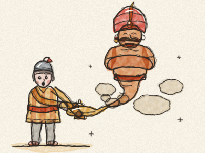
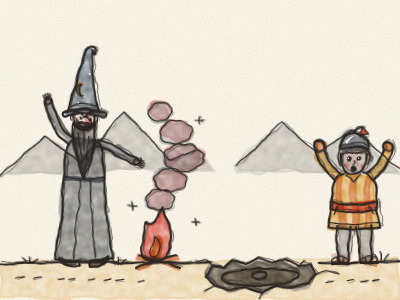
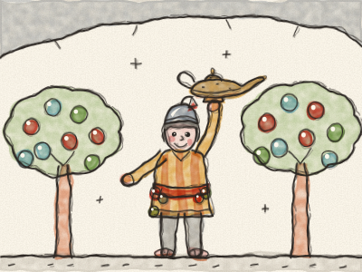
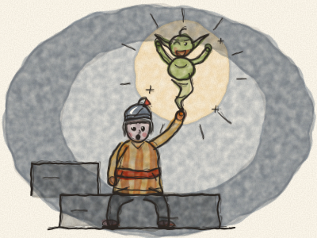
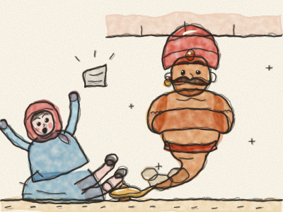
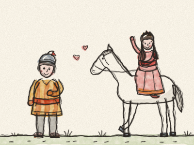
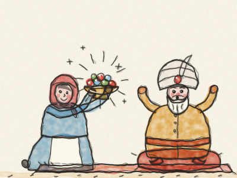
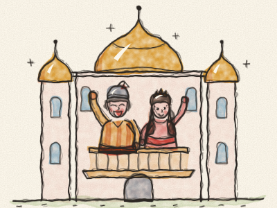
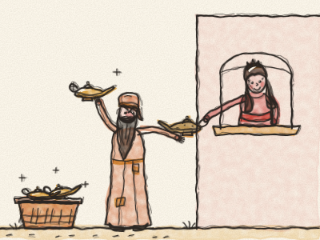
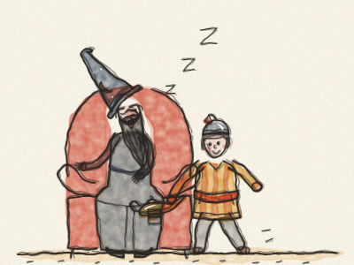

# Aladdin and the Magic Lamp

Long ago, in a great city far away, there lived a boy called Aladdin. He lived with his mother in a tiny house, and they were very poor. Aladdin did not like to work. He liked to run through the market and play in the street all day long.

One morning, a tall stranger came up to him. He had a long black beard, a pointed hat and sharp, glittering eyes. “Aladdin!” he cried. “At last! I am your uncle, your father’s long-lost brother!”

Aladdin had never heard of this uncle. But the stranger gave him a gold coin, and bought him new clothes, and Aladdin was very pleased. He did not know that the stranger was really a wicked sorcerer.

The next day, the “uncle” took Aladdin far out of the city, up into the mountains. There, he lit a little fire and threw in some magic powder. *Puff!* Purple smoke rose up. He said strange words. The ground began to shake. *Rumble, rumble…* And — *CRACK!* — it opened, showing a big flat stone with an iron ring.

“Lift the stone,” said the sorcerer. “Go down the steps. Touch nothing. At the very end, you will find an old lamp. Bring it to me.” Then he slipped a little ring onto Aladdin’s finger. “For luck,” he said.

Only Aladdin could go down; the magic would not let the sorcerer in. That is why he needed the boy.

Aladdin went down the steps, one, two, three… all the way to a wonderful garden under the ground. The trees there grew fruit made of jewels: red rubies, green emeralds, blue sapphires, shining like little lamps. Aladdin filled his pockets. *Clink, clink, clink!*

At the end of the garden, on a ledge, he found the old lamp, dusty and dull. He took it and ran back to the steps.

“Give me the lamp!” called the sorcerer from above. “Quickly!”

“Help me out first, Uncle,” said Aladdin. “My pockets are too heavy.”

“The lamp first!” shouted the sorcerer.

“Out first!” said Aladdin.

The sorcerer flew into a rage. He said a magic word and — *BOOM!* — the stone slammed shut. Aladdin was trapped in the dark.

It was very dark and very quiet. Aladdin sat down on the steps. “Oh dear,” he said. “Oh dear, oh dear.” He twisted his hands together, and without meaning to, he rubbed the little ring on his finger.

*Whoosh!* A small green genie popped out, with pointed ears and a friendly grin. “I am the Genie of the Ring!” he squeaked. “What do you wish, master?”

Aladdin could hardly believe it. “I wish… I wish to go home!”

“Easy-peasy!” said the little genie. He clapped his hands. *Whizz!* And Aladdin found himself standing in his mother’s kitchen, with his pockets full of jewels and the old lamp in his hand. His mother hugged him tight. Then they both felt very hungry, because there was nothing to eat.

“Let’s sell this old lamp,” said his mother. “But it’s so dirty! I’ll give it a polish first.” She rubbed it with a cloth. *Rub, rub, rub.*

*WHOOOSH!* Out of the lamp swirled a cloud of smoke, and out of the smoke came an enormous genie, so big that his turban touched the ceiling. “I am the Genie of the Lamp!” he boomed. “What do you wish, master?”

Aladdin’s mother gasped and sat down hard on the floor. *Bump!*

But Aladdin was brave. “We’re hungry,” he said. “Please bring us something to eat.”

*Pop!* There on the table stood twelve silver plates of food: warm bread, rice, fruit and honey cakes. They ate until their tummies were round. And they kept the lamp very, very safe.

Years went by, and Aladdin grew up. He did not ask the genie for silly things. He learned to work, and to be kind to everyone in the market, and he used the lamp only when they really needed it.

One day, the Sultan’s daughter rode through the city on a white horse. Her name was Princess Badroulbadour. *(Try saying that three times, fast!)* She had kind eyes and a merry laugh. Aladdin looked at her, and she looked at him, and they both smiled.

“Mother,” said Aladdin that evening, “I would like to marry the Princess.”

His mother laughed. “You? The son of a poor tailor? The Sultan will never say yes!”

“Take him these,” said Aladdin, and he filled a bowl with the jewels from the magic garden.

So Aladdin’s mother went to the palace. She knelt before the Sultan and held up the bowl. The jewels sparkled so brightly that the whole room lit up.

“Oooh!” said the Sultan. “Who sends me such a present?”

“My son, Aladdin,” said his mother. “He would like to marry the Princess.”

The Sultan’s grand vizier frowned. He wanted the Princess to marry his own son. “Ask for more,” he whispered. “Much more.”

“Very well,” said the Sultan. “If Aladdin sends me forty golden trays of jewels, carried by forty servants, he may marry my daughter.”

That night, Aladdin rubbed the lamp. *Whoosh!* And the next morning, forty servants walked up to the palace, carrying forty golden trays.

The Sultan was delighted, and the Princess most of all. Aladdin and Princess Badroulbadour were married with music and dancing, and the genie built them, in a single night, a palace with golden domes and windows that glittered in the sun.

But far, far away, the wicked sorcerer looked into his magic sand. *Swish, swish.* “What?” he shrieked. “That boy got out of the cave? And he has MY lamp?”

He dressed up as a lamp-seller, filled a basket with shiny new lamps, and walked under the palace windows. “New lamps for old!” he called. “New lamps for old!”

The Princess did not know about the magic. She saw the dusty old lamp on a shelf and thought, “What a nice surprise for Aladdin!”

She handed it down through the window. The sorcerer snatched it, gave her a shiny new lamp, and ran off laughing. He rubbed the old lamp. *WHOOSH!*

“Genie!” he ordered. “Carry this palace and the Princess far away, to my home!”

When Aladdin came back from the market that evening, the palace was gone. Only a big empty space was left. The Sultan was furious. “Where is my daughter? Find her, or else!”

Aladdin thought hard. Then he remembered the ring. He rubbed it. *Whoosh!* “What do you wish, master?” squeaked the little genie.

“Bring the palace back!”

“Oh, I can’t undo the magic of the Lamp,” said the little genie sadly. “But I can take you there.” *Whizz!*

Aladdin landed in a garden, right under the Princess’s window. She was so happy to see him! Together, they made a clever plan.

That evening, the Princess smiled at the sorcerer and gave him a cup of warm milk with a very strong sleeping powder in it. He drank it all. *Gulp.* He yawned. *Aaaah…* And he fell fast asleep in his big chair, snoring: *Rrrrr… pfff…*

On tiptoe, Aladdin crept in and took the lamp out of the sorcerer’s pocket. He rubbed it. “Genie! Please carry us home, and leave the sorcerer here, fast asleep, far away!”

*WHOOSH!* The palace flew home. And Aladdin and the Princess kept the lamp safe forever, and lived happily ever after.

> Being clever and kind is worth more than any treasure.
