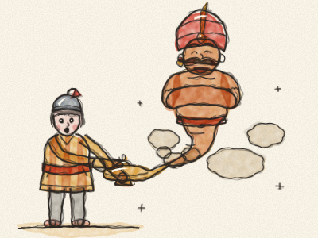
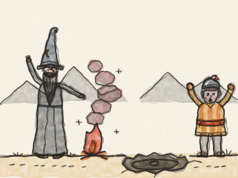
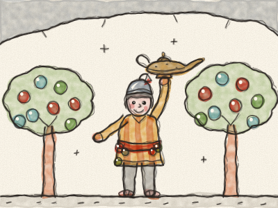
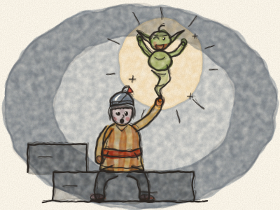
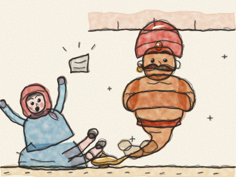
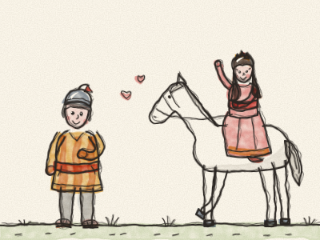
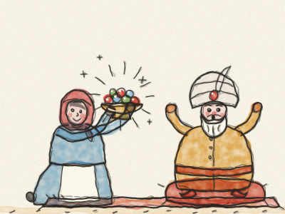
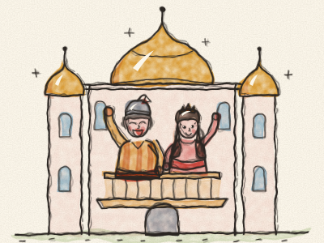
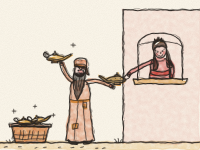
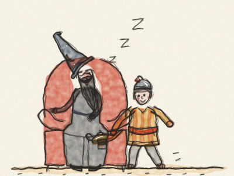

# Aladin et la Lampe merveilleuse

Il y a très longtemps, dans une grande ville très lointaine, vivait un garçon qui s’appelait Aladin. Il habitait avec sa mère dans une toute petite maison, et ils étaient très pauvres. Aladin n’aimait pas travailler. Il aimait courir dans le marché et jouer dans la rue toute la journée.

Un matin, un grand inconnu s’approcha de lui. Il avait une longue barbe noire, un chapeau pointu et des yeux perçants qui brillaient. « Aladin ! » s’écria-t-il. « Enfin ! Je suis ton oncle, le frère de ton père, perdu depuis si longtemps ! »

Aladin n’avait jamais entendu parler de cet oncle. Mais l’inconnu lui donna une pièce d’or et lui acheta des habits neufs, et Aladin était très content. Il ne savait pas que l’inconnu était en réalité un méchant magicien.

Le lendemain, l’« oncle » emmena Aladin loin de la ville, dans les montagnes. Là, il alluma un petit feu et y jeta une poudre magique. *Pouf !* Une fumée violette s’éleva. Il prononça des mots étranges. Le sol se mit à trembler. *Brrroum, brrroum…* Et — *CRAC !* — il s’ouvrit, montrant une grande pierre plate avec un anneau de fer.

« Soulève la pierre », dit le magicien. « Descends les marches. Ne touche à rien. Tout au bout, tu trouveras une vieille lampe. Rapporte-la-moi. » Puis il glissa une petite bague au doigt d’Aladin. « Pour te porter chance », dit-il.

Seul Aladin pouvait descendre : la magie empêchait le magicien d’entrer. Voilà pourquoi il avait besoin du garçon.

Aladin descendit les marches, une, deux, trois… jusqu’à un merveilleux jardin sous la terre. Là, les arbres portaient des fruits en pierres précieuses : des rubis rouges, des émeraudes vertes, des saphirs bleus, qui brillaient comme de petites lampes. Aladin remplit ses poches. *Cling, cling, cling !*

Au bout du jardin, sur un rebord, il trouva la vieille lampe, toute poussiéreuse et terne. Il la prit et courut jusqu’aux marches.

« Donne-moi la lampe ! » cria le magicien d’en haut. « Vite ! »

« Aide-moi d’abord à sortir, mon oncle », dit Aladin. « Mes poches sont trop lourdes. »

« La lampe d’abord ! » hurla le magicien.

« Sortir d’abord ! » dit Aladin.

Le magicien devint fou de colère. Il prononça un mot magique et — *BOUM !* — la pierre se referma. Aladin était enfermé dans le noir.

Il faisait très noir, et tout était silencieux. Aladin s’assit sur les marches. « Oh là là », dit-il. « Oh là là là là. » Il se tordit les mains et, sans le faire exprès, il frotta la petite bague à son doigt.

*Fouiii !* Un petit génie vert en sortit, avec des oreilles pointues et un grand sourire. « Je suis le Génie de l’Anneau ! » couina-t-il. « Que désires-tu, maître ? »

Aladin n’en croyait pas ses yeux. « Je voudrais… je voudrais rentrer à la maison ! »

« Facile comme tout ! » dit le petit génie. Il frappa dans ses mains. *Zzzip !* Et Aladin se retrouva debout dans la cuisine de sa mère, les poches pleines de bijoux et la vieille lampe à la main. Sa mère le serra très fort. Puis ils eurent tous les deux très faim, car il n’y avait rien à manger.

« Vendons cette vieille lampe », dit sa mère. « Mais elle est si sale ! Je vais d’abord la faire briller. » Elle la frotta avec un chiffon. *Frotte, frotte, frotte.*

*FOUIIIII !* De la lampe sortit un tourbillon de fumée, et de la fumée sortit un génie énorme, si grand que son turban touchait le plafond. « Je suis le Génie de la Lampe ! » tonna-t-il. « Que désires-tu, maître ? »

La mère d’Aladin poussa un cri et s’assit par terre. *Boum !*

Mais Aladin fut courageux. « Nous avons faim », dit-il. « S’il te plaît, apporte-nous à manger. »

*Pop !* Sur la table apparurent douze plats d’argent remplis de bonnes choses : du pain chaud, du riz, des fruits et des gâteaux au miel. Ils mangèrent jusqu’à avoir le ventre tout rond. Et ils gardèrent la lampe bien, bien cachée.

Les années passèrent, et Aladin grandit. Il ne demandait pas de bêtises au génie. Il apprit à travailler et à être gentil avec tout le monde au marché, et il ne se servait de la lampe que lorsqu’ils en avaient vraiment besoin.

Un jour, la fille du Sultan traversa la ville sur un cheval blanc. Elle s’appelait la Princesse Badroulboudour. *(Essaie de le dire trois fois très vite !)* Elle avait des yeux gentils et un rire joyeux. Aladin la regarda, elle le regarda, et ils se sourirent tous les deux.

« Maman », dit Aladin ce soir-là, « je voudrais épouser la Princesse. »

Sa mère éclata de rire. « Toi ? Le fils d’un pauvre tailleur ? Le Sultan ne dira jamais oui ! »

« Apporte-lui ceci », dit Aladin, et il remplit un bol avec les bijoux du jardin magique.

Alors la mère d’Aladin alla au palais. Elle s’agenouilla devant le Sultan et leva le bol. Les bijoux étincelaient si fort que toute la salle s’illumina.

« Oooh ! » dit le Sultan. « Qui m’envoie un si beau cadeau ? »

« Mon fils, Aladin », dit sa mère. « Il voudrait épouser la Princesse. »

Le grand vizir du Sultan fronça les sourcils. Il voulait que la Princesse épouse son propre fils. « Demandez-en plus », chuchota-t-il. « Beaucoup plus. »

« Très bien », dit le Sultan. « Si Aladin m’envoie quarante plateaux d’or remplis de bijoux, portés par quarante serviteurs, il pourra épouser ma fille. »

Cette nuit-là, Aladin frotta la lampe. *Fouiii !* Et le lendemain matin, quarante serviteurs montèrent jusqu’au palais, portant quarante plateaux d’or.

Le Sultan fut ravi, et la Princesse plus encore. Aladin et la Princesse Badroulboudour se marièrent en musique et en dansant, et le génie leur construisit, en une seule nuit, un palais aux coupoles dorées dont les fenêtres scintillaient au soleil.

Mais très, très loin de là, le méchant magicien regarda dans son sable magique. *Chhh, chhh.* « Quoi ? » glapit-il. « Ce garçon est sorti de la grotte ? Et il a MA lampe ? »

Il se déguisa en marchand de lampes, remplit un panier de lampes neuves et brillantes, et passa sous les fenêtres du palais. « Lampes neuves contre vieilles lampes ! » criait-il. « Lampes neuves contre vieilles lampes ! »

La Princesse ne savait rien de la magie. Elle vit la vieille lampe poussiéreuse sur une étagère et pensa : « Quelle jolie surprise pour Aladin ! »

Elle la lui tendit par la fenêtre. Le magicien l’attrapa, lui donna une lampe neuve et brillante, et s’enfuit en ricanant. Il frotta la vieille lampe. *FOUIIIII !*

« Génie ! » ordonna-t-il. « Emporte ce palais et la Princesse très loin, jusque chez moi ! »

Quand Aladin revint du marché ce soir-là, le palais avait disparu. Il ne restait qu’un grand espace vide. Le Sultan était furieux. « Où est ma fille ? Retrouve-la, sinon gare à toi ! »

Aladin réfléchit très fort. Puis il se souvint de la bague. Il la frotta. *Fouiii !* « Que désires-tu, maître ? » couina le petit génie.

« Ramène le palais ! »

« Oh, je ne peux pas défaire la magie de la Lampe », dit tristement le petit génie. « Mais je peux t’emmener là-bas. » *Zzzip !*

Aladin atterrit dans un jardin, juste sous la fenêtre de la Princesse. Elle était si heureuse de le voir ! Ensemble, ils préparèrent un plan très malin.

Ce soir-là, la Princesse sourit au magicien et lui offrit une tasse de lait chaud avec une poudre pour dormir très forte dedans. Il but tout. *Gloups.* Il bâilla. *Aaaah…* Et il s’endormit profondément dans son grand fauteuil, en ronflant : *Rrrrr… pfff…*

Sur la pointe des pieds, Aladin entra et prit la lampe dans la poche du magicien. Il la frotta. « Génie ! S’il te plaît, ramène-nous à la maison, et laisse le magicien ici, endormi, très loin ! »

*FOUIIIII !* Le palais s’envola jusque chez eux. Et Aladin et la Princesse gardèrent la lampe à l’abri pour toujours, et vécurent heureux.

> Être malin et gentil vaut plus que tous les trésors du monde.
