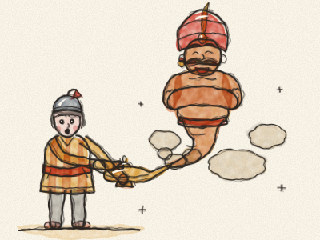
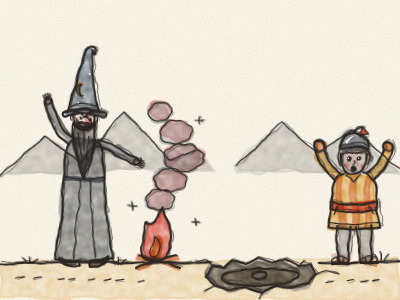
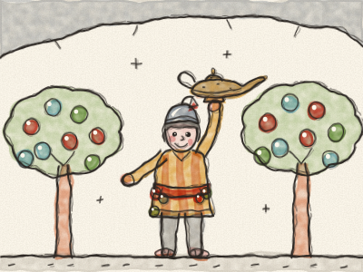
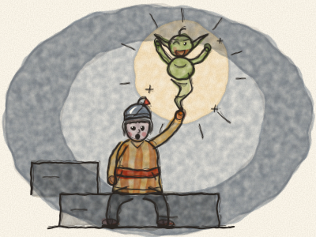
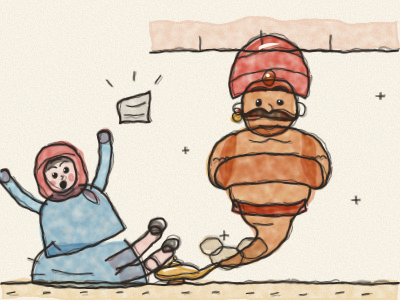
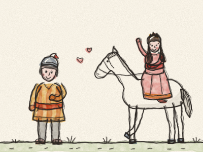
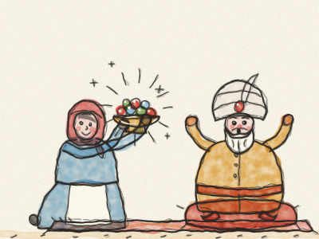
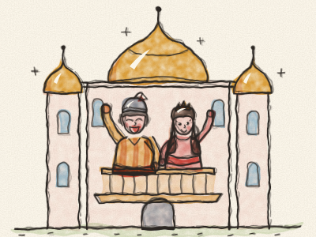
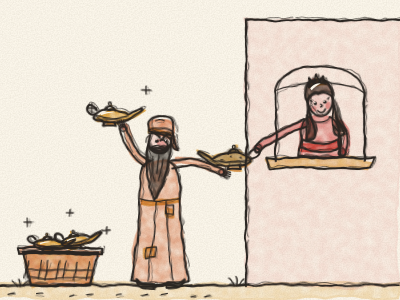
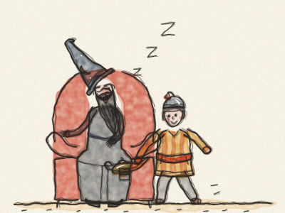

# Aladino e a Lâmpada Mágica

Há muito, muito tempo, numa grande cidade muito longe daqui, vivia um rapaz chamado Aladino. Morava com a mãe numa casinha pequenina, e eram muito pobres. O Aladino não gostava de trabalhar. Gostava era de correr pelo mercado e brincar na rua o dia inteiro.

Uma manhã, um homem alto e desconhecido aproximou-se dele. Tinha uma barba preta comprida, um chapéu bicudo e uns olhos afiados que brilhavam. — Aladino! — exclamou. — Finalmente! Sou o teu tio, o irmão do teu pai, que andava perdido há tanto tempo!

O Aladino nunca tinha ouvido falar deste tio. Mas o desconhecido deu-lhe uma moeda de ouro e comprou-lhe roupa nova, e o Aladino ficou muito contente. Não sabia que o desconhecido era, afinal, um feiticeiro malvado.

No dia seguinte, o «tio» levou o Aladino para longe da cidade, lá para as montanhas. Ali, acendeu uma pequena fogueira e atirou-lhe um pó mágico. *Puf!* Subiu um fumo roxo. Disse umas palavras estranhas. O chão começou a tremer. *Brrrum, brrrum…* E — *CRAC!* — abriu-se, mostrando uma grande pedra lisa com uma argola de ferro.

— Levanta a pedra — disse o feiticeiro. — Desce os degraus. Não toques em nada. Mesmo ao fundo, vais encontrar uma lâmpada velha. Traz-ma. — Depois enfiou um pequeno anel no dedo do Aladino. — Para dar sorte — disse.

Só o Aladino podia descer: a magia não deixava o feiticeiro entrar. Era por isso que ele precisava do rapaz.

O Aladino desceu os degraus, um, dois, três… até chegar a um jardim maravilhoso debaixo da terra. Ali, as árvores davam frutos feitos de pedras preciosas: rubis vermelhos, esmeraldas verdes, safiras azuis, a brilhar como pequenas lâmpadas. O Aladino encheu os bolsos. *Tlim, tlim, tlim!*

Ao fundo do jardim, numa saliência da rocha, encontrou a lâmpada velha, cheia de pó e sem brilho. Pegou nela e correu de volta para os degraus.

— Dá-me a lâmpada! — gritou o feiticeiro lá de cima. — Depressa!

— Ajude-me primeiro a sair, tio — disse o Aladino. — Tenho os bolsos muito pesados.

— Primeiro a lâmpada! — berrou o feiticeiro.

— Primeiro sair! — disse o Aladino.

O feiticeiro ficou furioso. Disse uma palavra mágica e — *BUM!* — a pedra fechou-se com estrondo. O Aladino ficou preso no escuro.

Estava tudo muito escuro e muito silencioso. O Aladino sentou-se nos degraus. — Ai, ai — disse ele. — Ai, ai, ai, ai. — Torceu as mãos e, sem querer, esfregou o pequeno anel que tinha no dedo.

*Fuuuch!* Saltou de lá um pequeno génio verde, com orelhas bicudas e um sorriso maroto. — Sou o Génio do Anel! — guinchou. — Qual é o teu desejo, amo?

O Aladino mal podia acreditar. — Desejo… desejo ir para casa!

— Canja! — disse o pequeno génio. Bateu as palmas. *Zzzip!* E o Aladino deu por si de pé na cozinha da mãe, com os bolsos cheios de joias e a lâmpada velha na mão. A mãe deu-lhe um abraço muito apertado. Depois, os dois ficaram cheios de fome, porque não havia nada para comer.

— Vamos vender esta lâmpada velha — disse a mãe. — Mas está tão suja! Primeiro vou dar-lhe um lustro. — Esfregou-a com um pano. *Esfrega, esfrega, esfrega.*

*FUUUUUCH!* Da lâmpada saiu um remoinho de fumo, e do fumo saiu um génio enorme, tão grande que o turbante lhe tocava no teto. — Sou o Génio da Lâmpada! — trovejou. — Qual é o teu desejo, amo?

A mãe do Aladino deu um grito e caiu sentada no chão. *Pumba!*

Mas o Aladino foi corajoso. — Temos fome — disse ele. — Por favor, traz-nos alguma coisa para comer.

*Pop!* Em cima da mesa apareceram doze pratos de prata cheios de coisas boas: pão quentinho, arroz, fruta e bolos de mel. Comeram até ficarem com a barriga redondinha. E guardaram a lâmpada muito, muito bem escondida.

Os anos passaram, e o Aladino cresceu. Não pedia disparates ao génio. Aprendeu a trabalhar e a ser simpático com toda a gente no mercado, e só usava a lâmpada quando precisavam mesmo.

Um dia, a filha do Sultão atravessou a cidade num cavalo branco. Chamava-se Princesa Badrulbudur. *(Experimenta dizer isto três vezes depressa!)* Tinha uns olhos meigos e uma gargalhada alegre. O Aladino olhou para ela, ela olhou para ele, e os dois sorriram.

— Mãe — disse o Aladino nessa noite —, eu queria casar com a Princesa.

A mãe desatou a rir. — Tu? O filho de um alfaiate pobre? O Sultão nunca vai dizer que sim!

— Leve-lhe isto — disse o Aladino, e encheu uma tigela com as joias do jardim mágico.

Então a mãe do Aladino foi ao palácio. Ajoelhou-se diante do Sultão e ergueu a tigela. As joias brilhavam tanto que a sala inteira se iluminou.

— Oooh! — disse o Sultão. — Quem me manda um presente assim?

— O meu filho, o Aladino — disse a mãe. — Ele queria casar com a Princesa.

O grão-vizir do Sultão franziu a testa. Queria que a Princesa casasse com o filho dele. — Peça mais — sussurrou. — Muito mais.

— Muito bem — disse o Sultão. — Se o Aladino me mandar quarenta bandejas de ouro cheias de joias, levadas por quarenta criados, pode casar com a minha filha.

Nessa noite, o Aladino esfregou a lâmpada. *Fuuuch!* E na manhã seguinte, quarenta criados subiram até ao palácio, com quarenta bandejas de ouro.

O Sultão ficou encantado, e a Princesa ainda mais. O Aladino e a Princesa Badrulbudur casaram-se com música e danças, e o génio construiu-lhes, numa só noite, um palácio com cúpulas douradas e janelas que cintilavam ao sol.

Mas muito, muito longe dali, o feiticeiro malvado olhou para a sua areia mágica. *Chhh, chhh.* — O quê? — guinchou. — Aquele rapaz saiu da gruta? E tem a MINHA lâmpada?

Disfarçou-se de vendedor de lâmpadas, encheu um cesto de lâmpadas novas e brilhantes, e foi passar por baixo das janelas do palácio. — Troco lâmpadas velhas por novas! — apregoava. — Troco lâmpadas velhas por novas!

A Princesa não sabia nada da magia. Viu a lâmpada velha e cheia de pó numa prateleira e pensou: «Que surpresa tão boa para o Aladino!»

Deu-lha pela janela. O feiticeiro agarrou-a, deu-lhe uma lâmpada nova e brilhante, e fugiu a rir-se. Esfregou a lâmpada velha. *FUUUUUCH!*

— Génio! — ordenou ele. — Leva este palácio e a Princesa para muito longe, para a minha casa!

Quando o Aladino voltou do mercado nessa noite, o palácio tinha desaparecido. Só restava um grande espaço vazio. O Sultão estava furioso. — Onde está a minha filha? Encontra-a, ou vais ver!

O Aladino pensou com muita força. Depois lembrou-se do anel. Esfregou-o. *Fuuuch!* — Qual é o teu desejo, amo? — guinchou o pequeno génio.

— Traz o palácio de volta!

— Ai, não posso desfazer a magia da Lâmpada — disse o pequeno génio, triste. — Mas posso levar-te até lá. — *Zzzip!*

O Aladino aterrou num jardim, mesmo por baixo da janela da Princesa. Ela ficou tão feliz por o ver! Juntos, prepararam um plano muito esperto.

Nessa noite, a Princesa sorriu ao feiticeiro e deu-lhe uma caneca de leite quente com um pó de dormir muito forte lá dentro. Ele bebeu tudo. *Glup.* Bocejou. *Aaaah…* E adormeceu profundamente no seu cadeirão, a ressonar: *Rrrrr… pfff…*

Em bicos de pés, o Aladino entrou e tirou a lâmpada do bolso do feiticeiro. Esfregou-a. — Génio! Por favor, leva-nos para casa, e deixa o feiticeiro aqui, a dormir, muito longe!

*FUUUUUCH!* O palácio voou para casa. E o Aladino e a Princesa guardaram a lâmpada em segurança para sempre, e viveram felizes.

> Ser esperto e bondoso vale mais do que qualquer tesouro.
