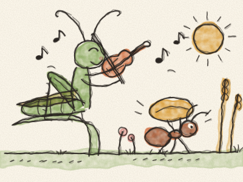
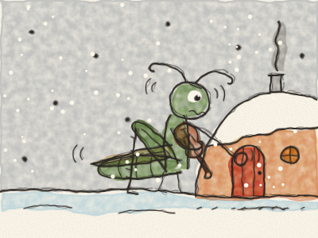

# The Ant and the Grasshopper

It was a hot, sunny summer in the meadow. The flowers were open, the wheat was golden, and a green Grasshopper sat on a blade of grass, playing his fiddle all day long. *Zing-a-zing! Zing-a-zing!*

Down below, a little Ant walked past, carrying a big grain of wheat on her back. *Puff, puff, puff.* It was nearly as big as she was.

“Hello, Ant!” sang Grasshopper. “Why are you working so hard? Come and dance with me!”

“I’m filling my store for the winter,” said Ant. “When the snow comes, there will be no food left in the meadow. You should do the same!”

“Winter? Pooh!” laughed Grasshopper. “Winter is miles away. *Zing-a-zing!*” And he went on playing.

But summer ended, as summers always do. The leaves fell, the wind blew, and one morning the whole meadow was white with snow. Grasshopper was cold and very, very hungry.

*Knock, knock, knock.* He tapped on Ant’s little door. “Ant,” he whispered, “I have nothing to eat. Could you help me, please?”

Ant looked at him, shivering in the snow. What do you think she said? *(Pause, and let Constance answer.)*

“Come in, come in,” said Ant. “I have enough for two. But next summer, you will help me fill the store!”

So all winter long, Grasshopper played his fiddle by the fire, and Ant danced. And the next summer, they carried the wheat together.

> Work a little today, and you’ll be glad tomorrow. And when a friend is in need, share what you have.
