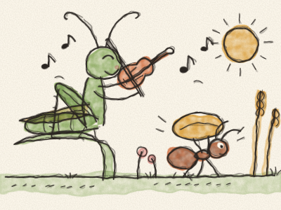
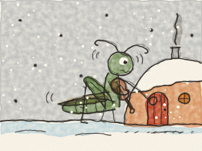

# La Cigale et la Fourmi

C’était un été chaud et ensoleillé dans la prairie. Les fleurs étaient ouvertes, le blé était doré, et une Cigale verte, assise sur un brin d’herbe, jouait du violon toute la journée. *Zing-a-zing ! Zing-a-zing !*

Tout en bas passait une petite Fourmi, avec un gros grain de blé sur le dos. *Pff, pff, pff.* Il était presque aussi gros qu’elle.

« Bonjour, Fourmi ! » chanta la Cigale. « Pourquoi travailles-tu si dur ? Viens danser avec moi ! »

« Je remplis mon garde-manger pour l’hiver », dit la Fourmi. « Quand la neige viendra, il n’y aura plus rien à manger dans la prairie. Tu devrais en faire autant ! »

« L’hiver ? Bah ! » rit la Cigale. « L’hiver, c’est dans très longtemps. *Zing-a-zing !* » Et elle continua de jouer.

Mais l’été finit, comme tous les étés. Les feuilles tombèrent, le vent souffla, et un matin toute la prairie fut blanche de neige. La Cigale avait froid, et très, très faim.

*Toc, toc, toc.* Elle frappa à la petite porte de la Fourmi. « Fourmi », murmura-t-elle, « je n’ai rien à manger. Pourrais-tu m’aider, s’il te plaît ? »

La Fourmi la regarda, toute tremblante dans la neige. À ton avis, qu’a-t-elle répondu ? *(Faire une pause, et laisser Constance répondre.)*

« Entre, entre », dit la Fourmi. « J’en ai assez pour deux. Mais l’été prochain, tu m’aideras à remplir le garde-manger ! »

Alors, tout l’hiver, la Cigale joua du violon près du feu, et la Fourmi dansa. Et l’été suivant, elles portèrent le blé ensemble.

> Un peu de travail aujourd’hui, et l’on est content demain. Et quand un ami a besoin d’aide, on partage ce que l’on a.
