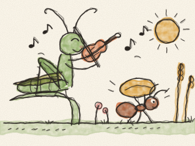
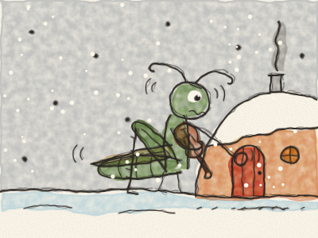

# A Cigarra e a Formiga

Era um verão quente e cheio de sol no prado. As flores estavam abertas, o trigo estava dourado, e uma Cigarra verde, sentada numa folha de erva, tocava violino o dia inteiro. *Zing-a-zing! Zing-a-zing!*

Lá em baixo passava uma Formiguinha, com um grande grão de trigo às costas. *Uf, uf, uf.* Era quase tão grande como ela.

— Olá, Formiga! — cantou a Cigarra. — Porque é que trabalhas tanto? Anda dançar comigo!

— Estou a encher a minha despensa para o inverno — disse a Formiga. — Quando a neve chegar, já não vai haver comida no prado. Devias fazer o mesmo!

— O inverno? Ora! — riu-se a Cigarra. — O inverno ainda está muito longe. *Zing-a-zing!* — E continuou a tocar.

Mas o verão acabou, como todos os verões acabam. As folhas caíram, o vento soprou, e uma manhã o prado inteiro estava branco de neve. A Cigarra tinha frio e muita, muita fome.

*Truz, truz, truz.* Bateu à portinha da Formiga. — Formiga — sussurrou ela —, não tenho nada para comer. Podes ajudar-me, por favor?

A Formiga olhou para ela, a tremer na neve. O que achas que ela respondeu? *(Fazer uma pausa e deixar a Constance responder.)*

— Entra, entra — disse a Formiga. — Tenho que chegue para as duas. Mas no próximo verão vais ajudar-me a encher a despensa!

E assim, durante todo o inverno, a Cigarra tocou violino ao pé da lareira e a Formiga dançou. E no verão seguinte carregaram o trigo juntas.

> Um pouco de trabalho hoje, e amanhã ficas contente. E quando um amigo precisa, partilha o que tens.
