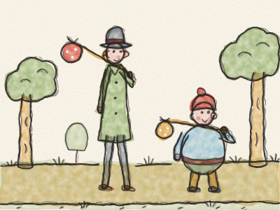
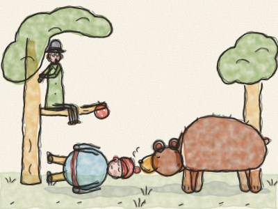

# The Bear and the Two Travellers

Once upon a time, two friends were walking through a big, dark forest. One was tall and thin, and one was short and round.

“If anything happens,” said the tall friend, “we will help each other. That’s what friends are for!” “Yes,” said the short friend. “Friends stick together!”

They walked on. *Tramp, tramp, tramp.* Then, suddenly… *Crack!* A twig snapped. *Grrrr!* Out of the trees came a great big brown bear!

The tall friend did not wait. He ran to the nearest tree and, *scramble, scramble*, he climbed right up to the top, all by himself.

The short friend could not climb: his legs were too short. So he lay down flat on the ground, shut his eyes, and kept very, very still. *(Shh! Hold your breath, like him.)*

The bear came closer. *Sniff, sniff.* It sniffed his hair. *Sniff, sniff.* It sniffed his nose. Then it put its big furry mouth right next to his ear… and it seemed to whisper something.

Then the bear yawned, and wandered back into the forest. *Pad, pad, pad.*

The tall friend climbed down. “Phew!” he laughed. “What did the bear whisper in your ear?”

The short friend got up and brushed off the leaves. “The bear said: never travel with a friend who runs away when there is trouble.”

The tall friend went quite red. “I’m sorry,” he said. “Next time, I will stay with you.” And they walked home together.

> A true friend stays with you when things go wrong.
