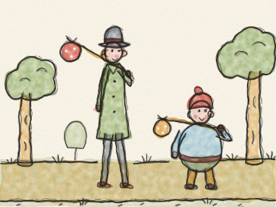
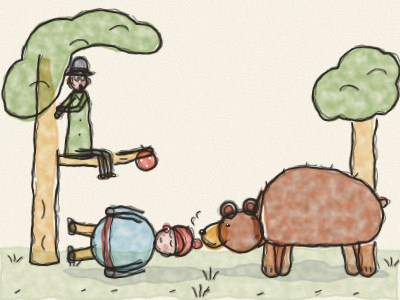

# L’Ours et les Deux Compagnons

Il était une fois deux amis qui traversaient une grande forêt sombre. L’un était grand et maigre, l’autre petit et tout rond.

« S’il arrive quelque chose, dit le grand, on s’aidera. C’est à ça que servent les amis ! » « Oui, dit le petit. Les amis restent toujours ensemble ! »

Ils continuèrent leur chemin. *Tap, tap, tap.* Et soudain… *Crac !* Une branche craqua. *Grrrr !* Un énorme ours brun sortit d’entre les arbres !

Le grand n’attendit pas. Il courut jusqu’à l’arbre le plus proche et, *grimpe, grimpe*, il monta tout en haut, tout seul.

Le petit ne savait pas grimper : ses jambes étaient trop courtes. Alors il se coucha à plat ventre par terre, ferma les yeux et ne bougea plus du tout. *(Chut ! Retiens ton souffle, comme lui.)*

L’ours s’approcha. *Snif, snif.* Il renifla ses cheveux. *Snif, snif.* Il renifla son nez. Puis il colla son gros museau poilu contre son oreille… et on aurait dit qu’il lui chuchotait quelque chose.

Puis l’ours bâilla, et repartit dans la forêt. *Pof, pof, pof.*

Le grand redescendit de l’arbre. « Ouf ! dit-il en riant. Qu’est-ce que l’ours t’a chuchoté à l’oreille ? »

Le petit se releva et enleva les feuilles de ses habits. « L’ours m’a dit : ne voyage jamais avec un ami qui s’enfuit quand il y a un danger. »

Le grand devint tout rouge. « Pardon, dit-il. La prochaine fois, je resterai avec toi. » Et ils rentrèrent ensemble à la maison.

> Un vrai ami reste avec toi quand les choses vont mal.
