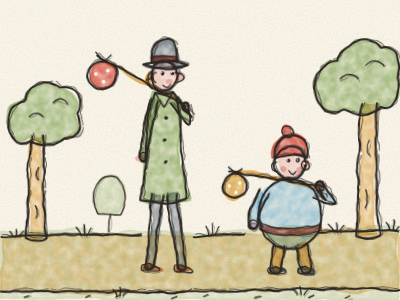
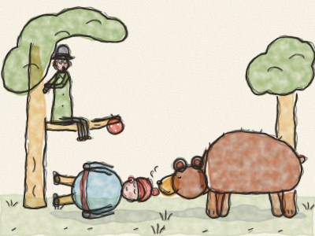

# O Urso e os Dois Viajantes

Era uma vez dois amigos que atravessavam uma floresta grande e escura. Um era alto e magro, e o outro era baixinho e redondo.

— Se acontecer alguma coisa — disse o alto —, ajudamo-nos um ao outro. Os amigos servem para isso! — Pois é — disse o baixinho. — Os amigos estão sempre juntos!

Lá seguiram caminho. *Tum, tum, tum.* E de repente… *Crac!* Partiu-se um raminho. *Grrrr!* Do meio das árvores saiu um enorme urso castanho!

O alto não esperou. Correu para a árvore mais próxima e, *trepa, trepa*, subiu lá para o cimo, sozinho.

O baixinho não sabia trepar: tinha as pernas curtas demais. Então deitou-se no chão, fechou os olhos e ficou muito, muito quieto. *(Chiu! Sustém a respiração, como ele.)*

O urso aproximou-se. *Snif, snif.* Cheirou-lhe o cabelo. *Snif, snif.* Cheirou-lhe o nariz. Depois encostou o focinho peludo mesmo à orelha dele… e parecia que lhe estava a segredar alguma coisa.

Depois o urso bocejou e voltou para a floresta. *Pum, pum, pum.*

O alto desceu da árvore. — Ufa! — disse ele, a rir. — O que é que o urso te segredou ao ouvido?

O baixinho levantou-se e sacudiu as folhas da roupa. — O urso disse: nunca viajes com um amigo que foge quando há perigo.

O alto ficou todo vermelho. — Desculpa — disse ele. — Para a próxima, fico contigo. — E voltaram juntos para casa.

> Um verdadeiro amigo fica contigo quando as coisas correm mal.
