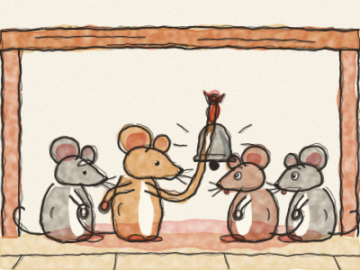
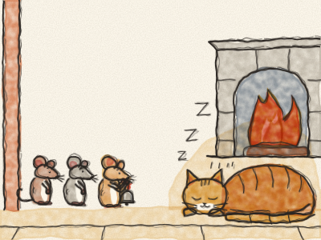

# Belling the Cat

Once upon a time, in a big old house, there lived a family of mice. And in the same house lived a big ginger Cat. The Cat walked so softly on his padded paws — *pad, pad, pad* — that the mice never heard him coming. *Pounce!* And they had to run for their lives.

So one night, all the mice met under the kitchen table. “We must do something about that Cat!” said Grandpa Mouse. “Who has an idea?”

A young mouse jumped up. “I know! We tie a little bell round the Cat’s neck. Then, every time he comes — *ding-a-ling, ding-a-ling* — we will hear him, and we will all run home in time!”

“Hooray!” cheered the mice. “What a clever idea!” They clapped their little paws and danced round in a circle.

Then old Grandpa Mouse cleared his throat. “Ahem. It is a very good idea. Just one question.” *(Pause.)* “Who is going to tie the bell on the Cat?”

Everybody stopped dancing. “Not me!” said one mouse. “Not me!” said another. “Not me, not me, not me!” And they all looked at their toes.

So the bell stayed under the table, and the Cat never wore it.

> An idea is easy to have. The hard part is doing it.
