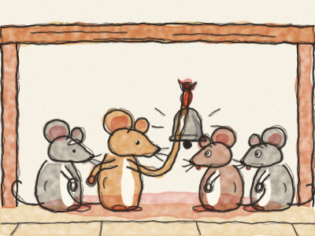
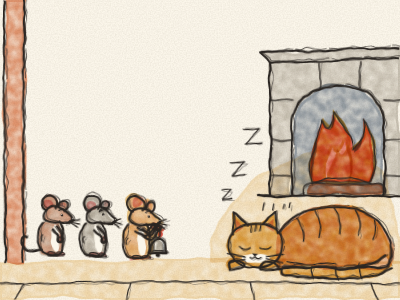

# Le Grelot du Chat

Il était une fois, dans une grande vieille maison, une famille de souris. Et dans la même maison vivait un gros Chat roux. Le Chat marchait si doucement sur ses pattes de velours — *pat, pat, pat* — que les souris ne l’entendaient jamais venir. *Hop !* Et elles devaient se sauver à toutes pattes.

Alors une nuit, toutes les souris se réunirent sous la table de la cuisine. « Il faut faire quelque chose contre ce Chat ! » dit Grand-Père Souris. « Qui a une idée ? »

Une jeune souris se leva d’un bond. « Moi ! On attache un petit grelot au cou du Chat. Comme ça, chaque fois qu’il arrive — *drelin, drelin* — on l’entend, et on a le temps de rentrer chez nous ! »

« Hourra ! » crièrent les souris. « Quelle idée géniale ! » Elles tapèrent dans leurs petites pattes et dansèrent en rond.

Puis le vieux Grand-Père Souris s’éclaircit la gorge. « Hum hum. C’est une très bonne idée. Juste une question. » *(Pause.)* « Qui va attacher le grelot au Chat ? »

Tout le monde s’arrêta de danser. « Pas moi ! » dit une souris. « Pas moi ! » dit une autre. « Pas moi, pas moi, pas moi ! » Et toutes regardèrent leurs pieds.

Alors le grelot resta sous la table, et le Chat ne le porta jamais.

> Avoir une idée, c’est facile. Le plus dur, c’est de la faire.
