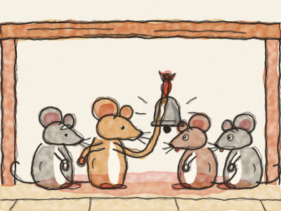
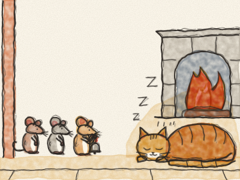

# O Guizo do Gato

Era uma vez, numa casa grande e antiga, uma família de ratinhos. E na mesma casa vivia um Gato ruivo e gordo. O Gato andava tão de mansinho nas suas patas de veludo — *pat, pat, pat* — que os ratinhos nunca o ouviam chegar. *Zás!* E tinham de fugir a sete pés.

Então, uma noite, todos os ratinhos se reuniram debaixo da mesa da cozinha. — Temos de fazer alguma coisa por causa daquele Gato! — disse o Avô Rato. — Quem tem uma ideia?

Um ratinho novo deu um salto. — Eu sei! Atamos um guizo pequenino ao pescoço do Gato. Assim, sempre que ele vier — *tlim, tlim, tlim* — ouvimo-lo, e temos tempo de fugir todos para casa!

— Viva! — gritaram os ratinhos. — Que ideia tão esperta! — Bateram as patinhas e dançaram à roda.

Depois o velho Avô Rato pigarreou. — Ahem. É uma ideia muito boa. Só uma pergunta. — *(Pausa.)* — Quem é que vai atar o guizo ao Gato?

Toda a gente parou de dançar. — Eu não! — disse um ratinho. — Eu não! — disse outro. — Eu não, eu não, eu não! — E todos ficaram a olhar para os pés.

E assim o guizo ficou debaixo da mesa, e o Gato nunca o usou.

> Ter uma ideia é fácil. O difícil é pô-la em prática.
