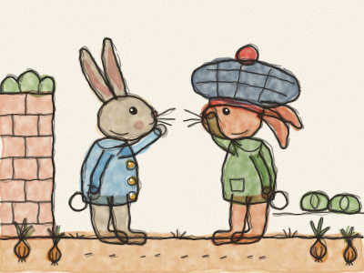
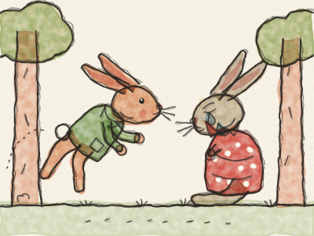
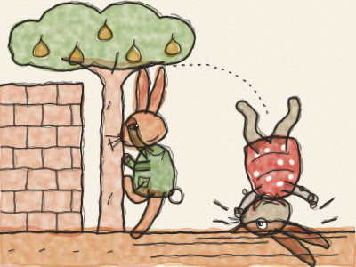
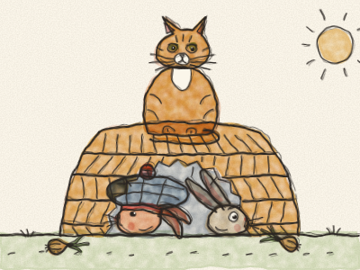

# The Tale of Benjamin Bunny

One morning, a little rabbit called Benjamin Bunny sat on a bank by the lane. Benjamin was Peter Rabbit’s cousin.

*Trit-trot, trit-trot.* Along the lane came a pony pulling a little cart. In it sat Mr McGregor, and beside him sat Mrs McGregor, in her best bonnet.

“They’re going out for the whole day!” thought Benjamin. And off he hopped, *hop, skip, hop*, to call on his cousin Peter.

He found Peter sitting all by himself in the wood, wrapped up in a red cotton handkerchief. Peter looked very sorry for himself.

Peter had lost his jacket and his shoes in Mr McGregor’s garden, and now Mr McGregor had put them on his scarecrow!

“Don’t worry,” said Benjamin. “Mr McGregor has gone out in the cart, and Mrs McGregor too. Let’s go and get your clothes back!”

Peter was not sure. *(What do you think, Constance? Should they go?)*

But Benjamin was already hopping off. So the two little rabbits went to the garden. This time they did not squeeze under the gate. They climbed down a big pear tree on the other side of the wall. Benjamin went first, very neatly. Peter fell down head first. *Bump!* But the earth was soft and newly raked, so he was not hurt at all.

There stood the scarecrow, wearing Peter’s little blue jacket and his shoes, and an old tam-o’-shanter hat that belonged to Mr McGregor.

Peter took back his jacket and his shoes. It had rained in the night, so the shoes were full of water, and the jacket had shrunk a little. *Squelch, squelch.*

Benjamin tried on the tam-o’-shanter. It was much too big for him! It came right down over his ears.

“Now,” said Benjamin, “let’s fill the handkerchief with onions, as a present for your mother!” So they pulled up onions, *pull, pull, pop*, and wrapped them in the red handkerchief.

Peter did not enjoy himself at all. He kept hearing noises. *Rustle, rustle.* “What was that?”

Benjamin knew the garden very well. He led the way out, along a little path under the gooseberry bushes. *Hop, hop, hop…* and then they stopped.

Round the corner, sitting in the sun, was… a cat! A big cat, with long whiskers and green eyes.

Quick as a wink, the two little rabbits hid under a big basket. *Shh!*

The cat got up, stretched, and came over to the basket. *Sniff, sniff.* Perhaps she liked the smell of onions. And then she sat down on top of the basket… and she stayed there. For five whole hours! The onions made the rabbits’ eyes water. *Sniff, sniff.*

“We’ll be stuck here for ever,” whispered Peter.

But who came marching along the top of the wall? It was old Mr Benjamin Bunny, Benjamin’s father, looking for his son. He was not a bit afraid of cats. He jumped down, *whoosh*, and gave the cat such a fright that she ran into the greenhouse. He shut the door behind her. *Click!*

Then he lifted up the basket. “There you are, you two!” he said very sternly. And he took them both straight home, one paw in each hand.

When Peter got home, his mother was so glad to see that he had found his shoes and his jacket that she forgave him. Peter folded up the red handkerchief, and his mother hung the onions from the kitchen ceiling, to keep for the winter.

> When you get into a pickle, a grown-up can help you out, so it is best to tell one where you are going.
