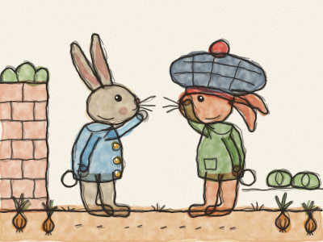
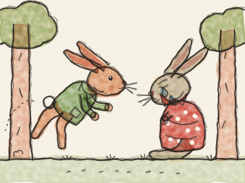
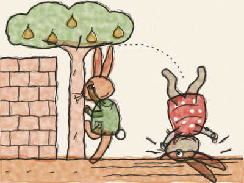
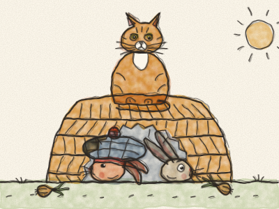

# Jeannot Lapin

Un matin, un petit lapin qui s’appelait Jeannot Lapin était assis sur un talus, au bord du chemin. Jeannot était le cousin de Pierre Lapin.

*Trotte, trotte, trotte.* Sur le chemin arriva un poney qui tirait une petite carriole. Dedans était assis M. McGregor, et à côté de lui Mme McGregor, avec son plus beau chapeau.

« Ils partent pour toute la journée ! » se dit Jeannot. Et il partit en sautillant, *hop, hop, hop*, rendre visite à son cousin Pierre.

Il trouva Pierre assis tout seul dans le bois, enveloppé dans un mouchoir de coton rouge. Pierre avait l’air très malheureux.

Pierre avait perdu sa veste et ses chaussures dans le jardin de M. McGregor, et maintenant M. McGregor les avait mises sur son épouvantail !

« Ne t’inquiète pas, dit Jeannot. M. McGregor est parti en carriole, et Mme McGregor aussi. Allons récupérer tes habits ! »

Pierre n’était pas très sûr. *(Qu’en penses-tu, Constance ? Est-ce qu’ils doivent y aller ?)*

Mais Jeannot sautillait déjà. Alors les deux petits lapins allèrent au jardin. Cette fois, ils ne se faufilèrent pas sous la barrière. Ils descendirent par un grand poirier, de l’autre côté du mur. Jeannot passa le premier, très proprement. Pierre tomba la tête la première. *Boum !* Mais la terre était molle et fraîchement ratissée, et il ne se fit pas mal du tout.

Là se tenait l’épouvantail, avec la petite veste bleue de Pierre, ses chaussures, et un vieux béret écossais qui appartenait à M. McGregor.

Pierre reprit sa veste et ses chaussures. Il avait plu pendant la nuit : les chaussures étaient pleines d’eau, et la veste avait un peu rétréci. *Floc, floc.*

Jeannot essaya le béret. Il était bien trop grand pour lui ! Il lui tombait jusque sur les oreilles.

« Maintenant, dit Jeannot, remplissons le mouchoir d’oignons, comme cadeau pour ta maman ! » Alors ils arrachèrent des oignons, *tire, tire, pop*, et les enveloppèrent dans le mouchoir rouge.

Pierre ne s’amusait pas du tout. Il entendait sans cesse des bruits. *Frou, frou.* « Qu’est-ce que c’était ? »

Jeannot connaissait très bien le jardin. Il montra le chemin pour sortir, par un petit sentier sous les groseilliers. *Hop, hop, hop…* et puis ils s’arrêtèrent net.

Au coin, assis au soleil, il y avait… un chat ! Un gros chat, avec de longues moustaches et des yeux verts.

En un clin d’œil, les deux petits lapins se cachèrent sous un grand panier. *Chut !*

Le chat se leva, s’étira et vint vers le panier. *Snif, snif.* Peut-être qu’il aimait l’odeur des oignons. Et puis il s’assit sur le panier… et il y resta. Cinq heures entières ! Les oignons faisaient pleurer les yeux des lapins. *Snif, snif.*

« On va rester coincés ici pour toujours », chuchota Pierre.

Mais qui arrivait d’un pas décidé sur le haut du mur ? C’était le vieux M. Lapin, le papa de Jeannot, qui cherchait son fils. Il n’avait pas peur des chats, pas du tout. Il sauta en bas, *hop*, et fit une telle peur au chat qu’il fila dans la serre. M. Lapin referma la porte derrière lui. *Clic !*

Puis il souleva le panier. « Vous voilà, tous les deux ! » dit-il d’un ton très sévère. Et il les ramena tout droit à la maison, une patte dans chaque main.

Quand Pierre rentra chez lui, sa maman fut si contente qu’il ait retrouvé ses chaussures et sa veste qu’elle lui pardonna. Pierre plia le mouchoir rouge, et sa maman accrocha les oignons au plafond de la cuisine, pour l’hiver.

> Quand on se met dans le pétrin, un grand peut nous aider : alors dis toujours à un grand où tu vas.
