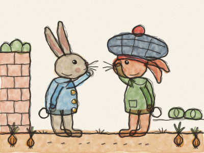
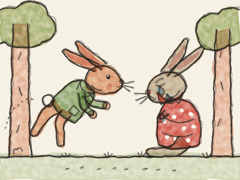
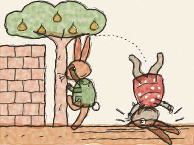
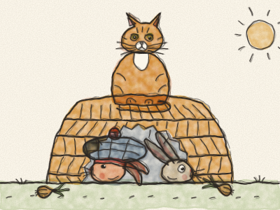

# A História do Benjamim Coelho

Uma manhã, um coelhinho chamado Benjamim Coelho estava sentado num barranco, à beira do caminho. O Benjamim era primo do Pedro Coelho.

*Trote, trote, trote.* Pelo caminho vinha um pónei a puxar uma carroça pequenina. Lá dentro ia o senhor McGregor e, ao lado dele, a senhora McGregor, com o seu melhor chapéu.

— Vão sair o dia inteiro! — pensou o Benjamim. E lá foi aos saltinhos, *hop, hop, hop*, visitar o primo Pedro.

Encontrou o Pedro sentado sozinho no bosque, embrulhado num lenço de algodão vermelho. O Pedro estava com um ar muito triste.

O Pedro tinha perdido o casaco e os sapatos na horta do senhor McGregor, e agora o senhor McGregor tinha-os posto no espantalho!

— Não te preocupes — disse o Benjamim. — O senhor McGregor saiu de carroça, e a senhora McGregor também. Vamos buscar a tua roupa!

O Pedro não tinha bem a certeza. *(O que achas, Constance? Devem ir?)*

Mas o Benjamim já ia aos saltos. Então os dois coelhinhos foram até à horta. Desta vez não passaram por baixo do portão. Desceram por uma grande pereira, do outro lado do muro. O Benjamim foi primeiro, muito direitinho. O Pedro caiu de cabeça. *Pum!* Mas a terra estava mole e acabada de ancinhar, por isso não se magoou nada.

Ali estava o espantalho, com o casaquinho azul do Pedro, os sapatos dele e uma velha boina escocesa que era do senhor McGregor.

O Pedro recuperou o casaco e os sapatos. Tinha chovido durante a noite, por isso os sapatos estavam cheios de água e o casaco tinha encolhido um bocadinho. *Chape, chape.*

O Benjamim experimentou a boina. Era muito grande para ele! Tapava-lhe as orelhas todas.

— Agora — disse o Benjamim —, vamos encher o lenço de cebolas, para dar à tua mãe! — Então arrancaram cebolas, *puxa, puxa, pop*, e embrulharam-nas no lenço vermelho.

O Pedro não se estava a divertir nada. Ouvia barulhos a toda a hora. *Fru, fru.* — O que foi aquilo?

O Benjamim conhecia muito bem a horta. Foi à frente para mostrar a saída, por um carreirinho debaixo das groselheiras. *Hop, hop, hop…* e de repente pararam.

Ao virar da esquina, sentado ao sol, estava… um gato! Um gato grande, de bigodes compridos e olhos verdes.

Num abrir e fechar de olhos, os dois coelhinhos esconderam-se debaixo de um cesto grande. *Chiu!*

O gato levantou-se, espreguiçou-se e veio até ao cesto. *Snif, snif.* Se calhar gostava do cheiro das cebolas. E depois sentou-se em cima do cesto… e ali ficou. Cinco horas inteirinhas! As cebolas faziam chorar os olhos dos coelhos. *Snif, snif.*

— Vamos ficar aqui presos para sempre — segredou o Pedro.

Mas quem vinha a marchar pelo cimo do muro? Era o velho senhor Benjamim Coelho, o pai do Benjamim, à procura do filho. Não tinha medo nenhum de gatos. Saltou cá para baixo, *zás*, e pregou tal susto ao gato que ele fugiu para a estufa. Ele fechou-lhe a porta. *Clic!*

Depois levantou o cesto. — Cá estão vocês os dois! — disse ele, muito sério. E levou-os direitinhos para casa, uma pata em cada mão.

Quando o Pedro chegou a casa, a mãe ficou tão contente por ele ter encontrado os sapatos e o casaco que lhe perdoou. O Pedro dobrou o lenço vermelho, e a mãe pendurou as cebolas no teto da cozinha, para o inverno.

> Quando nos metemos em sarilhos, um adulto pode ajudar-nos: por isso, diz sempre a um adulto aonde vais.
