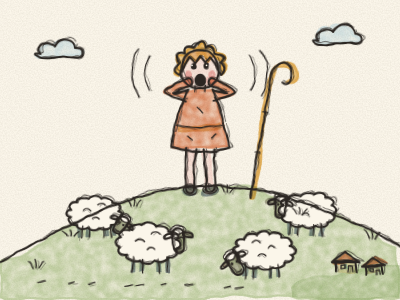
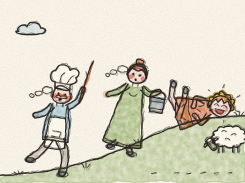
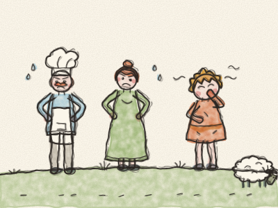
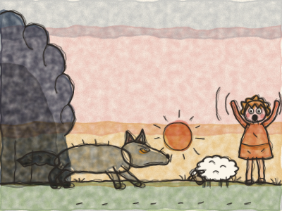
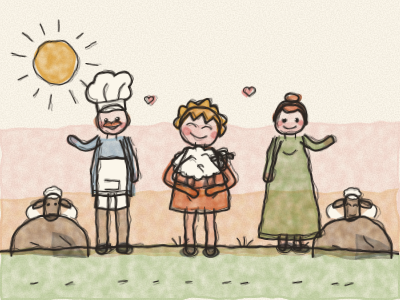

# The Boy Who Cried Wolf

Once upon a time, in a little village at the bottom of a big green hill, there lived a shepherd boy called Peter. Every morning, Peter took the village sheep up the hill to eat the sweet green grass. *Baa! Baa!* said the sheep. And every evening he brought them home again.

But up on the hill, all day long, there was nothing to do. The sheep munched. *Munch, munch.* The clouds floated by. Peter yawned. “I’m so bored,” he said. “Nothing ever happens up here!”

Then he had an idea, a naughty idea. He stood up, cupped his hands round his mouth and shouted as loudly as he could: “WOLF! WOLF! A wolf is chasing the sheep! HELP!”

Down in the village, everybody heard him. The baker dropped his bread. The farmer dropped her fork. The blacksmith dropped his hammer. And they all ran up the hill as fast as they could, *puff, puff, puff*, with sticks and buckets to chase the wolf away.

But when they got to the top, there was no wolf. Only the sheep, munching. And Peter, rolling in the grass and laughing. “Ha ha ha! There’s no wolf! I tricked you!”

The villagers were not pleased. “Peter,” said the baker, “that was not funny. Don’t cry wolf when there is no wolf.” And they walked all the way back down the hill, grumbling.

A few days later, Peter was bored again. And he did it again. “WOLF! WOLF! HELP!” *(What do you think the villagers did?)*

Down in the village, everybody dropped what they were doing and ran up the hill once more. *Puff, puff, puff.* And once more, there was no wolf. Just Peter, giggling. “Tricked you again!”

This time the villagers were cross. They put their hands on their hips. “Peter,” said the farmer, “if you keep telling fibs, one day nobody will believe you, even when you tell the truth.” Peter only shrugged. But he would soon find out that she was right.

One evening, just as the sun was going down, something moved at the edge of the dark wood. Two yellow eyes. A long grey nose. A big bushy tail. It was a real wolf! And it was creeping, creeping towards the sheep.

“WOLF! WOLF!” shouted Peter, with all his might. “A REAL WOLF! PLEASE HELP!”

Down in the village, everybody heard him. But the baker just shook his head. The farmer went on with her supper. “It’s only Peter playing his silly trick again,” they said. And nobody came.

The wolf leapt out. *Grrrr!* The sheep ran in every direction. *Baa! Baa! Baa!* They ran into the wood, behind the rocks and far over the hill, and the wolf ran after them.

Peter ran all the way down to the village, crying. “It was a real wolf this time! I promise! The sheep are gone!” And when the villagers saw his tears, they knew he was telling the truth.

Early the next morning, everybody went up the hill together. They searched behind every rock and every bush. And one by one, they found the sheep, frightened but safe. The wolf had gone back into the wood, hungry and grumpy.

Peter hugged the littlest lamb. “I’m sorry,” he said to everyone. “I will never tell fibs again.” And he never did.

> Nobody believes someone who tells fibs, even when they tell the truth. So always tell the truth.
