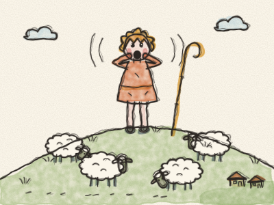
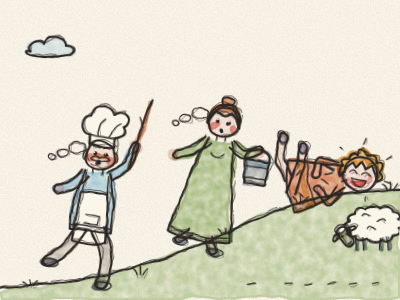
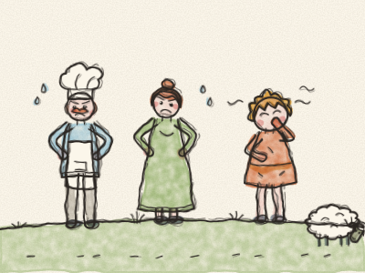
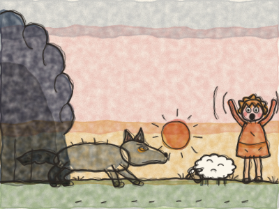
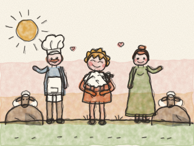

# Le Garçon qui criait au loup

Il était une fois, dans un petit village au pied d’une grande colline verte, un petit berger qui s’appelait Pierre. Chaque matin, Pierre emmenait les moutons du village en haut de la colline pour manger la bonne herbe verte. *Bêê ! Bêê !* faisaient les moutons. Et chaque soir, il les ramenait à la maison.

Mais là-haut, toute la journée, il n’y avait rien à faire. Les moutons broutaient. *Crounch, crounch.* Les nuages passaient. Pierre bâillait. « Je m’ennuie, dit-il. Il ne se passe jamais rien ici ! »

Alors il eut une idée, une très vilaine idée. Il se leva, mit ses mains autour de sa bouche et cria aussi fort qu’il put : « AU LOUP ! AU LOUP ! Un loup poursuit les moutons ! AU SECOURS ! »

En bas, au village, tout le monde l’entendit. Le boulanger lâcha son pain. La fermière lâcha sa fourche. Le forgeron lâcha son marteau. Et tous montèrent la colline aussi vite qu’ils purent, *pff, pff, pff*, avec des bâtons et des seaux pour chasser le loup.

Mais quand ils arrivèrent en haut, il n’y avait pas de loup. Seulement les moutons qui broutaient. Et Pierre, qui se roulait dans l’herbe en riant. « Ha ha ha ! Il n’y a pas de loup ! Je vous ai bien eus ! »

Les villageois n’étaient pas contents. « Pierre, dit le boulanger, ce n’était pas drôle. On ne crie pas au loup quand il n’y a pas de loup. » Et ils redescendirent toute la colline en ronchonnant.

Quelques jours plus tard, Pierre s’ennuyait encore. Et il recommença. « AU LOUP ! AU LOUP ! AU SECOURS ! » *(À ton avis, qu’ont fait les villageois ?)*

En bas, au village, tout le monde lâcha ce qu’il faisait et remonta la colline encore une fois. *Pff, pff, pff.* Et encore une fois, il n’y avait pas de loup. Juste Pierre, qui pouffait de rire. « Encore eus ! »

Cette fois, les villageois étaient fâchés. Ils mirent les mains sur les hanches. « Pierre, dit la fermière, si tu continues à raconter des mensonges, un jour plus personne ne te croira, même quand tu diras la vérité. » Pierre haussa les épaules. Mais il allait bientôt découvrir qu’elle avait raison.

Un soir, juste au coucher du soleil, quelque chose bougea au bord du bois sombre. Deux yeux jaunes. Un long museau gris. Une grosse queue touffue. C’était un vrai loup ! Et il s’approchait, tout doucement, des moutons.

« AU LOUP ! AU LOUP ! cria Pierre de toutes ses forces. UN VRAI LOUP ! AU SECOURS, S’IL VOUS PLAÎT ! »

En bas, au village, tout le monde l’entendit. Mais le boulanger secoua la tête. La fermière continua son dîner. « Ce n’est que Pierre qui recommence sa bêtise », dirent-ils. Et personne ne vint.

Le loup bondit. *Grrrr !* Les moutons s’enfuirent dans tous les sens. *Bêê ! Bêê ! Bêê !* Ils coururent dans le bois, derrière les rochers et loin de l’autre côté de la colline, et le loup courut après eux.

Pierre descendit en courant jusqu’au village, en pleurant. « C’était un vrai loup cette fois ! Je le promets ! Les moutons sont partis ! » Et quand les villageois virent ses larmes, ils comprirent qu’il disait la vérité.

Le lendemain, très tôt, tout le monde monta la colline ensemble. Ils cherchèrent derrière chaque rocher et chaque buisson. Et un par un, ils retrouvèrent les moutons, effrayés mais sains et saufs. Le loup était reparti dans le bois, affamé et grognon.

Pierre serra le plus petit agneau dans ses bras. « Pardon, dit-il à tout le monde. Je ne raconterai plus jamais de mensonges. » Et il n’en raconta plus jamais.

> Personne ne croit celui qui ment, même quand il dit la vérité. Alors dis toujours la vérité.
