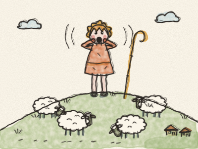
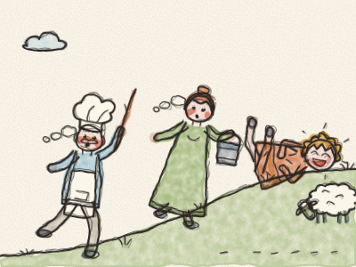
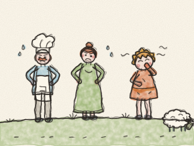
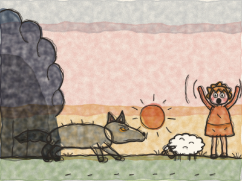
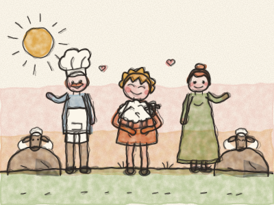

# O Pastor e o Lobo

Era uma vez, numa pequena aldeia ao fundo de uma grande colina verde, um pequeno pastor chamado Pedro. Todas as manhãs, o Pedro levava as ovelhas da aldeia até ao cimo da colina, para comerem a erva verde e fresquinha. *Mé! Mé!* faziam as ovelhas. E todas as tardes trazia-as de volta para casa.

Mas lá em cima, o dia inteiro, não havia nada para fazer. As ovelhas pastavam. *Nham, nham.* As nuvens passavam. O Pedro bocejava. — Que aborrecido — dizia ele. — Aqui nunca acontece nada!

Então teve uma ideia, uma ideia muito marota. Levantou-se, pôs as mãos à volta da boca e gritou com toda a força: — LOBO! LOBO! Está um lobo a perseguir as ovelhas! SOCORRO!

Lá em baixo, na aldeia, toda a gente o ouviu. O padeiro deixou cair o pão. A lavradora deixou cair a forquilha. O ferreiro deixou cair o martelo. E todos subiram a colina o mais depressa que puderam, *uff, uff, uff*, com paus e baldes para afugentar o lobo.

Mas quando chegaram lá acima, não havia lobo nenhum. Só as ovelhas, a pastar. E o Pedro, a rebolar na erva a rir. — Ah ah ah! Não há lobo nenhum! Enganei-vos!

Os aldeões não gostaram nada. — Pedro — disse o padeiro —, isso não teve graça nenhuma. Não se grita «lobo» quando não há lobo. — E desceram a colina toda outra vez, a resmungar.

Uns dias depois, o Pedro estava outra vez aborrecido. E fez o mesmo. — LOBO! LOBO! SOCORRO! *(O que achas que os aldeões fizeram?)*

Lá em baixo, na aldeia, toda a gente largou o que estava a fazer e subiu a colina mais uma vez. *Uff, uff, uff.* E mais uma vez, não havia lobo nenhum. Só o Pedro, a rir-se. — Enganei-vos outra vez!

Desta vez os aldeões ficaram zangados. Puseram as mãos na cintura. — Pedro — disse a lavradora —, se continuas a dizer mentiras, um dia já ninguém acredita em ti, nem quando disseres a verdade. — O Pedro encolheu os ombros. Mas em breve ia descobrir que ela tinha razão.

Uma tarde, mesmo ao pôr do sol, alguma coisa mexeu-se na orla do bosque escuro. Dois olhos amarelos. Um focinho comprido e cinzento. Uma cauda grande e farfalhuda. Era um lobo a sério! E vinha devagarinho, devagarinho, em direção às ovelhas.

— LOBO! LOBO! — gritou o Pedro, com todas as forças. — UM LOBO A SÉRIO! SOCORRO, POR FAVOR!

Lá em baixo, na aldeia, toda a gente o ouviu. Mas o padeiro abanou a cabeça. A lavradora continuou a jantar. — É só o Pedro com a brincadeira tola dele outra vez — disseram. E ninguém foi.

O lobo saltou. *Grrrr!* As ovelhas fugiram para todos os lados. *Mé! Mé! Mé!* Correram para dentro do bosque, para trás das rochas e para longe, para o outro lado da colina, e o lobo correu atrás delas.

O Pedro desceu a correr até à aldeia, a chorar. — Desta vez era um lobo a sério! Prometo! As ovelhas desapareceram! — E quando os aldeões viram as lágrimas dele, perceberam que estava a dizer a verdade.

Na manhã seguinte, muito cedo, toda a gente subiu a colina junta. Procuraram atrás de cada rocha e de cada arbusto. E, uma a uma, encontraram as ovelhas, assustadas mas sãs e salvas. O lobo tinha voltado para o bosque, com fome e mal-humorado.

O Pedro abraçou o cordeirinho mais pequeno. — Desculpem — disse ele a todos. — Nunca mais digo mentiras. — E nunca mais disse.

> Ninguém acredita em quem mente, nem quando diz a verdade. Por isso, diz sempre a verdade.
