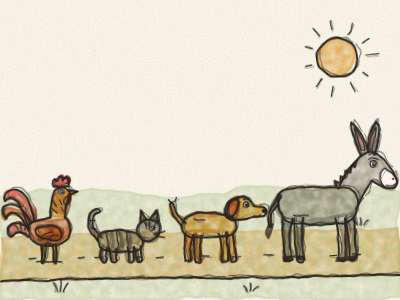
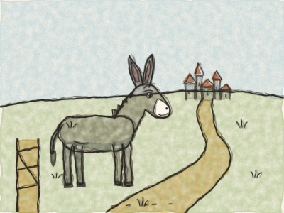
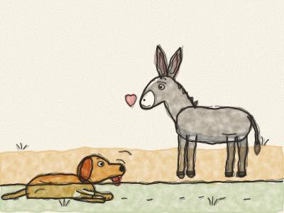
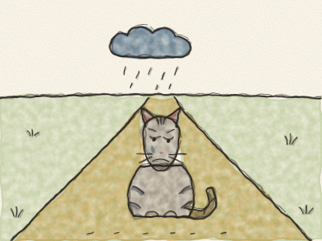
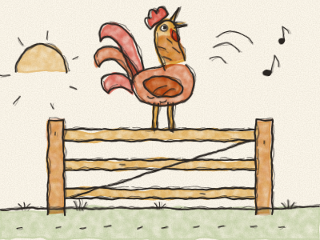
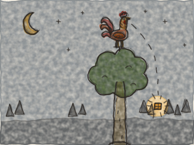
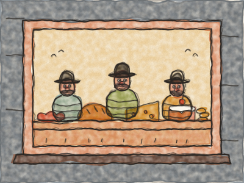
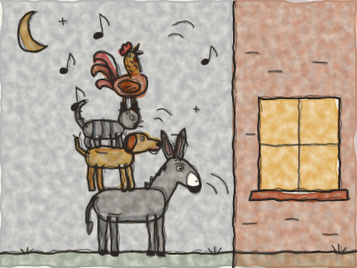
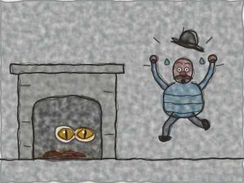
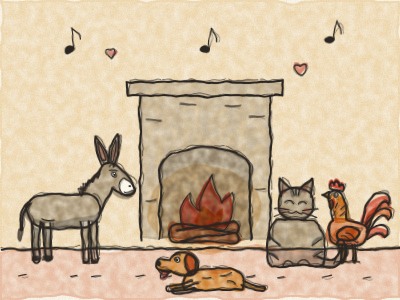

# The Bremen Town Musicians

Once upon a time, on a farm, there lived a Donkey. For many, many years he had carried heavy sacks of flour to the mill. *Clip-clop, clip-clop.* But now the Donkey was old, and his legs were tired, and the sacks felt heavier every day.

One morning he heard the farmer say, “That donkey is too old to work. I don’t need him any more.”

The Donkey’s long ears drooped. Then he lifted his head. “Too old to carry sacks,” he said, “but not too old to sing! I have the loudest voice in the whole country. *Hee-haw! Hee-haw!* I shall go to the town of Bremen and become a musician.”

So he walked out of the farm gate, and off he went down the long road to Bremen. *Clip-clop, clip-clop.*

He had not gone very far when he saw a Dog lying by the side of the road, panting. *Hah, hah, hah.*

“Why are you puffing like that, my friend?” asked the Donkey.

“Oh,” sighed the Dog, “I am old, and I can’t run fast enough to go hunting any more. My master doesn’t want me. I don’t know where to go.”

“Then come with me!” said the Donkey. “I am going to Bremen to be a musician. I will play the music and you can bark the tune. *Hee-haw!*”

The Dog wagged his tail. “*Woof!* What a good idea!” And so the two of them walked on together. *Clip-clop, pitter-pat.*

A little later, they saw a Cat sitting in the middle of the road, with a face as long as three rainy days.

“What’s the matter, old whiskers?” asked the Donkey.

“Oh dear,” said the Cat. “I am getting old. My teeth are not sharp any more, and I would rather sit by the fire and purr than chase mice. So my mistress doesn’t want me any more. What will become of me?”

“Come with us to Bremen!” said the Donkey. “You sing so beautifully at night. You can be a musician too!”

The Cat thought about it, and then she smiled a big cat smile. “*Miaow!* Why not?” And so the three of them walked on together. *Clip-clop, pitter-pat, tippy-toe.*

Soon they came to a farmyard. On top of the gate stood a Rooster, crowing as loudly as he could. *Cock-a-doodle-DOO! Cock-a-doodle-DOO!*

“My goodness!” said the Donkey. “What a noise! Why are you shouting like that?”

“Because tomorrow is a big party at the farm,” said the Rooster, “and the cook wants to put me in the soup! So I am crowing while I still can!”

“Soup? Oh no, no, no,” said the Donkey. “Come with us to Bremen instead. You have a splendid voice. With all four of us singing together, what music we shall make!”

The Rooster flapped his wings. “*Cock-a-doodle-doo!* I’m coming!”

So now there were four of them: the Donkey, the Dog, the Cat and the Rooster. *(Count them on your fingers with Constance.)*

But Bremen was far away, and they could not get there in one day. When evening came, they reached a big dark forest. The Donkey and the Dog lay down under a tall tree. The Cat climbed onto a branch. And the Rooster flew right up to the very top, where it was safest.

Before he went to sleep, the Rooster looked all around. And far away, between the trees, he saw a little light shining.

“Friends!” he called down. “There’s a house over there! I can see a light in the window!”

“A house?” said the Donkey. “Then let’s go. It will be warmer than this hard ground.”

“And maybe there will be a bone or two,” said the Dog.

“Or a little bowl of milk,” said the Cat.

So off they went through the forest, towards the light. The light grew bigger and brighter, until they came to a little house. The Donkey, who was the tallest, crept up to the window and peeped inside.

“What can you see, Donkey?” whispered the Rooster.

“I see a table,” whispered the Donkey, “covered with good things to eat and drink. Sausages, bread, cheese, cakes… And sitting around it are robbers, eating and laughing and counting their gold.”

“Oh, how I wish we were in there!” sighed the Dog.

So the four friends put their heads together to make a plan. And this is what they did.

The Donkey put his front hooves on the windowsill. The Dog jumped onto the Donkey’s back. The Cat climbed onto the Dog’s back. And the Rooster flew up and sat on the Cat’s head.

Then, all together, they began to sing. *(Do all the voices with Constance!)*

The Donkey brayed: *HEE-HAW!* The Dog barked: *WOOF! WOOF!* The Cat miaowed: *MIAOOOW!* And the Rooster crowed: *COCK-A-DOODLE-DOO!*

Then — *CRASH!* — they all tumbled through the window into the room.

The robbers jumped out of their chairs. “A monster! A monster with four heads!” they shouted. And they ran out of the door and far away into the forest, as fast as their legs could carry them.

The four friends looked at each other. Then they sat down at the table and ate and ate, until they could not eat another crumb.

When they had finished, they blew out the light and went to bed. The Donkey lay on the straw in the yard. The Dog lay behind the door. The Cat curled up by the warm ashes of the fire. And the Rooster sat up on the roof. Soon they were all fast asleep.

In the middle of the night, one of the robbers crept back to the house. *Tiptoe, tiptoe.* Everything was dark and quiet. He went into the kitchen to light a candle, and he saw the Cat’s eyes glowing by the fire. He thought they were two little coals.

*Hiss! Scratch!* went the Cat. *Woof! Woof!* went the Dog, with a pinch on his leg. *Bump!* went the Donkey, with a little kick. And from the roof: *COCK-A-DOODLE-DOO!*

The robber ran all the way back to the others. “Don’t go back there!” he cried. “There’s a witch who scratched me, a man behind the door who pinched my leg, a giant who thumped me, and a judge on the roof who shouted: Bring him to me-e-e!”

So the robbers never came back to the little house in the forest, not ever again.

And the four friends? They liked the little house so much that they never went to Bremen at all. They stayed there together, warm and happy, and every evening they sang their music by the fire. *Hee-haw, woof, miaow, cock-a-doodle-doo!*

> Even when you feel old or small, good friends together can do great things, and make a home anywhere.
