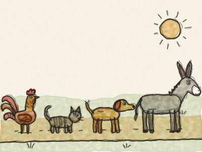
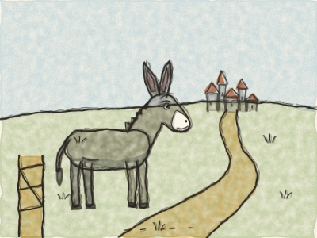
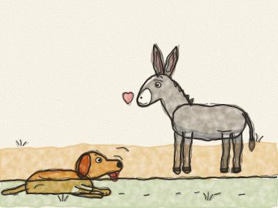
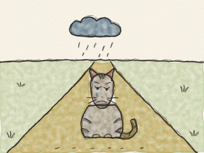
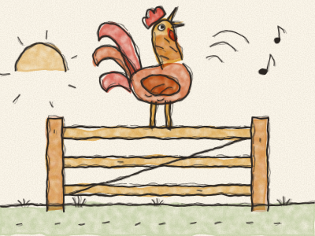
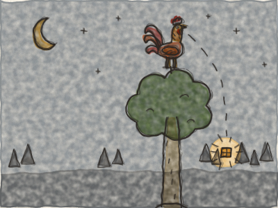
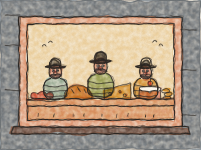
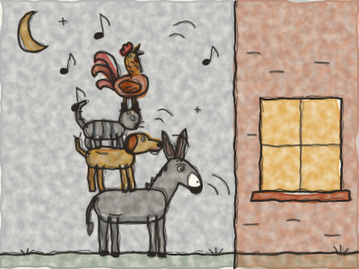
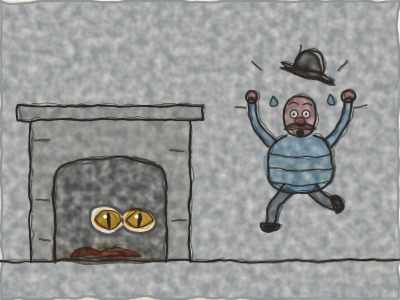
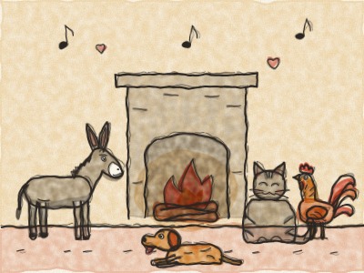

# Les Musiciens de Brême

Il était une fois, dans une ferme, un Âne. Pendant des années et des années, il avait porté de lourds sacs de farine jusqu’au moulin. *Clip-clop, clip-clop.* Mais à présent, l’Âne était vieux, ses jambes étaient fatiguées, et les sacs lui semblaient chaque jour plus lourds.

Un matin, il entendit le fermier dire : « Cet âne est trop vieux pour travailler. Je n’ai plus besoin de lui. »

Les longues oreilles de l’Âne retombèrent. Puis il releva la tête. « Trop vieux pour porter des sacs », dit-il, « mais pas trop vieux pour chanter ! J’ai la voix la plus forte de tout le pays. *Hi-han ! Hi-han !* Je vais aller à Brême, et je deviendrai musicien. »

Alors il franchit la barrière de la ferme et s’en alla sur la longue route de Brême. *Clip-clop, clip-clop.*

Il n’avait pas fait beaucoup de chemin quand il vit un Chien couché au bord de la route, tout essoufflé. *Hah, hah, hah.*

« Pourquoi souffles-tu comme ça, mon ami ? » demanda l’Âne.

« Oh », soupira le Chien, « je suis vieux, et je ne cours plus assez vite pour aller à la chasse. Mon maître ne veut plus de moi. Je ne sais pas où aller. »

« Alors viens avec moi ! » dit l’Âne. « Je vais à Brême pour devenir musicien. Je jouerai la musique, et toi, tu aboieras la chanson. *Hi-han !* »

Le Chien remua la queue. « *Ouaf !* Quelle bonne idée ! » Et les voilà partis tous les deux. *Clip-clop, trotte-trotte.*

Un peu plus loin, ils virent une Chatte assise au milieu de la route, avec une tête longue comme trois jours de pluie.

« Qu’est-ce qui ne va pas, vieilles moustaches ? » demanda l’Âne.

« Hélas », dit la Chatte. « Je vieillis. Mes dents ne sont plus pointues, et je préfère ronronner au coin du feu plutôt que de courir après les souris. Alors ma maîtresse ne veut plus de moi. Que vais-je devenir ? »

« Viens avec nous à Brême ! » dit l’Âne. « Tu chantes si bien la nuit. Tu seras musicienne, toi aussi ! »

La Chatte réfléchit, puis elle fit un grand sourire de chat. « *Miaou !* Pourquoi pas ? » Et les voilà partis tous les trois. *Clip-clop, trotte-trotte, patte-de-velours.*

Bientôt, ils arrivèrent devant une ferme. Tout en haut de la barrière se tenait un Coq, qui chantait aussi fort qu’il pouvait. *Cocorico ! Cocorico !*

« Ma parole ! » dit l’Âne. « Quel vacarme ! Pourquoi cries-tu comme ça ? »

« Parce que demain, il y a une grande fête à la ferme », dit le Coq, « et la cuisinière veut me mettre dans la soupe ! Alors je chante tant que je le peux encore ! »

« Dans la soupe ? Oh non, non, non », dit l’Âne. « Viens plutôt avec nous à Brême. Tu as une voix magnifique. Si nous chantons tous les quatre ensemble, quelle musique nous ferons ! »

Le Coq battit des ailes. « *Cocorico !* J’arrive ! »

Maintenant, ils étaient quatre : l’Âne, le Chien, la Chatte et le Coq. *(Comptez-les sur vos doigts avec Constance.)*

Mais Brême était loin, et ils ne pouvaient pas y arriver en un jour. Le soir venu, ils atteignirent une grande forêt sombre. L’Âne et le Chien se couchèrent sous un grand arbre. La Chatte grimpa sur une branche. Et le Coq s’envola tout en haut, là où l’on est le plus en sécurité.

Avant de s’endormir, le Coq regarda tout autour de lui. Et très loin, entre les arbres, il vit briller une petite lumière.

« Mes amis ! » cria-t-il. « Il y a une maison là-bas ! Je vois de la lumière à la fenêtre ! »

« Une maison ? » dit l’Âne. « Alors allons-y. On y sera mieux que sur ce sol tout dur. »

« Et il y aura peut-être un os ou deux », dit le Chien.

« Ou un petit bol de lait », dit la Chatte.

Les voilà donc partis à travers la forêt, vers la lumière. La lumière devenait plus grande et plus brillante, jusqu’à ce qu’ils arrivent devant une petite maison. L’Âne, qui était le plus grand, s’approcha de la fenêtre à pas de loup et jeta un œil à l’intérieur.

« Que vois-tu, l’Âne ? » chuchota le Coq.

« Je vois une table », chuchota l’Âne, « couverte de bonnes choses à manger et à boire. Des saucisses, du pain, du fromage, des gâteaux… Et autour, il y a des brigands qui mangent, qui rient et qui comptent leur or. »

« Oh, comme j’aimerais être là-dedans ! » soupira le Chien.

Alors les quatre amis réfléchirent ensemble à un plan. Et voici ce qu’ils firent.

L’Âne posa ses sabots de devant sur le rebord de la fenêtre. Le Chien sauta sur le dos de l’Âne. La Chatte grimpa sur le dos du Chien. Et le Coq s’envola et se posa sur la tête de la Chatte.

Puis, tous ensemble, ils se mirent à chanter. *(Faites toutes les voix avec Constance !)*

L’Âne brailla : *HI-HAN !* Le Chien aboya : *OUAF ! OUAF !* La Chatte miaula : *MIAOUUU !* Et le Coq chanta : *COCORICO !*

Et puis — *BADABOUM !* — ils dégringolèrent tous par la fenêtre, au milieu de la pièce.

Les brigands sautèrent de leurs chaises. « Un monstre ! Un monstre à quatre têtes ! » crièrent-ils. Et ils sortirent par la porte en courant, loin, très loin dans la forêt, aussi vite que leurs jambes pouvaient les porter.

Les quatre amis se regardèrent. Puis ils s’assirent à table, et ils mangèrent, et ils mangèrent, jusqu’à ne plus pouvoir avaler une miette.

Quand ils eurent fini, ils éteignirent la lumière et allèrent se coucher. L’Âne s’allongea sur la paille, dans la cour. Le Chien se coucha derrière la porte. La Chatte se roula en boule près des cendres chaudes du feu. Et le Coq se percha sur le toit. Bientôt, ils dormaient tous à poings fermés.

Au milieu de la nuit, un des brigands revint vers la maison. *Sur la pointe des pieds, sur la pointe des pieds.* Tout était noir et silencieux. Il entra dans la cuisine pour allumer une bougie, et il vit les yeux de la Chatte briller près du feu. Il crut que c’étaient deux petites braises.

*Pfff ! Griff !* fit la Chatte. *Ouaf ! Ouaf !* fit le Chien, en lui pinçant la jambe. *Boum !* fit l’Âne, avec une petite ruade. Et, du haut du toit : *COCORICO !*

Le brigand courut jusqu’aux autres. « N’y retournez pas ! » cria-t-il. « Il y a une sorcière qui m’a griffé, un homme derrière la porte qui m’a pincé la jambe, un géant qui m’a donné un grand coup, et un juge sur le toit qui criait : Amenez-le-moi-a-a-a ! »

Alors les brigands ne revinrent jamais à la petite maison de la forêt, plus jamais.

Et les quatre amis ? Ils aimaient tant la petite maison qu’ils n’allèrent jamais à Brême. Ils y restèrent ensemble, au chaud et heureux, et chaque soir ils jouaient leur musique au coin du feu. *Hi-han, ouaf, miaou, cocorico !*

> Même quand on se sent vieux ou petit, de bons amis ensemble peuvent faire de grandes choses, et trouver une maison n’importe où.
