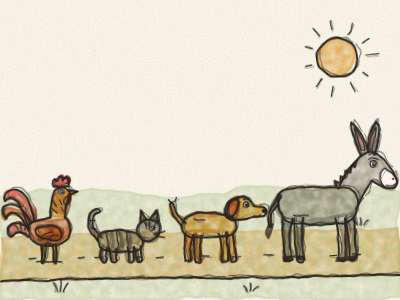
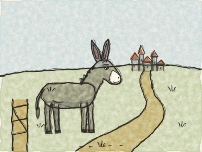
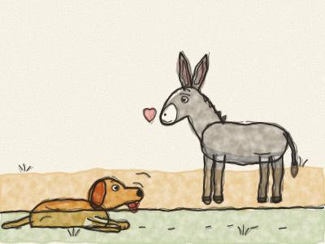
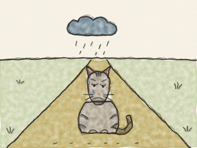
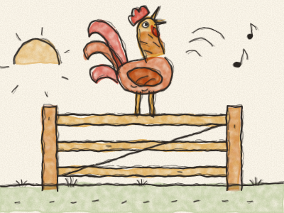
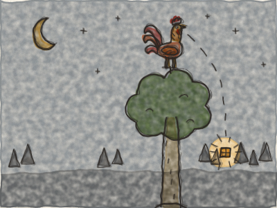
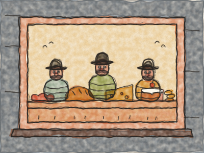
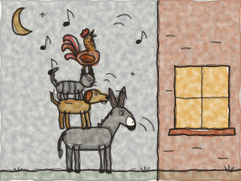
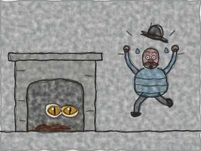
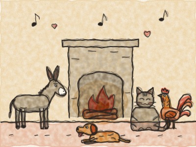

# Os Músicos de Bremen

Era uma vez, numa quinta, um Burro. Durante muitos, muitos anos, tinha levado pesados sacos de farinha até ao moinho. *Cloc-cloc, cloc-cloc.* Mas agora o Burro estava velho, tinha as pernas cansadas, e os sacos pareciam-lhe cada dia mais pesados.

Uma manhã, ouviu o lavrador dizer: — Este burro já está velho demais para trabalhar. Já não preciso dele.

As orelhas compridas do Burro descaíram. Depois, ele levantou a cabeça. — Velho demais para carregar sacos — disse ele —, mas não velho demais para cantar! Tenho a voz mais forte do país inteiro. *Ió-ió! Ió-ió!* Vou para a cidade de Bremen ser músico.

E assim saiu pelo portão da quinta e lá foi pela longa estrada de Bremen. *Cloc-cloc, cloc-cloc.*

Ainda não tinha ido muito longe quando viu um Cão deitado à beira da estrada, todo ofegante. *Hah, hah, hah.*

— Porque estás a arfar assim, meu amigo? — perguntou o Burro.

— Ai — suspirou o Cão —, estou velho e já não consigo correr depressa para ir à caça. O meu dono já não me quer. Não sei para onde ir.

— Então vem comigo! — disse o Burro. — Vou para Bremen ser músico. Eu toco a música e tu ladras a canção. *Ió-ió!*

O Cão abanou a cauda. — *Ão-ão!* Que boa ideia! — E lá foram os dois juntos. *Cloc-cloc, trote-trote.*

Um pouco mais à frente, viram uma Gata sentada no meio da estrada, com uma cara tão comprida como três dias de chuva.

— O que se passa, velhos bigodes? — perguntou o Burro.

— Ai de mim — disse a Gata. — Estou a ficar velha. Os meus dentes já não são afiados, e prefiro ronronar ao pé da lareira do que correr atrás dos ratos. Por isso a minha dona já não me quer. O que vai ser de mim?

— Vem connosco para Bremen! — disse o Burro. — Cantas tão bem à noite. Também podes ser música!

A Gata pensou um bocadinho, e depois fez um grande sorriso de gata. — *Miau!* Porque não? — E lá foram os três juntos. *Cloc-cloc, trote-trote, pé-ante-pé.*

Pouco depois, chegaram a uma quinta. Em cima do portão estava um Galo, a cantar o mais alto que podia. *Cocorocó! Cocorocó!*

— Valha-me Deus! — disse o Burro. — Que barulheira! Porque estás a gritar assim?

— Porque amanhã há uma grande festa na quinta — disse o Galo — e a cozinheira quer pôr-me na sopa! Por isso canto enquanto ainda posso!

— Na sopa? Ah não, não, não — disse o Burro. — Vem antes connosco para Bremen. Tens uma voz esplêndida. Se cantarmos os quatro juntos, que música vamos fazer!

O Galo bateu as asas. — *Cocorocó!* Eu vou!

Agora eram quatro: o Burro, o Cão, a Gata e o Galo. *(Contem-nos pelos dedos com a Constance.)*

Mas Bremen ficava longe, e não conseguiam lá chegar num só dia. Ao fim da tarde, chegaram a uma grande floresta escura. O Burro e o Cão deitaram-se debaixo de uma árvore alta. A Gata subiu para um ramo. E o Galo voou lá para o cimo de tudo, onde estava mais seguro.

Antes de adormecer, o Galo olhou à sua volta. E lá muito longe, entre as árvores, viu uma luzinha a brilhar.

— Amigos! — chamou ele lá de cima. — Há uma casa ali adiante! Vejo uma luz na janela!

— Uma casa? — disse o Burro. — Então vamos lá. Sempre é mais quente do que este chão duro.

— E talvez haja um ou dois ossos — disse o Cão.

— Ou uma tigelinha de leite — disse a Gata.

E lá foram pela floresta, em direção à luz. A luz foi ficando maior e mais brilhante, até que chegaram a uma casinha. O Burro, que era o mais alto, aproximou-se da janela pé ante pé e espreitou lá para dentro.

— O que vês, Burro? — sussurrou o Galo.

— Vejo uma mesa — sussurrou o Burro — cheia de coisas boas para comer e beber. Salsichas, pão, queijo, bolos… E sentados à volta estão uns ladrões, a comer, a rir e a contar o seu ouro.

— Ai, quem me dera estar lá dentro! — suspirou o Cão.

Então os quatro amigos juntaram as cabeças para fazer um plano. E foi isto que fizeram.

O Burro pôs as patas da frente no parapeito da janela. O Cão saltou para as costas do Burro. A Gata subiu para as costas do Cão. E o Galo voou e pousou na cabeça da Gata.

Depois, todos juntos, começaram a cantar. *(Façam todas as vozes com a Constance!)*

O Burro zurrou: *IÓ-IÓ!* O Cão ladrou: *ÃO! ÃO!* A Gata miou: *MIAUUU!* E o Galo cantou: *COCOROCÓ!*

E então — *CATRAPUM!* — caíram todos pela janela para dentro da sala.

Os ladrões saltaram das cadeiras. — Um monstro! Um monstro com quatro cabeças! — gritaram. E fugiram pela porta fora, para longe, muito longe na floresta, o mais depressa que as pernas os deixavam.

Os quatro amigos olharam uns para os outros. Depois sentaram-se à mesa e comeram, e comeram, até não conseguirem comer nem mais uma migalha.

Quando acabaram, apagaram a luz e foram dormir. O Burro deitou-se na palha, no pátio. O Cão deitou-se atrás da porta. A Gata enroscou-se junto às cinzas quentes da lareira. E o Galo empoleirou-se no telhado. Pouco depois, dormiam todos profundamente.

A meio da noite, um dos ladrões voltou à casa. *Pé ante pé, pé ante pé.* Estava tudo escuro e calado. Entrou na cozinha para acender uma vela e viu os olhos da Gata a brilhar junto à lareira. Pensou que eram duas brasinhas.

*Fff! Zás!* fez a Gata, com uma arranhadela. *Ão! Ão!* fez o Cão, beliscando-lhe a perna. *Pum!* fez o Burro, com um pequeno coice. E lá do telhado: *COCOROCÓ!*

O ladrão correu até junto dos outros. — Não voltem lá! — gritou ele. — Há uma bruxa que me arranhou, um homem atrás da porta que me beliscou a perna, um gigante que me deu um encontrão, e um juiz no telhado que gritava: Tragam-mo cá-á-á!

E assim os ladrões nunca mais voltaram à casinha da floresta, nunca, nunca mais.

E os quatro amigos? Gostaram tanto da casinha que nunca chegaram a ir a Bremen. Ficaram lá juntos, quentinhos e felizes, e todas as noites tocavam a sua música ao pé da lareira. *Ió-ió, ão-ão, miau, cocorocó!*

> Mesmo quando nos sentimos velhos ou pequenos, bons amigos juntos conseguem fazer grandes coisas, e encontrar uma casa em qualquer lado.
