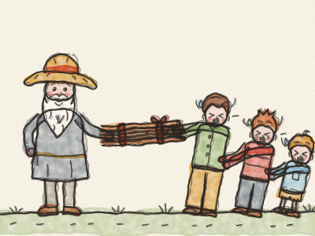
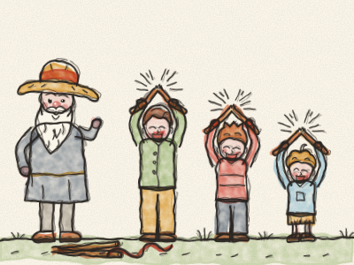

# The Bundle of Sticks

Once upon a time, an old farmer lived on a little farm with his three sons. They were strong boys, and kind boys, most of the time. But oh, how they quarrelled!

“That’s my spade!” “No, it’s mine!” “You took my apple!” “Did not!” “Did too!” From morning to night, the farm was full of shouting. *Grumble, grumble, grumble.*

One evening, the old farmer called his sons. In his hands he had a bundle of sticks, tied tightly together with a piece of string. “Who can break this bundle?” he asked.

The eldest son took it. He pushed and he pulled. *Hnnnngh!* It would not break. The middle son took it. He bent it over his knee. *Hnnnngh!* It would not break. The youngest son even sat on it. *Bump!* It would not break.

Then the farmer untied the string and gave each son just one stick. “Now try,” he said.

*Crack! Crack! Crack!* Each little stick broke at once, as easy as anything.

“You see, my boys,” said the farmer gently. “When you fight each other, you are like these sticks, one by one: anyone can break you. But when you stick together and help each other, you are like the bundle. Nobody can break you.”

The three brothers looked at each other. Then they put their arms round each other’s shoulders, and they laughed. And from that day on, the farm was a lot quieter. Well… most of the time.

> Together, we are strong.
