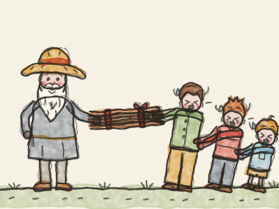
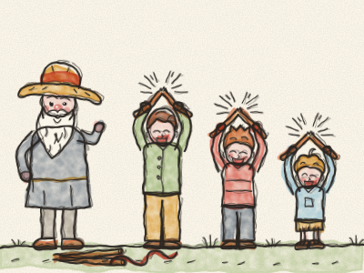

# Le Fagot de bâtons

Il était une fois un vieux fermier qui vivait dans une petite ferme avec ses trois fils. C’étaient des garçons forts, et des garçons gentils, la plupart du temps. Mais qu’est-ce qu’ils se disputaient !

« C’est ma pelle ! » « Non, c’est la mienne ! » « Tu as pris ma pomme ! » « C’est pas vrai ! » « Si, c’est vrai ! » Du matin au soir, la ferme était pleine de cris. *Grrr, grrr, grrr.*

Un soir, le vieux fermier appela ses fils. Il tenait dans ses mains un fagot de bâtons, bien serrés ensemble avec un bout de ficelle. « Qui peut casser ce fagot ? » demanda-t-il.

L’aîné le prit. Il poussa, il tira. *Hmmmmf !* Le fagot ne cassa pas. Le deuxième le prit. Il le plia sur son genou. *Hmmmmf !* Le fagot ne cassa pas. Le plus petit s’assit même dessus. *Boum !* Le fagot ne cassa pas.

Alors le fermier défit la ficelle et donna à chaque fils un seul bâton. « Maintenant, essayez », dit-il.

*Crac ! Crac ! Crac !* Chaque petit bâton se cassa tout de suite, aussi facilement que rien.

« Vous voyez, mes garçons, dit doucement le fermier. Quand vous vous battez, vous êtes comme ces bâtons, un par un : n’importe qui peut vous casser. Mais quand vous restez ensemble et que vous vous aidez, vous êtes comme le fagot. Personne ne peut vous casser. »

Les trois frères se regardèrent. Puis ils se prirent par les épaules, et ils éclatèrent de rire. Et à partir de ce jour-là, la ferme fut beaucoup plus calme. Enfin… la plupart du temps.

> Toute puissance est faible, à moins que d’être unie. Ensemble, on est forts.
