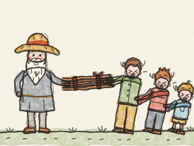
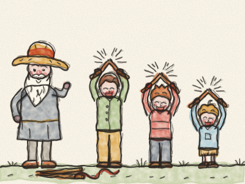

# O Feixe de Varas

Era uma vez um velho lavrador que vivia numa pequena quinta com os seus três filhos. Eram rapazes fortes, e rapazes bons, quase sempre. Mas, ai, como eles discutiam!

— Essa pá é minha! — Não, é minha! — Tiraste-me a maçã! — Não tirei! — Tiraste, sim! — Da manhã à noite, a quinta estava cheia de gritos. *Resmungo, resmungo, resmungo.*

Uma tarde, o velho lavrador chamou os filhos. Tinha nas mãos um feixe de varas, bem apertadas umas às outras com um bocado de cordel. — Quem é capaz de partir este feixe? — perguntou ele.

O mais velho pegou nele. Empurrou e puxou. *Hmmmmf!* O feixe não se partiu. O do meio pegou nele. Dobrou-o no joelho. *Hmmmmf!* O feixe não se partiu. O mais novo até se sentou em cima dele. *Bum!* O feixe não se partiu.

Então o lavrador desatou o cordel e deu a cada filho uma só vara. — Agora experimentem — disse ele.

*Crac! Crac! Crac!* Cada varinha partiu-se logo, sem custo nenhum.

— Estão a ver, meus rapazes? — disse o lavrador, com doçura. — Quando lutam uns com os outros, são como estas varas, uma a uma: qualquer pessoa vos pode partir. Mas quando ficam juntos e se ajudam, são como o feixe. Ninguém vos consegue partir.

Os três irmãos olharam uns para os outros. Depois puseram os braços sobre os ombros uns dos outros e desataram a rir. E, a partir desse dia, a quinta ficou muito mais sossegada. Bem… quase sempre.

> Juntos, somos fortes.
