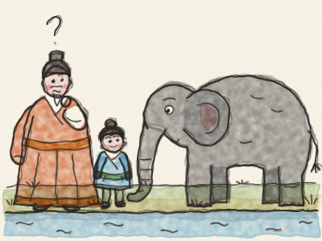
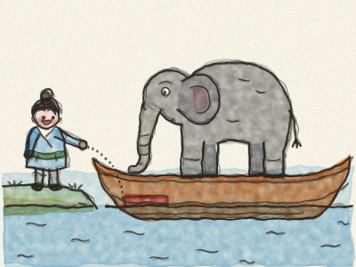

# Cao Chong Weighs the Elephant

Long ago in China, there lived a great lord. One day, a king from far away sent him a present: an enormous grey elephant!

The elephant was as tall as a house. Its ears flapped like sails, and its feet went *Boom! Boom! Boom!*

“How heavy is it?” wondered the lord. “I must know!”

But there was no scale big enough for an elephant.

The lord’s wise men scratched their heads. “Let’s build a giant scale!” said one. “That would take a hundred years,” sighed the lord. “Let’s lift it up!” said another. They pushed and they pulled. *Hmmmf!* The elephant didn’t move at all.

Then the lord’s son, little Cao Chong, stepped forward. He was only six years old. “Father, I know how to do it!”

Everybody laughed. But the lord said, “Tell us, my son.”

And you, how would you do it? *(Pause, and let Constance guess.)*

“Let’s put the elephant in a boat!” said Cao Chong. So the elephant stepped into a boat on the river. *Splosh!* The boat sank lower in the water, and Cao Chong drew a mark on its side, just where the water came up to.

Then the elephant stepped out again, and they filled the boat with stones. One stone, two stones, lots and lots of stones… until the boat sank down to the very same mark.

“Now,” said Cao Chong, “the stones weigh as much as the elephant. And stones are small: we can weigh them one by one, and add them all up!”

And that is just what they did. The lord smiled proudly. “A little boy with a big idea!”

> You don’t need to be big to have a big idea. Stop, think, and look for a clever way!
