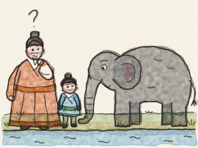
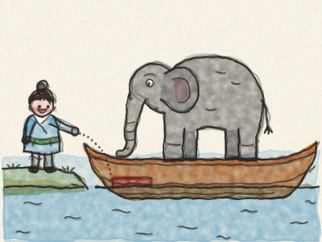

# Cao Chong pèse l’éléphant

Il y a très longtemps, en Chine, vivait un grand seigneur. Un jour, le roi d’un pays lointain lui envoya un cadeau : un énorme éléphant gris !

L’éléphant était grand comme une maison. Ses oreilles battaient comme des voiles, et ses pieds faisaient *Boum ! Boum ! Boum !*

« Combien pèse-t-il ? » se demanda le seigneur. « Je veux le savoir ! »

Mais il n’existait aucune balance assez grande pour un éléphant.

Les sages du seigneur se grattèrent la tête. « Construisons une balance géante ! » dit l’un. « Cela prendrait cent ans », soupira le seigneur. « Soulevons-le ! » dit un autre. Ils poussèrent, ils tirèrent. *Hmmmf !* L’éléphant ne bougea pas d’un poil.

Alors le fils du seigneur, le petit Cao Chong, s’avança. Il n’avait que six ans. « Père, je sais comment faire ! »

Tout le monde se mit à rire. Mais le seigneur dit : « Explique-nous, mon fils. »

Et toi, comment ferais-tu ? *(Faire une pause, et laisser Constance deviner.)*

« Mettons l’éléphant dans un bateau ! » dit Cao Chong. Alors l’éléphant monta dans un bateau, sur la rivière. *Plouf !* Le bateau s’enfonça dans l’eau, et Cao Chong traça une marque sur la coque, juste à la hauteur de l’eau.

Puis l’éléphant redescendit, et on remplit le bateau de pierres. Une pierre, deux pierres, des tas et des tas de pierres… jusqu’à ce que le bateau s’enfonce exactement jusqu’à la même marque.

« Maintenant, dit Cao Chong, les pierres pèsent autant que l’éléphant. Et les pierres sont petites : on peut les peser une par une, puis tout additionner ! »

Et c’est exactement ce qu’ils firent. Le seigneur sourit, très fier. « Un petit garçon, une grande idée ! »

> Pas besoin d’être grand pour avoir une grande idée. On s’arrête, on réfléchit, et on cherche une façon astucieuse !
