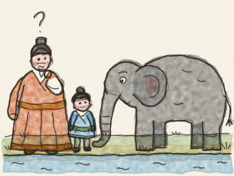
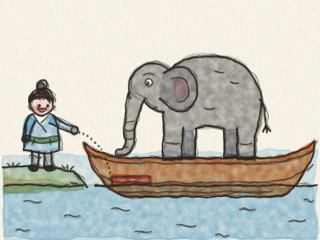

# Cao Chong pesa o elefante

Há muito, muito tempo, na China, vivia um grande senhor. Um dia, o rei de um país distante mandou-lhe um presente: um enorme elefante cinzento!

O elefante era alto como uma casa. As orelhas abanavam como velas, e as patas faziam *Bum! Bum! Bum!*

— Quanto pesará ele? — perguntou-se o senhor. — Quero saber!

Mas não havia nenhuma balança suficientemente grande para um elefante.

Os sábios do senhor coçaram a cabeça. — Vamos construir uma balança gigante! — disse um. — Isso levaria cem anos — suspirou o senhor. — Vamos levantá-lo! — disse outro. Empurraram e puxaram. *Hmmmf!* O elefante não se mexeu nem um bocadinho.

Então o filho do senhor, o pequeno Cao Chong, deu um passo em frente. Tinha só seis anos. — Pai, eu sei como fazer!

Toda a gente se riu. Mas o senhor disse: — Explica-nos, meu filho.

E tu, como farias? *(Fazer uma pausa e deixar a Constance adivinhar.)*

— Vamos pôr o elefante num barco! — disse Cao Chong. Então o elefante subiu para um barco, no rio. *Chape!* O barco desceu na água, e Cao Chong fez uma marca no casco, mesmo onde a água chegava.

Depois, o elefante saiu do barco, e encheram o barco de pedras. Uma pedra, duas pedras, montes e montes de pedras… até o barco descer exatamente até à mesma marca.

— Agora — disse Cao Chong — as pedras pesam tanto como o elefante. E as pedras são pequenas: podemos pesá-las uma a uma e depois somar tudo!

E foi mesmo isso que fizeram. O senhor sorriu, muito orgulhoso. — Um rapazinho com uma grande ideia!

> Não é preciso ser grande para ter uma grande ideia. Para, pensa e procura uma maneira esperta!
