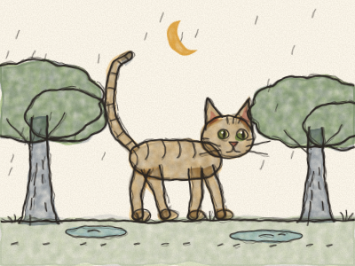
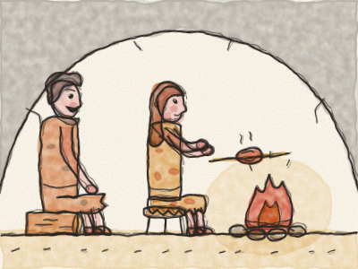
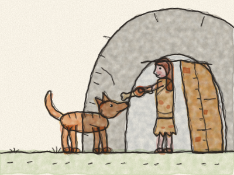
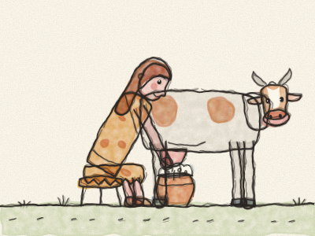
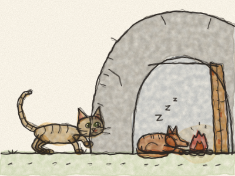
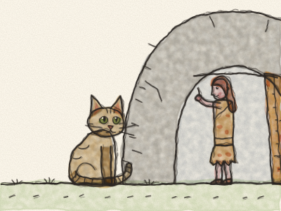
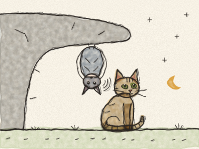
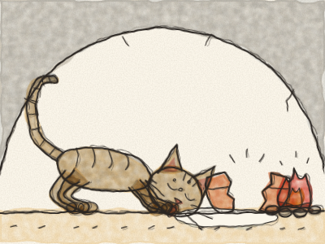

# The Cat that Walked by Himself

Listen, my Best Beloved, for this happened long, long ago, when all the animals were wild.

The Dog was wild, and the Horse was wild, and the Cow was wild. But the wildest of all the wild animals was the Cat. He walked by himself, and all places were alike to him.

The Man was wild too, until he met the Woman. She did not like living wild. She found a nice dry Cave to sleep in, and she lit a nice wood fire at the back of the Cave. She hung a curtain of skins over the door.

“Wipe your feet, dear, when you come in,” she said to the Man. “Now we will keep house.”

That evening, the Woman roasted some lamb on the fire, with wild garlic and wild pepper. *Sizzle, sizzle.* The Man ate it all up, and then he lay down by the fire and went to sleep. *Snore… snore…*

Out in the Wet Wild Woods, the wild animals gathered together. They could see the light of the fire, far away, and they wondered what it was.

Wild Dog lifted his nose. *Sniff, sniff.* “Something smells good,” he said. “I will go and see. Cat, come with me!”

“No!” said the Cat. “I am the Cat who walks by himself, and all places are alike to me. I will not come.”

But he followed Wild Dog very, very quietly, and hid where he could hear everything.

Wild Dog lifted the curtain with his nose. *Sniff, sniff.*

“Here comes the first wild thing out of the Wild Woods,” said the Woman. “What do you want?”

“What is this that smells so good?” asked Wild Dog.

The Woman picked up a roasted bone and gave it to him. “Taste it,” she said. Wild Dog gnawed the bone. *Crunch, crunch.* It was more delicious than anything he had ever tasted.

“Please, give me another,” said Wild Dog.

“If you help my Man to hunt by day, and guard this Cave by night,” said the Woman, “I will give you as many bones as you need.”

“Ah!” said the Cat, who was listening. “This is a very wise Woman. But she is not as wise as I am.”

So Wild Dog crawled into the Cave and laid his head on the Woman’s lap. “I will be your friend,” he said. And the Woman said, “His name is not Wild Dog any more. He is the First Friend.”

The next night, Wild Horse came stamping up to the Cave. *Clip-clop, clip-clop.* “Where is Wild Dog?” he asked.

“He is here, and he is the First Friend,” said the Woman, “but you have come for this nice fresh grass.” She held out a bundle of sweet, fresh grass, and a plaited halter. “Wear this, and you shall eat grass three times a day.”

Wild Horse bent his head. “I will be your servant, for the sake of the wonderful grass,” he said.

“Ah!” said the Cat, who was listening. “This is a clever Woman. But she is not as clever as I am.” And he walked back through the Wet Wild Woods, waving his wild tail.

The next night, Wild Cow came up to the Cave. *Moo!* She wanted the wonderful grass too. And she promised to give her warm white milk every single day in return. The Woman said, “Her name is the Giver of Good Food.”

The Cat listened, and he said the very same thing again. “This is a clever Woman. But she is not as clever as I am.”

And he walked by himself, as he always did, through the Wet Wild Woods. *Pad, pad, pad.*

The next day, the Cat came up to the Cave himself, to see what had happened. He peeped in. There was the Dog, dozing by the fire, and the smell of warm white milk.

“Where is Wild Dog? Where is Wild Horse? Where is Wild Cow?” asked the Cat.

The Woman laughed. “Wild thing out of the Wild Woods, go back to the woods again! We do not need any more friends or servants.”

“I am not a friend, and I am not a servant,” said the Cat. “I am the Cat who walks by himself, but I would like to come into your Cave.”

“Then why didn’t you come with First Friend on the very first night?” asked the Woman.

The Cat grew a little cross. Then he said, very sweetly, “Will you let me come in?”

The Woman was very clever. “You are neither a friend nor a servant,” she said. “But I will make a bargain with you. If ever I say one word in your praise, you may come into the Cave.”

“And if you say two words in my praise?” asked the Cat.

“I never shall,” said the Woman. “But if I do, you may sit by the fire.”

“And if you say three words?”

“I never shall. But if I do, you may drink the warm white milk, three times a day, for always and always.”

“Remember that!” said the Cat. And he walked away, waving his wild tail.

The Cat went far away and hid himself for a long time. But the little Bat, who hung upside down inside the Cave, flew out to tell him the news. *Flitter, flutter.*

“There is a Baby in the Cave,” said the Bat. “He is new and pink and fat and small, and the Woman loves him very much.”

“Ah,” said the Cat. “Then my time has come.”

The next evening, the Woman was very busy with her spinning, and the Baby cried and cried. *Waa! Waa!* She took him outside the Cave to calm him, and gave him a pebble to play with, but still he cried and kicked his little fat legs.

*(Pause. What do you think the Cat will do?)*

Out of the Woods came the Cat. He rubbed his soft fur against the Baby’s fat cheek. *Purr, purr.* He patted the Baby’s toes with his paw, and tickled him under the chin with his tail. And the Baby laughed and laughed. *Hee hee hee!*

“Thank you,” said the Woman. “Whoever you are, you are very clever!”

*Whoosh!* At that very moment, the curtain at the door of the Cave fell down, because it remembered the bargain. And the Cat walked in and sat down.

Then the Baby cried again. So the Cat purred, loud and low, *purrr… purrr…*, until the Baby fell fast asleep. “You are wonderful,” said the Woman. *Puff!* The fire smoked, for it remembered the bargain, and there was the Cat, sitting snug beside it.

Just then, a tiny mouse crept out of a corner. *Squeak!* “Oh!” cried the Woman, jumping up onto her stool. “A mouse!”

*Pounce!* The Cat chased the little mouse right out of the Cave.

“A hundred thanks,” said the Woman. “You are very quick, and very wise.” *Crack!* The milk pot split in two, for it remembered the bargain. And the Cat lapped up the warm white milk. *Lap, lap, lap.*

So the Cat came to live in the Cave. He was kind to the Baby, and he kept the mice away, and the Man and the Dog learned to be kind to him too.

But at night, when the moon comes up, he still goes out into the Wet Wild Woods, waving his wild tail and walking by his wild lone. For he is the Cat who walks by himself, and all places are alike to him.

> Everyone can find their own way to belong, even those who like to walk by themselves.
