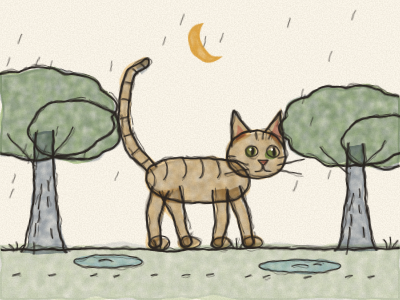
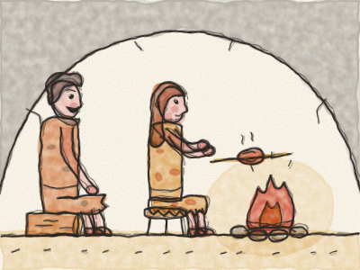
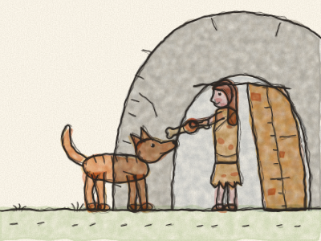
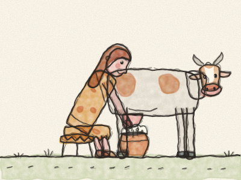
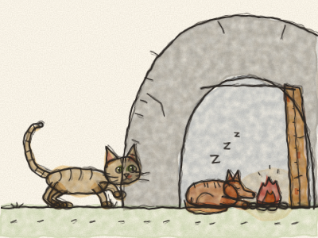
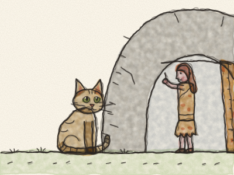
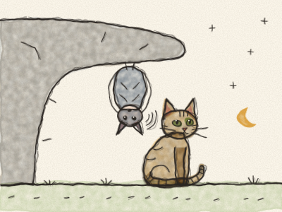
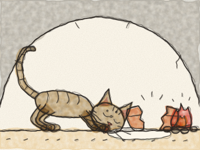

# Le Chat qui s’en allait tout seul

Écoute bien, mon trésor, car cela se passa il y a très, très longtemps, quand tous les animaux étaient sauvages.

Le Chien était sauvage, le Cheval était sauvage, et la Vache était sauvage. Mais le plus sauvage de tous les animaux sauvages, c’était le Chat. Il s’en allait tout seul, et tous les endroits se valaient pour lui.

L’Homme aussi était sauvage, jusqu’au jour où il rencontra la Femme. Elle, elle n’aimait pas vivre en sauvage. Elle trouva une jolie Caverne bien sèche pour dormir, et elle alluma un joli feu de bois au fond de la Caverne. Elle suspendit un rideau de peaux devant l’entrée.

« Essuie-toi les pieds, mon chéri, quand tu rentres, dit-elle à l’Homme. Maintenant, nous allons tenir une maison. »

Ce soir-là, la Femme fit rôtir de l’agneau sur le feu, avec de l’ail sauvage et du poivre sauvage. *Grésille, grésille.* L’Homme mangea tout, puis il se coucha près du feu et s’endormit. *Ronfle… ronfle…*

Dehors, dans les Bois Sauvages et Mouillés, les animaux sauvages se rassemblèrent. Ils voyaient la lumière du feu, tout là-bas, et ils se demandaient ce que c’était.

Le Chien Sauvage leva le nez. *Snif, snif.* « Ça sent bon, dit-il. Je vais aller voir. Chat, viens avec moi ! »

« Non ! dit le Chat. Je suis le Chat qui s’en va tout seul, et tous les endroits se valent pour moi. Je ne viendrai pas. »

Mais il suivit le Chien Sauvage tout doucement, tout doucement, et se cacha là où il pouvait tout entendre.

Le Chien Sauvage souleva le rideau avec son nez. *Snif, snif.*

« Voici la première bête sauvage sortie des Bois Sauvages, dit la Femme. Que veux-tu ? »

« Qu’est-ce qui sent si bon ? » demanda le Chien Sauvage.

La Femme prit un os rôti et le lui donna. « Goûte », dit-elle. Le Chien Sauvage rongea l’os. *Crunch, crunch.* C’était meilleur que tout ce qu’il avait jamais goûté.

« S’il te plaît, donne-m’en un autre », dit le Chien Sauvage.

« Si tu aides mon Homme à chasser le jour, et si tu gardes cette Caverne la nuit, dit la Femme, je te donnerai autant d’os qu’il t’en faut. »

« Ah ! dit le Chat, qui écoutait. Voilà une Femme très sage. Mais elle n’est pas aussi sage que moi. »

Alors le Chien Sauvage entra dans la Caverne en rampant et posa la tête sur les genoux de la Femme. « Je serai ton ami », dit-il. Et la Femme dit : « Il ne s’appelle plus Chien Sauvage. C’est le Premier Ami. »

La nuit suivante, le Cheval Sauvage arriva à la Caverne en tapant des sabots. *Cloc-cloc, cloc-cloc.* « Où est le Chien Sauvage ? » demanda-t-il.

« Il est ici, et c’est le Premier Ami, dit la Femme, mais toi, tu es venu pour cette bonne herbe fraîche. » Elle lui tendit une botte d’herbe douce et fraîche, et un licol tressé. « Porte ceci, et tu mangeras de l’herbe trois fois par jour. »

Le Cheval Sauvage baissa la tête. « Je serai ton serviteur, pour cette herbe merveilleuse », dit-il.

« Ah ! dit le Chat, qui écoutait. Voilà une Femme bien maligne. Mais elle n’est pas aussi maligne que moi. » Et il repartit à travers les Bois Sauvages et Mouillés, en agitant sa queue sauvage.

La nuit suivante, la Vache Sauvage vint à la Caverne. *Meuh !* Elle aussi voulait l’herbe merveilleuse. Et elle promit de donner son bon lait blanc et chaud chaque jour en échange. La Femme dit : « Elle s’appelle la Donneuse de Bonne Nourriture. »

Le Chat écouta, et il redit exactement la même chose. « Voilà une Femme bien maligne. Mais elle n’est pas aussi maligne que moi. »

Et il s’en alla tout seul, comme toujours, à travers les Bois Sauvages et Mouillés. *Pof, pof, pof.*

Le lendemain, le Chat vint lui-même à la Caverne, pour voir ce qui s’était passé. Il jeta un coup d’œil à l’intérieur. Il y avait le Chien, qui somnolait près du feu, et une odeur de bon lait blanc et chaud.

« Où est le Chien Sauvage ? Où est le Cheval Sauvage ? Où est la Vache Sauvage ? » demanda le Chat.

La Femme se mit à rire. « Bête sauvage des Bois Sauvages, retourne dans les bois ! Nous n’avons plus besoin d’amis ni de serviteurs. »

« Je ne suis pas un ami, et je ne suis pas un serviteur, dit le Chat. Je suis le Chat qui s’en va tout seul, mais j’aimerais bien entrer dans ta Caverne. »

« Alors pourquoi n’es-tu pas venu avec le Premier Ami, la toute première nuit ? » demanda la Femme.

Le Chat se fâcha un petit peu. Puis il dit, très gentiment : « Veux-tu bien me laisser entrer ? »

La Femme était très maligne. « Tu n’es ni un ami ni un serviteur, dit-elle. Mais je vais faire un marché avec toi. Si jamais je dis un seul mot pour te féliciter, tu pourras entrer dans la Caverne. »

« Et si tu dis deux mots pour me féliciter ? » demanda le Chat.

« Je ne le ferai jamais, dit la Femme. Mais si je le fais, tu pourras t’asseoir près du feu. »

« Et si tu dis trois mots ? »

« Je ne le ferai jamais. Mais si je le fais, tu pourras boire le bon lait blanc et chaud, trois fois par jour, pour toujours et à jamais. »

« Souviens-t’en ! » dit le Chat. Et il s’en alla, en agitant sa queue sauvage.

Le Chat partit très loin et se cacha longtemps. Mais la petite Chauve-Souris, qui dormait la tête en bas dans la Caverne, vint lui raconter les nouvelles. *Frrt, frrt.*

« Il y a un Bébé dans la Caverne, dit la Chauve-Souris. Il est tout neuf, tout rose, tout rond et tout petit, et la Femme l’aime très fort. »

« Ah, dit le Chat. Alors mon heure est venue. »

Le soir suivant, la Femme était très occupée à filer, et le Bébé pleurait, pleurait. *Ouin ! Ouin !* Elle l’emmena dehors pour le calmer, et lui donna un caillou pour jouer, mais il pleurait toujours en agitant ses petites jambes potelées.

*(Pause. À ton avis, que va faire le Chat ?)*

Le Chat sortit des Bois. Il frotta sa fourrure toute douce contre la joue ronde du Bébé. *Ronron, ronron.* Il tapota les orteils du Bébé avec sa patte, et lui chatouilla le menton avec sa queue. Et le Bébé rit, rit et rit. *Hi hi hi !*

« Merci, dit la Femme. Qui que tu sois, tu es très habile ! »

*Vlouf !* Au même instant, le rideau de l’entrée de la Caverne tomba, parce qu’il se souvenait du marché. Et le Chat entra et s’assit.

Puis le Bébé se remit à pleurer. Alors le Chat ronronna, fort et doux, *rrronron… rrronron…*, jusqu’à ce que le Bébé s’endorme profondément. « Tu es merveilleux », dit la Femme. *Pouf !* Le feu fuma, parce qu’il se souvenait du marché, et voilà le Chat bien installé tout près de lui.

Juste à ce moment, une toute petite souris sortit d’un coin. *Couic !* « Oh ! s’écria la Femme en sautant sur son tabouret. Une souris ! »

*Hop !* Le Chat chassa la petite souris hors de la Caverne.

« Mille mercis, dit la Femme. Tu es très rapide, et très sage. » *Crac !* Le pot de lait se fendit en deux, parce qu’il se souvenait du marché. Et le Chat lapa le bon lait blanc et chaud. *Lap, lap, lap.*

Ainsi le Chat vint vivre dans la Caverne. Il était gentil avec le Bébé, il chassait les souris, et l’Homme et le Chien apprirent à être gentils avec lui aussi.

Mais la nuit, quand la lune se lève, il s’en va encore dans les Bois Sauvages et Mouillés, en agitant sa queue sauvage, tout seul, à sa façon. Car il est le Chat qui s’en va tout seul, et tous les endroits se valent pour lui.

> Chacun peut trouver sa place à sa manière, même ceux qui aiment s’en aller tout seuls.
