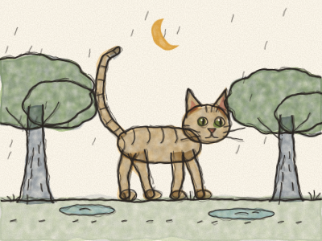
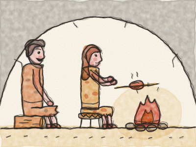
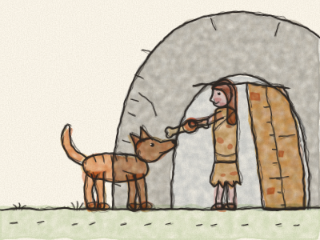
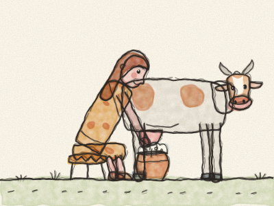
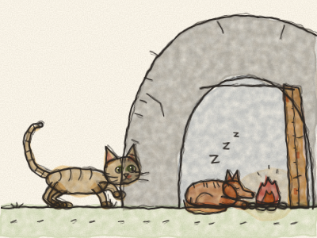
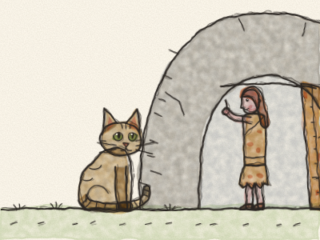
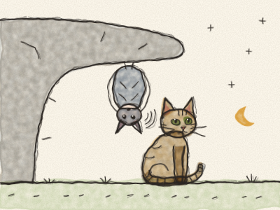
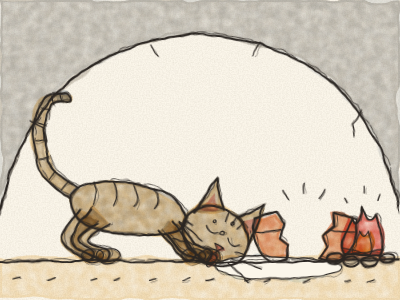

# O Gato que Andava Sozinho

Ouve bem, meu amor, porque isto aconteceu há muito, muito tempo, quando todos os animais eram selvagens.

O Cão era selvagem, o Cavalo era selvagem e a Vaca era selvagem. Mas o mais selvagem de todos os animais selvagens era o Gato. Andava sozinho, e todos os sítios eram iguais para ele.

O Homem também era selvagem, até ao dia em que conheceu a Mulher. Ela não gostava de viver como os selvagens. Encontrou uma Gruta seca e bonita para dormir, e acendeu uma bela fogueira ao fundo da Gruta. Pendurou uma cortina de peles à entrada.

— Limpa os pés quando entrares, querido — disse ela ao Homem. — Agora vamos ter uma casa.

Nessa noite, a Mulher assou borrego na fogueira, com alho selvagem e pimenta selvagem. *Chia, chia.* O Homem comeu tudo, depois deitou-se ao pé do fogo e adormeceu. *Ronc… ronc…*

Lá fora, nos Bosques Selvagens e Molhados, os animais selvagens juntaram-se. Viam a luz da fogueira, ao longe, e perguntavam-se o que seria.

O Cão Selvagem levantou o focinho. *Snif, snif.* — Cheira bem — disse ele. — Vou ver o que é. Gato, anda comigo!

— Não! — disse o Gato. — Eu sou o Gato que anda sozinho, e todos os sítios são iguais para mim. Não vou.

Mas seguiu o Cão Selvagem muito, muito devagarinho, e escondeu-se num sítio onde conseguia ouvir tudo.

O Cão Selvagem levantou a cortina com o focinho. *Snif, snif.*

— Aqui vem o primeiro bicho selvagem dos Bosques Selvagens — disse a Mulher. — O que queres?

— O que é isto que cheira tão bem? — perguntou o Cão Selvagem.

A Mulher pegou num osso assado e deu-lho. — Prova — disse ela. O Cão Selvagem roeu o osso. *Crunch, crunch.* Era mais delicioso do que tudo o que alguma vez tinha provado.

— Por favor, dá-me outro — disse o Cão Selvagem.

— Se ajudares o meu Homem a caçar de dia, e guardares esta Gruta de noite — disse a Mulher —, dou-te todos os ossos de que precisares.

— Ah! — disse o Gato, que estava a ouvir. — Esta Mulher é muito sábia. Mas não é tão sábia como eu.

Então o Cão Selvagem entrou na Gruta, de rastos, e pousou a cabeça no colo da Mulher. — Vou ser teu amigo — disse ele. E a Mulher disse: — Já não se chama Cão Selvagem. É o Primeiro Amigo.

Na noite seguinte, o Cavalo Selvagem chegou à Gruta a bater com os cascos. *Clop-clop, clop-clop.* — Onde está o Cão Selvagem? — perguntou.

— Está aqui, e é o Primeiro Amigo — disse a Mulher —, mas tu vieste por causa desta erva fresquinha. — E estendeu-lhe um molho de erva doce e fresca, e um cabresto entrançado. — Usa isto, e comerás erva três vezes por dia.

O Cavalo Selvagem baixou a cabeça. — Vou ser teu servo, por causa desta erva maravilhosa — disse ele.

— Ah! — disse o Gato, que estava a ouvir. — Esta Mulher é esperta. Mas não é tão esperta como eu. — E voltou pelos Bosques Selvagens e Molhados, a abanar a sua cauda selvagem.

Na noite seguinte, a Vaca Selvagem veio até à Gruta. *Muuu!* Também ela queria a erva maravilhosa. E prometeu dar o seu leite branco e quentinho todos os dias, em troca. A Mulher disse: — Chama-se a Dadora de Boa Comida.

O Gato ouviu, e voltou a dizer exatamente a mesma coisa. — Esta Mulher é esperta. Mas não é tão esperta como eu.

E foi-se embora sozinho, como sempre, pelos Bosques Selvagens e Molhados. *Pum, pum, pum.*

No dia seguinte, o Gato foi ele próprio à Gruta, para ver o que se tinha passado. Espreitou lá para dentro. Lá estava o Cão, a dormitar ao pé do fogo, e um cheirinho a leite branco e quentinho.

— Onde está o Cão Selvagem? Onde está o Cavalo Selvagem? Onde está a Vaca Selvagem? — perguntou o Gato.

A Mulher riu-se. — Bicho selvagem dos Bosques Selvagens, volta para os bosques! Já não precisamos de mais amigos nem de mais servos.

— Eu não sou amigo, e não sou servo — disse o Gato. — Sou o Gato que anda sozinho, mas gostava de entrar na tua Gruta.

— Então porque é que não vieste com o Primeiro Amigo, logo na primeira noite? — perguntou a Mulher.

O Gato ficou um bocadinho zangado. Depois disse, com muita doçura: — Deixas-me entrar?

A Mulher era muito esperta. — Tu não és amigo nem servo — disse ela. — Mas vou fazer um acordo contigo. Se alguma vez eu disser uma palavra a elogiar-te, podes entrar na Gruta.

— E se disseres duas palavras a elogiar-me? — perguntou o Gato.

— Nunca hei de dizer — respondeu a Mulher. — Mas, se disser, podes sentar-te ao pé do fogo.

— E se disseres três?

— Nunca hei de dizer. Mas, se disser, podes beber o leite branco e quentinho, três vezes por dia, para todo o sempre.

— Não te esqueças! — disse o Gato. E foi-se embora, a abanar a sua cauda selvagem.

O Gato foi para muito longe e escondeu-se durante muito tempo. Mas o pequeno Morcego, que dormia de cabeça para baixo dentro da Gruta, foi contar-lhe as novidades. *Fla, fla.*

— Há um Bebé na Gruta — disse o Morcego. — É novinho, cor-de-rosa, gorducho e pequenino, e a Mulher gosta muito dele.

— Ah — disse o Gato. — Então chegou a minha vez.

Na noite seguinte, a Mulher estava muito ocupada a fiar, e o Bebé chorava sem parar. *Uá! Uá!* Ela levou-o para fora da Gruta para o acalmar, e deu-lhe uma pedrinha para brincar, mas ele continuava a chorar e a dar pontapés com as perninhas gorduchas.

*(Pausa. O que achas que o Gato vai fazer?)*

Do Bosque saiu o Gato. Esfregou o seu pelo macio na bochecha gorducha do Bebé. *Rom-rom, rom-rom.* Tocou nos dedos dos pés do Bebé com a pata, e fez-lhe cócegas debaixo do queixo com a cauda. E o Bebé riu-se, riu-se, riu-se. *Hi hi hi!*

— Obrigada — disse a Mulher. — Sejas quem fores, és muito habilidoso!

*Zás!* Nesse mesmo instante, a cortina da entrada da Gruta caiu, porque se lembrava do acordo. E o Gato entrou e sentou-se.

Depois o Bebé voltou a chorar. Então o Gato ronronou, forte e baixinho, *rrrom… rrrom…*, até o Bebé adormecer profundamente. — És maravilhoso — disse a Mulher. *Puf!* O fogo deitou fumo, porque se lembrava do acordo, e lá estava o Gato, todo aconchegado ao pé dele.

Mesmo nessa altura, um ratinho pequenino saiu de um canto. *Quim!* — Ai! — gritou a Mulher, a saltar para cima do banquinho. — Um rato!

*Zás!* O Gato correu atrás do ratinho até ele sair da Gruta.

— Muito obrigada — disse a Mulher. — És muito rápido, e muito sábio. — *Crac!* O pote do leite partiu-se ao meio, porque se lembrava do acordo. E o Gato lambeu o leite branco e quentinho. *Lap, lap, lap.*

Foi assim que o Gato veio viver para a Gruta. Era meigo com o Bebé, afastava os ratos, e o Homem e o Cão aprenderam a ser meigos com ele também.

Mas à noite, quando a lua nasce, ele ainda sai para os Bosques Selvagens e Molhados, a abanar a sua cauda selvagem, sozinho, à sua maneira. Porque ele é o Gato que anda sozinho, e todos os sítios são iguais para ele.

> Cada um pode encontrar o seu lugar à sua maneira, mesmo quem gosta de andar sozinho.
