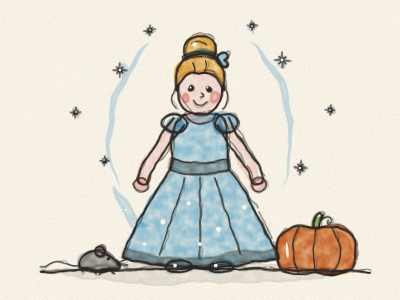
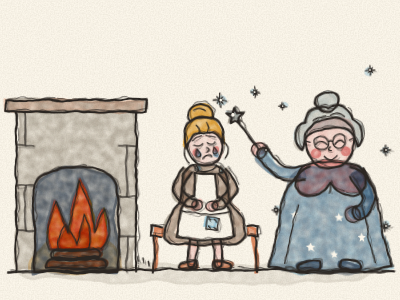
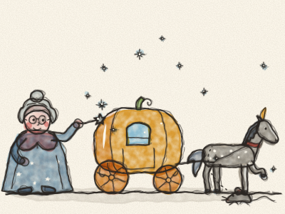
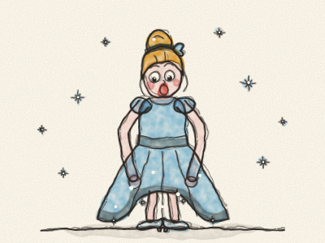
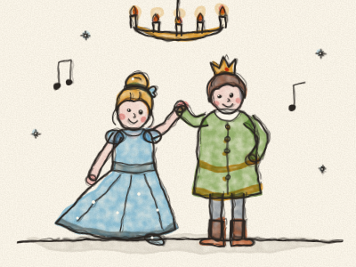
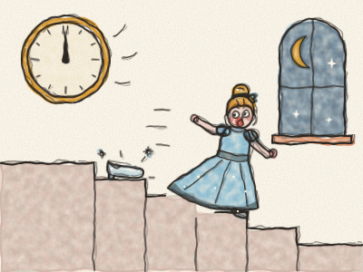
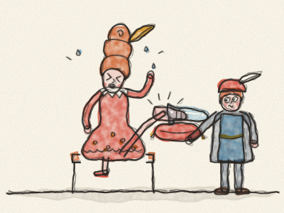
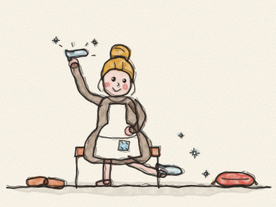

# Cinderella

Once upon a time, there was a kind and gentle girl who lived with her father in a big house. Her mother had died when she was little, and after a while, her father married again. Her new stepmother had two daughters, and oh, they were proud, and bossy, and unkind!

The stepmother gave the girl all the hardest work in the house. She scrubbed the floors, she washed the dishes, she carried the wood and polished the stairs. At night, when her work was done, she sat in the corner by the fireplace, among the warm grey cinders. So her stepsisters laughed at her and called her Cinderella.

But Cinderella never grumbled. She sang as she worked, and the little mice came out to keep her company. *Squeak, squeak!*

One day, a letter came from the palace. The King’s son was giving a grand ball, and every young lady in the land was invited!

The two stepsisters were thrilled. “I shall wear my red velvet dress!” said the elder one. “And I shall wear my golden cloak, with diamonds in my hair!” said the younger one.

For days and days, they talked of nothing else. Cinderella ironed their dresses and sewed on their ribbons. On the evening of the ball, she even did their hair, beautifully, because she was kind.

“Cinderella,” said the elder sister, “wouldn’t you like to go to the ball?”

“Oh, I would love to,” said Cinderella softly.

“Ha! Ha! Ha!” laughed the sisters. “Cinderella at the ball! In her dusty old apron! Everyone would laugh!”

Then off they went in their carriage. *Clip-clop, clip-clop.* Cinderella watched them go until she could not see them any more. Then she sat down by the fire, all alone, and she began to cry.

“What’s the matter, my dear?” said a gentle voice.

Cinderella looked up. There stood a little old lady, with twinkly eyes and a long silver wand. It was her fairy godmother!

“I wish… I wish I could…” sobbed Cinderella.

“You wish you could go to the ball. Is that it?”

“Yes,” sighed Cinderella.

“Well,” said her fairy godmother, “you are a good girl, and you shall go! Now dry your tears, run to the garden, and bring me a pumpkin. The biggest one you can find.”

Cinderella ran and brought back the biggest, roundest, orangest pumpkin in the garden. The fairy godmother scooped it out until only the skin was left. Then she touched it with her wand. *Ting!* At once, the pumpkin grew, and grew, and turned into a beautiful golden coach!

Then she looked in the mousetrap, where six little mice were running about. She opened the little door, and as each mouse came out, *ting, ting, ting*, it turned into a fine grey horse with a long flowing mane.

“Now we need a coachman,” said the fairy godmother. Cinderella brought a big rat with fine whiskers. *Ting!* He became a jolly coachman with an enormous moustache. And six green lizards from behind the watering can became six footmen in green coats.

“There!” said the fairy godmother. “Now you can go to the ball.”

“But… in these old clothes?” said Cinderella.

The fairy godmother smiled, and touched her with the wand. *Ting!* At once, her dusty apron became a gown of silver and blue, shining like the night sky full of stars. And on her feet was a pair of little slippers made of glass, the prettiest in the whole world.

“Off you go,” said the fairy godmother. “But remember: you must be home before midnight. When the clock strikes twelve, the magic will stop. The coach will be a pumpkin again, the horses will be mice, and your gown will be your old apron.”

“I promise,” said Cinderella. And away she went. *Clip-clop, clip-clop!*

When Cinderella came into the palace, everybody stopped and stared. The music stopped. The dancing stopped. “Who is she?” they whispered. “What a beautiful princess!” Even her stepsisters did not know her.

The prince came straight to her, bowed, and asked her to dance. And they danced, and danced, all evening long. The prince would not dance with anybody else.

Cinderella even went to sit beside her stepsisters, and shared with them the oranges and lemons that the prince had given her. They were very surprised that the beautiful princess was so kind to them. And still, they did not know her!

Cinderella was so happy that she forgot all about the time.

*Dong!* The great clock began to strike midnight. *Dong! Dong!*

“Oh no!” cried Cinderella. She ran out of the ballroom, as fast as she could. *Dong! Dong! Dong!* The prince ran after her. Down the great staircase she flew. *Dong! Dong! Dong!* And on the way, one of her glass slippers slipped off, and she had no time to pick it up.

*Dong! Dong! Dong!* On the twelfth stroke, her gown turned back into her dusty apron. Her coach was gone, and in its place lay a pumpkin, with six mice, a rat and six lizards scampering away.

The prince reached the bottom of the stairs. He saw nobody there, only a poor girl in an apron, running home in the dark. But on the steps, shining in the moonlight, lay a little glass slipper.

The next morning, the prince held up the little glass slipper. “I will marry the girl whose foot fits this slipper,” he said. “Nobody else!”

So the prince’s messenger went from house to house, carrying the slipper on a velvet cushion. Princesses tried it on. Duchesses tried it on. But nobody’s foot would fit. It was far too small.

At last, he came to Cinderella’s house. The elder stepsister pushed, and squeezed, and wriggled. *Hnnngh!* Her foot was much too big. The younger stepsister pushed, and squeezed, and wriggled. *Hnnngh!* Her foot was much too big too.

“Is there nobody else in this house?” asked the messenger.

“Only Cinderella,” laughed the sisters. “But she wasn’t at the ball!”

“Every girl must try,” said the messenger. So Cinderella sat down on a little stool, and he slipped the glass slipper onto her foot. *Slip!* It fitted perfectly, like a glove.

The stepsisters gasped. And then Cinderella took something out of her apron pocket: the other glass slipper! She put that one on, too.

*Ting!* There was the fairy godmother again. She touched Cinderella with her wand, and once more the dusty apron turned into a gown, even more beautiful than before.

Now, at last, the stepsisters knew her. It was the beautiful princess from the ball! They were so ashamed that they did not know where to look.

The stepsisters fell on their knees. “Oh, Cinderella, we were so unkind to you! Please, please forgive us!”

Cinderella lifted them up and hugged them both. “I forgive you with all my heart,” she said. “And I hope you will love me always.”

The prince took Cinderella to the palace, and soon there was a wedding, with music and flowers and cake. Cinderella did not forget her stepsisters. She asked them to come and live at the palace too, and they were never unkind again. As for the fairy godmother, she danced at the wedding all night long, and nobody minded when the clock struck twelve. And they all lived happily ever after.

> Being kind is the most beautiful gown of all.
