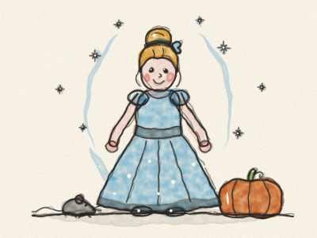
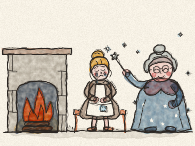
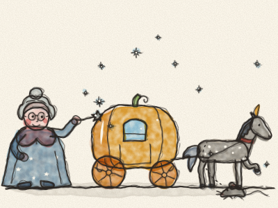
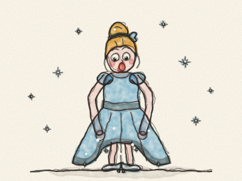
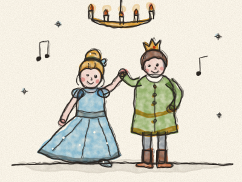
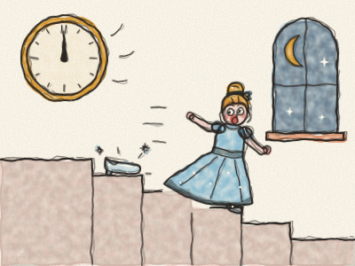
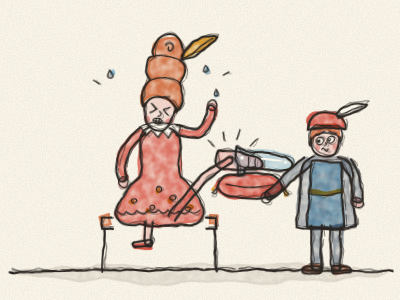
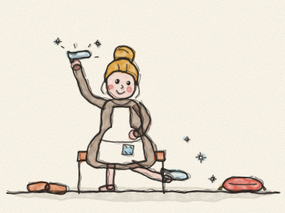

# Cendrillon

Il était une fois une jeune fille douce et gentille qui vivait avec son père dans une grande maison. Sa maman était morte quand elle était petite, et quelque temps après, son père se remaria. Sa nouvelle belle-mère avait deux filles, et oh là là, qu’elles étaient fières, et autoritaires, et méchantes !

La belle-mère donnait à la jeune fille tous les travaux les plus durs de la maison. Elle frottait les planchers, elle lavait la vaisselle, elle portait le bois et cirait les escaliers. Le soir, quand son travail était fini, elle s’asseyait dans un coin, près de la cheminée, dans les cendres tièdes et grises. Alors ses demi-sœurs se moquaient d’elle et l’appelaient Cendrillon.

Mais Cendrillon ne se plaignait jamais. Elle chantait en travaillant, et les petites souris sortaient pour lui tenir compagnie. *Couic, couic !*

Un jour, une lettre arriva du palais. Le fils du Roi donnait un grand bal, et toutes les jeunes filles du pays étaient invitées !

Les deux demi-sœurs étaient folles de joie. « Moi, je mettrai ma robe de velours rouge ! » dit l’aînée. « Et moi, je mettrai mon manteau doré, avec des diamants dans les cheveux ! » dit la cadette.

Pendant des jours et des jours, elles ne parlèrent que de ça. Cendrillon repassa leurs robes et cousit leurs rubans. Le soir du bal, elle les coiffa même, à merveille, parce qu’elle était gentille.

« Cendrillon, » dit l’aînée, « tu n’aimerais pas aller au bal, toi ? »

« Oh si, j’aimerais tant, » dit doucement Cendrillon.

« Ha ! Ha ! Ha ! » rirent les sœurs. « Cendrillon au bal ! Avec son vieux tablier plein de poussière ! Tout le monde rirait ! »

Puis elles partirent dans leur carrosse. *Clip-clop, clip-clop.* Cendrillon les regarda s’éloigner jusqu’à ne plus les voir. Alors elle s’assit près du feu, toute seule, et elle se mit à pleurer.

« Qu’as-tu donc, ma chérie ? » dit une voix très douce.

Cendrillon leva les yeux. Devant elle se tenait une petite vieille dame, avec des yeux pétillants et une longue baguette d’argent. C’était sa marraine, qui était une fée !

« Je voudrais bien… je voudrais bien… » sanglota Cendrillon.

« Tu voudrais bien aller au bal, c’est ça ? »

« Oui, » soupira Cendrillon.

« Eh bien, » dit sa marraine, « tu es une bonne fille, et tu iras ! Sèche tes larmes, cours au jardin, et rapporte-moi une citrouille. La plus grosse que tu trouveras. »

Cendrillon courut et rapporta la citrouille la plus grosse, la plus ronde et la plus orange du jardin. Sa marraine la creusa jusqu’à ce qu’il ne reste plus que l’écorce. Puis elle la toucha de sa baguette. *Ting !* Aussitôt, la citrouille grandit, grandit, et devint un magnifique carrosse doré !

Ensuite, elle regarda dans la souricière, où six petites souris couraient en tous sens. Elle ouvrit la petite porte, et chaque souris qui sortait, *ting, ting, ting*, devenait un beau cheval gris à la longue crinière.

« Maintenant, il nous faut un cocher, » dit la marraine. Cendrillon apporta un gros rat aux belles moustaches. *Ting !* Il devint un joyeux cocher avec une énorme moustache. Et six lézards verts, cachés derrière l’arrosoir, devinrent six laquais en habits verts.

« Voilà ! » dit la marraine. « Maintenant, tu peux aller au bal. »

« Mais… avec ces vieux habits ? » dit Cendrillon.

La marraine sourit, et la toucha de sa baguette. *Ting !* Aussitôt, son tablier poussiéreux devint une robe d’argent et de bleu, qui brillait comme un ciel de nuit plein d’étoiles. Et à ses pieds, il y avait une paire de petites pantoufles de verre, les plus jolies du monde.

« Va, maintenant, » dit la marraine. « Mais souviens-toi : tu dois rentrer avant minuit. Quand l’horloge sonnera les douze coups, la magie s’arrêtera. Le carrosse redeviendra citrouille, les chevaux redeviendront souris, et ta robe redeviendra ton vieux tablier. »

« Je te le promets, » dit Cendrillon. Et elle partit. *Clip-clop, clip-clop !*

Quand Cendrillon entra dans le palais, tout le monde s’arrêta pour la regarder. La musique s’arrêta. Les danses s’arrêtèrent. « Qui est-ce ? » chuchotait-on. « Quelle belle princesse ! » Même ses demi-sœurs ne la reconnurent pas.

Le prince vint tout droit vers elle, s’inclina, et l’invita à danser. Et ils dansèrent, et dansèrent, toute la soirée. Le prince ne voulut danser avec personne d’autre.

Cendrillon alla même s’asseoir à côté de ses demi-sœurs, et partagea avec elles les oranges et les citrons que le prince lui avait donnés. Elles étaient très étonnées que la belle princesse soit si gentille avec elles. Et elles ne la reconnaissaient toujours pas !

Cendrillon était si heureuse qu’elle en oublia l’heure.

*Dong !* La grande horloge se mit à sonner minuit. *Dong ! Dong !*

« Oh non ! » s’écria Cendrillon. Elle sortit de la salle de bal en courant, aussi vite qu’elle put. *Dong ! Dong ! Dong !* Le prince courut derrière elle. Elle dévala le grand escalier. *Dong ! Dong ! Dong !* Et en chemin, une de ses pantoufles de verre glissa de son pied, et elle n’eut pas le temps de la ramasser.

*Dong ! Dong ! Dong !* Au douzième coup, sa robe redevint son tablier poussiéreux. Son carrosse avait disparu, et à sa place il y avait une citrouille, avec six souris, un rat et six lézards qui détalaient.

Le prince arriva en bas de l’escalier. Il ne vit personne, seulement une pauvre fille en tablier qui rentrait chez elle en courant dans la nuit. Mais sur les marches, brillant au clair de lune, il y avait une petite pantoufle de verre.

Le lendemain matin, le prince montra la petite pantoufle de verre. « J’épouserai la jeune fille à qui cette pantoufle ira, » dit-il. « Et personne d’autre ! »

Alors le messager du prince alla de maison en maison, avec la pantoufle posée sur un coussin de velours. Les princesses l’essayèrent. Les duchesses l’essayèrent. Mais elle n’allait à personne. Elle était bien trop petite.

Enfin, il arriva chez Cendrillon. L’aînée des demi-sœurs poussa, et serra, et se tortilla. *Hmmmpf !* Son pied était bien trop grand. La cadette poussa, et serra, et se tortilla. *Hmmmpf !* Son pied était bien trop grand, lui aussi.

« N’y a-t-il personne d’autre dans cette maison ? » demanda le messager.

« Il n’y a que Cendrillon, » rirent les sœurs. « Mais elle n’était pas au bal ! »

« Toutes les jeunes filles doivent l’essayer, » dit le messager. Alors Cendrillon s’assit sur un petit tabouret, et il lui glissa la pantoufle de verre au pied. *Hop !* Elle lui allait parfaitement, comme un gant.

Les demi-sœurs en restèrent bouche bée. Et puis Cendrillon sortit quelque chose de la poche de son tablier : l’autre pantoufle de verre ! Elle la mit aussi.

*Ting !* Voilà que la marraine était de retour. Elle toucha Cendrillon de sa baguette, et une fois encore le tablier poussiéreux devint une robe, plus belle encore que la première.

Alors, enfin, les demi-sœurs la reconnurent. C’était la belle princesse du bal ! Elles avaient tellement honte qu’elles ne savaient plus où se mettre.

Les demi-sœurs tombèrent à genoux. « Oh, Cendrillon, nous avons été si méchantes avec toi ! Pardonne-nous, s’il te plaît ! »

Cendrillon les releva et les serra toutes les deux dans ses bras. « Je vous pardonne de tout mon cœur, » dit-elle. « Et j’espère que vous m’aimerez toujours. »

Le prince emmena Cendrillon au palais, et bientôt il y eut un mariage, avec de la musique, des fleurs et du gâteau. Cendrillon n’oublia pas ses demi-sœurs. Elle leur demanda de venir vivre au palais, elles aussi, et elles ne furent plus jamais méchantes. Quant à la marraine, elle dansa au mariage toute la nuit, et personne ne s’inquiéta quand l’horloge sonna les douze coups. Et ils vécurent tous heureux pour toujours.

> La gentillesse est la plus belle des robes.
