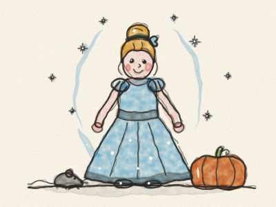
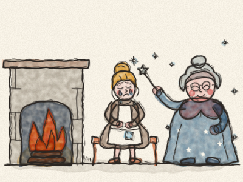
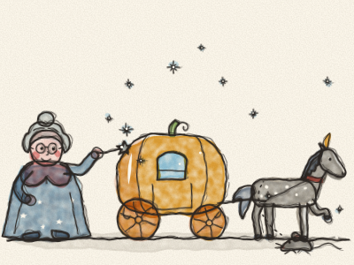
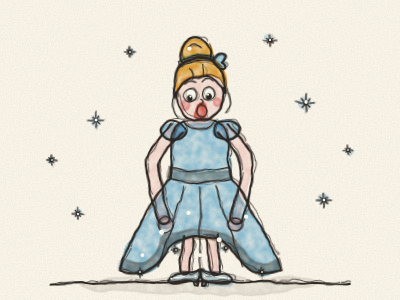
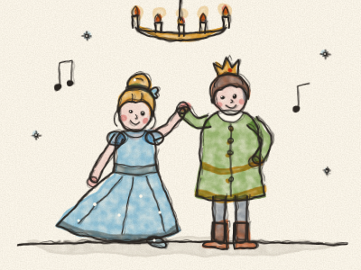
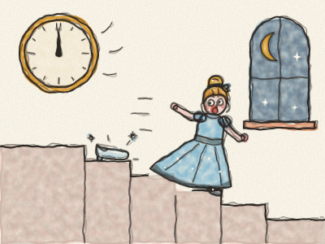
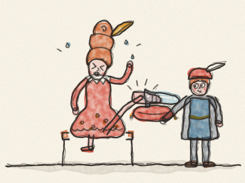
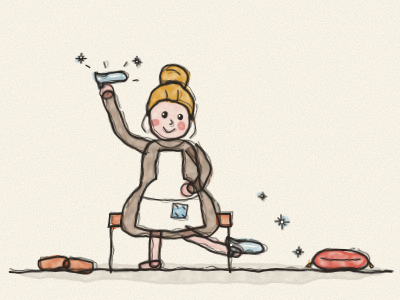

# A Gata Borralheira

Era uma vez uma menina meiga e bondosa que vivia com o pai numa casa grande. A mãe tinha morrido quando ela era pequenina e, passado algum tempo, o pai voltou a casar. A nova madrasta tinha duas filhas, e ai, como eram vaidosas, e mandonas, e más!

A madrasta dava à menina os trabalhos mais pesados da casa. Ela esfregava o chão, lavava a loiça, carregava a lenha e encerava as escadas. À noite, quando acabava o trabalho, sentava-se a um canto, junto à lareira, no meio do borralho morno e cinzento. Por isso, as meias-irmãs troçavam dela e chamavam-lhe Gata Borralheira.

Mas a Gata Borralheira nunca se queixava. Cantava enquanto trabalhava, e os ratinhos vinham fazer-lhe companhia. *Chi, chi!*

Um dia, chegou uma carta do palácio. O filho do Rei ia dar um grande baile, e todas as meninas do reino estavam convidadas!

As duas meias-irmãs ficaram doidas de alegria. — Eu vou levar o meu vestido de veludo vermelho! — disse a mais velha. — E eu vou levar a minha capa dourada, com diamantes no cabelo! — disse a mais nova.

Durante dias e dias, não falaram de outra coisa. A Gata Borralheira passou-lhes os vestidos a ferro e coseu-lhes as fitas. Na noite do baile, até as penteou, lindamente, porque era bondosa.

— Gata Borralheira — disse a irmã mais velha —, não gostavas de ir ao baile?

— Ai, gostava tanto — disse a Gata Borralheira, baixinho.

— Ah! Ah! Ah! — riram-se as irmãs. — A Gata Borralheira no baile! Com o avental velho e cheio de pó! Toda a gente se ia rir!

Depois partiram na carruagem. *Cloc-cloc, cloc-cloc.* A Gata Borralheira ficou a vê-las até deixar de as ver. Então sentou-se ao pé do lume, sozinha, e começou a chorar.

— Que tens tu, minha querida? — disse uma voz muito doce.

A Gata Borralheira levantou os olhos. À frente dela estava uma velhinha pequenina, de olhos a brilhar e com uma varinha de prata comprida. Era a sua fada madrinha!

— Eu queria… eu queria tanto… — soluçou a Gata Borralheira.

— Querias ir ao baile. É isso?

— É — suspirou a Gata Borralheira.

— Pois bem — disse a fada madrinha —, tu és uma boa menina, e vais ao baile! Agora limpa essas lágrimas, corre ao quintal e traz-me uma abóbora. A maior que encontrares.

A Gata Borralheira foi a correr e trouxe a abóbora maior, mais redonda e mais cor de laranja do quintal. A fada madrinha escavou-a até só ficar a casca. Depois tocou-lhe com a varinha. *Tlim!* Logo a abóbora cresceu, e cresceu, e transformou-se numa linda carruagem dourada!

A seguir, espreitou para a ratoeira, onde seis ratinhos corriam de um lado para o outro. Abriu a portinha e, à medida que cada ratinho saía, *tlim, tlim, tlim*, transformava-se num belo cavalo cinzento de crina comprida.

— Agora precisamos de um cocheiro — disse a fada madrinha. A Gata Borralheira trouxe uma ratazana com uns bigodes muito bonitos. *Tlim!* Transformou-se num cocheiro bem-disposto, com um bigode enorme. E seis lagartixas verdes, escondidas atrás do regador, transformaram-se em seis lacaios de casaca verde.

— Pronto! — disse a fada madrinha. — Agora já podes ir ao baile.

— Mas… com esta roupa velha? — disse a Gata Borralheira.

A fada madrinha sorriu e tocou-lhe com a varinha. *Tlim!* Logo o avental cheio de pó se transformou num vestido prateado e azul, que brilhava como um céu de noite cheio de estrelas. E nos pés tinha um par de sapatinhos de cristal, os mais bonitos do mundo inteiro.

— Vai lá — disse a fada madrinha. — Mas lembra-te: tens de estar em casa antes da meia-noite. Quando o relógio der as doze badaladas, a magia acaba. A carruagem volta a ser abóbora, os cavalos voltam a ser ratinhos, e o teu vestido volta a ser o avental velho.

— Prometo — disse a Gata Borralheira. E lá foi ela. *Cloc-cloc, cloc-cloc!*

Quando a Gata Borralheira entrou no palácio, toda a gente parou para olhar. A música parou. As danças pararam. — Quem será? — sussurravam. — Que princesa tão bonita! — Nem as meias-irmãs a reconheceram.

O príncipe foi direitinho ter com ela, fez uma vénia e convidou-a para dançar. E dançaram, e dançaram, a noite inteira. O príncipe não quis dançar com mais ninguém.

A Gata Borralheira até se foi sentar ao lado das meias-irmãs, e repartiu com elas as laranjas e os limões que o príncipe lhe tinha dado. Elas ficaram muito admiradas por a bela princesa ser tão simpática com elas. E continuavam sem a reconhecer!

A Gata Borralheira estava tão feliz que se esqueceu das horas.

*Dlão!* O grande relógio começou a dar a meia-noite. *Dlão! Dlão!*

— Ai não! — gritou a Gata Borralheira. Saiu do salão a correr, o mais depressa que pôde. *Dlão! Dlão! Dlão!* O príncipe correu atrás dela. Ela desceu a grande escadaria a voar. *Dlão! Dlão! Dlão!* E pelo caminho, um dos sapatinhos de cristal saiu-lhe do pé, e ela não teve tempo de o apanhar.

*Dlão! Dlão! Dlão!* À décima segunda badalada, o vestido voltou a ser o avental cheio de pó. A carruagem tinha desaparecido e, no lugar dela, estava uma abóbora, com seis ratinhos, uma ratazana e seis lagartixas a fugir.

O príncipe chegou ao fundo das escadas. Não viu ninguém, só uma pobre rapariga de avental, a correr para casa no escuro. Mas nos degraus, a brilhar ao luar, estava um sapatinho de cristal.

Na manhã seguinte, o príncipe levantou o sapatinho de cristal. — Vou casar com a menina a quem este sapatinho servir — disse ele. — Com mais ninguém!

Então o mensageiro do príncipe foi de casa em casa, com o sapatinho pousado numa almofada de veludo. As princesas experimentaram-no. As duquesas experimentaram-no. Mas não servia a ninguém. Era pequeno demais.

Por fim, chegou a casa da Gata Borralheira. A meia-irmã mais velha empurrou, e apertou, e torceu-se toda. *Hmmmf!* O pé dela era grande demais. A meia-irmã mais nova empurrou, e apertou, e torceu-se toda. *Hmmmf!* O pé dela também era grande demais.

— Não há mais ninguém nesta casa? — perguntou o mensageiro.

— Só a Gata Borralheira — riram-se as irmãs. — Mas ela não foi ao baile!

— Todas as meninas têm de experimentar — disse o mensageiro. Então a Gata Borralheira sentou-se num banquinho, e ele calçou-lhe o sapatinho de cristal. *Zás!* Servia-lhe na perfeição, como uma luva.

As meias-irmãs ficaram de boca aberta. E depois a Gata Borralheira tirou uma coisa do bolso do avental: o outro sapatinho de cristal! E calçou-o também.

*Tlim!* Ali estava outra vez a fada madrinha. Tocou na Gata Borralheira com a varinha e, mais uma vez, o avental cheio de pó transformou-se num vestido, ainda mais bonito do que o primeiro.

Então, finalmente, as meias-irmãs reconheceram-na. Era a bela princesa do baile! Ficaram com tanta vergonha que não sabiam para onde olhar.

As meias-irmãs puseram-se de joelhos. — Ai, Gata Borralheira, fomos tão más para ti! Perdoa-nos, por favor!

A Gata Borralheira levantou-as e abraçou-as às duas. — Perdoo-vos de todo o coração — disse ela. — E espero que gostem sempre de mim.

O príncipe levou a Gata Borralheira para o palácio, e pouco depois houve um casamento, com música, flores e bolo. A Gata Borralheira não se esqueceu das meias-irmãs. Pediu-lhes que fossem viver também para o palácio, e elas nunca mais foram más. Quanto à fada madrinha, dançou no casamento a noite inteira, e ninguém se preocupou quando o relógio deu as doze badaladas. E viveram todos felizes para sempre.

> A bondade é o vestido mais bonito de todos.
