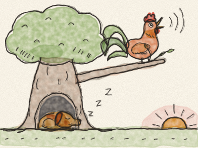
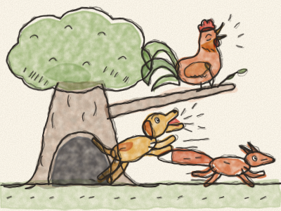

# The Cockerel, the Dog and the Fox

Once upon a time, a Cockerel and a Dog were the best of friends. One day they set off together to see the world. They walked and walked, until the sun went down.

“Where shall we sleep?” asked the Dog, with a big yawn.

They found an old oak tree with a hole at the bottom of its trunk. The Dog curled up inside the hole, nice and cosy. The Cockerel flew up onto a high branch. And they both fell asleep.

In the morning, the sun came up, and the Cockerel did what cockerels always do. “*Cock-a-doodle-doo!*”

A hungry Fox heard him. “Breakfast!” thought the Fox, licking his lips. He trotted to the tree and smiled his sweetest smile.

“Good morning, dear Cockerel! What a beautiful voice you have! Do come down, so that I can give you a big hug.”

The Cockerel was not silly. “Thank you, Mr Fox,” he said. “I’ll gladly come down. But first, please knock at the door at the bottom of the tree. My porter is sleeping in there. He will open it for you.”

“A porter? How grand!” said the Fox. And he knocked. *Knock, knock, knock!*

Out jumped the Dog. “*WOOF! WOOF!*”

The Fox ran away so fast that his tail flew behind him like a flag. And he never came back to that tree again.

> Whoever tries to trick others can end up tricked himself.
