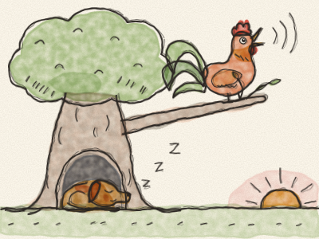
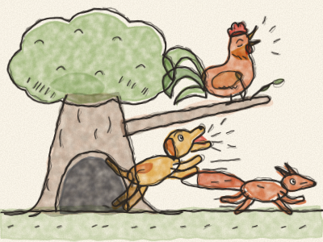

# Le Coq, le Chien et le Renard

Il était une fois un Coq et un Chien qui étaient les meilleurs amis du monde. Un jour, ils partirent ensemble voir du pays. Ils marchèrent, marchèrent, jusqu’au coucher du soleil.

« Où allons-nous dormir ? » demanda le Chien, en bâillant très fort.

Ils trouvèrent un vieux chêne avec un trou tout en bas de son tronc. Le Chien se roula en boule dans le trou, bien au chaud. Le Coq s’envola sur une haute branche. Et ils s’endormirent tous les deux.

Le matin, le soleil se leva, et le Coq fit ce que les coqs font toujours. « *Cocorico !* »

Un Renard affamé l’entendit. « Mon petit déjeuner ! » pensa le Renard en se léchant les babines. Il trottina jusqu’à l’arbre et fit son plus beau sourire.

« Bonjour, cher Coq ! Quelle jolie voix vous avez ! Descendez donc, que je vous fasse un gros câlin. »

Mais le Coq n’était pas sot. « Merci, Monsieur le Renard, » dit-il. « Je descends avec plaisir. Mais d’abord, frappez donc à la porte, en bas de l’arbre. Mon portier dort là-dedans. Il va vous ouvrir. »

« Un portier ? Comme c’est chic ! » dit le Renard. Et il frappa. *Toc, toc, toc !*

Le Chien bondit dehors. « *OUAF ! OUAF !* »

Le Renard s’enfuit si vite que sa queue flottait derrière lui comme un drapeau. Et il ne revint plus jamais près de cet arbre.

> Tel est pris qui croyait prendre.
