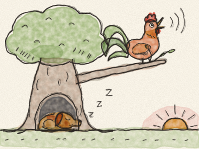
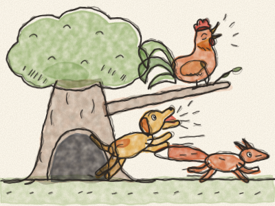

# O Galo, o Cão e a Raposa

Era uma vez um Galo e um Cão que eram os melhores amigos do mundo. Um dia, partiram juntos para conhecer o mundo. Andaram, andaram, até o sol se pôr.

— Onde é que vamos dormir? — perguntou o Cão, com um grande bocejo.

Encontraram um velho carvalho com um buraco mesmo no fundo do tronco. O Cão enroscou-se dentro do buraco, muito quentinho. O Galo voou para um ramo alto. E adormeceram os dois.

De manhã, o sol nasceu, e o Galo fez o que os galos fazem sempre: — *Cocorocó!*

Uma Raposa esfomeada ouviu-o. «O meu pequeno-almoço!», pensou a Raposa, a lamber os beiços. Foi a trote até à árvore e fez o seu sorriso mais doce.

— Bom dia, querido Galo! Que voz tão bonita que tem! Desça cá abaixo, para eu lhe dar um grande abraço.

Mas o Galo não era tolo. — Obrigado, senhora Raposa — disse ele. — Desço com todo o gosto. Mas primeiro, faça o favor de bater à porta, lá em baixo na árvore. O meu porteiro está a dormir lá dentro. Ele vai abrir-lhe a porta.

— Um porteiro? Que chique! — disse a Raposa. E bateu. *Toc, toc, toc!*

O Cão saltou cá para fora. — *ÃO! ÃO!*

A Raposa fugiu tão depressa que a cauda voava atrás dela como uma bandeira. E nunca mais voltou àquela árvore.

> Quem tenta enganar os outros pode acabar por ser enganado.
