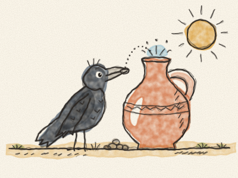
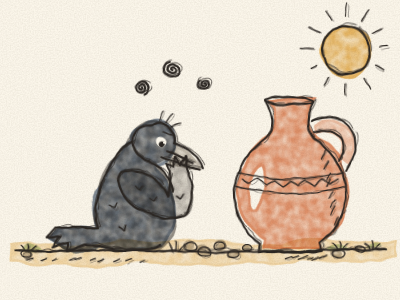

# La Corneille et la Cruche

C’était le jour le plus chaud de tout l’été. Le soleil brûlait, l’herbe devenait toute jaune, et les mares et les flaques avaient séché.

Une corneille noire volait au-dessus des champs. « Croâ ! » croassa-t-elle. « J’ai tellement soif ! Si je ne trouve pas d’eau très vite, je ne pourrai plus voler du tout. »

Enfin, elle aperçut une grande cruche en terre posée dans un jardin. Elle se posa sur le bord et regarda dedans. De l’eau ! Mais juste un petit peu, tout au fond.

La corneille enfonça son bec aussi loin que possible. Elle tendit le cou. Elle le tendit encore plus. *Toc !* Son bec ne touchait que la paroi de la cruche. L’eau était beaucoup trop bas.

Elle essaya de renverser la cruche. *Hop !* Bien trop lourde.

Alors la corneille s’assit et réfléchit très fort. Puis elle regarda les petits cailloux qui traînaient partout dans l’allée du jardin.

Devine ce qu’elle a fait ? *(Faire une pause, et laisser Constance deviner.)*

Elle prit un caillou dans son bec et le laissa tomber dans la cruche. *Plouf !* Puis un autre. *Plouf !* Et encore un autre. *Plouf ! Plouf ! Plouf !*

À chaque caillou, l’eau montait un tout petit peu. Elle monta, monta, monta… jusqu’en haut de la cruche.

La corneille y trempa son bec et but, et but, jusqu’à ne plus avoir soif du tout. « Croâ ! » dit-elle, toute contente, et elle s’envola dans le ciel bleu.

> Quand ça ne marche pas d’une façon, on s’arrête, on réfléchit, et on essaie autrement. Petit à petit, on y arrive !
