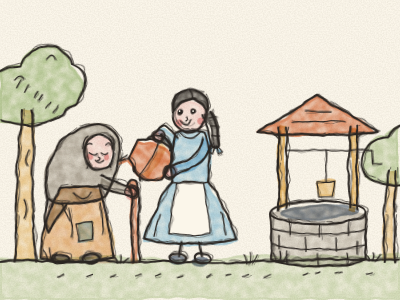
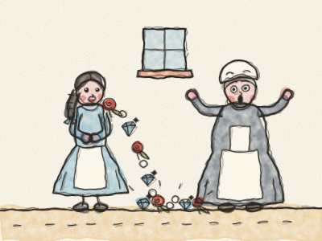
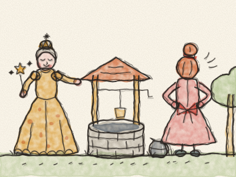
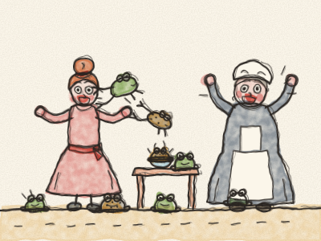
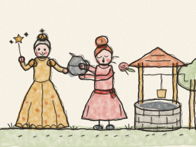

# Diamonds and Toads

Once upon a time, there was a mother who had two daughters. The elder, Fanchon, was just like her mother: proud, and grumpy, and always cross. *Hmph!* The younger, Rose, was gentle and kind, and always ready to help.

Every day, Rose had to walk a long, long way to the well in the wood to fetch water, with a big heavy jug. *Clink, clonk, clink, clonk.*

One day, at the well, a poor old woman came up to her. “Good morning, my dear. Would you give me a little drink? I’m so very thirsty.”

“Of course, Granny,” said Rose. She rinsed the jug, filled it with the cleanest, coldest water, and held it up high so the old woman could drink easily.

The old woman drank, *gloup, gloup, gloup*, and smiled. Now, she wasn’t really an old woman. She was a fairy! “You are so kind,” she said, “that I will give you a gift. Each time you speak, a flower or a jewel will fall from your mouth.”

When Rose got home, her mother shouted, “Why are you so late?”

“I’m sorry, Mother,” said Rose, and out of her mouth fell two roses, two pearls and two shining diamonds. *Plink, plink, plonk!*

“What?” cried her mother. “Pearls! Diamonds! How did this happen, my darling?” *(She had never called Rose “my darling” before.)*

So Rose told her the whole story, and with every word, more flowers and jewels tumbled onto the floor.

“Fanchon!” said the mother. “Quick, go to the well! And when a poor old woman asks you for a drink, be nice to her.”

“Me? Walk all the way to the well?” grumbled Fanchon. “Hmph!” But she wanted diamonds too, so off she went, with the best silver jug in the house.

At the well, she waited. But no poor old woman came. Instead, out of the wood came a grand lady in a beautiful dress. It was the very same fairy, dressed up differently, to see how kind Fanchon would be.

“Good morning,” said the lady. “Would you give me a little drink?”

“Get it yourself!” snapped Fanchon. “I didn’t walk all this way to serve you. I’m waiting for an old woman!”

“That was not very kind,” said the fairy calmly. “So here is your gift. Each time you speak, a toad or a frog will jump out of your mouth.”

Fanchon ran home. “Well?” asked her mother. “Where are the diamonds?”

“Oh, Mother…” began Fanchon, and — *croak!* — out hopped a big green frog. *Croak! Croak!* Then two fat brown toads. *Ribbit!* Then another frog, right onto her mother’s shoe.

“Eek!” cried the mother. Frogs on the table! Toads in the soup! *Ribbit, ribbit, croak!*

Fanchon put her hand over her mouth and began to cry. She didn’t dare say a single word.

Rose took her sister’s hand. “Don’t cry,” she said softly, and a little daisy fell. “Come with me.”

Together, they walked back to the well. The fairy was there, waiting. Fanchon looked at her feet. Then, in a tiny voice, she said, “I’m sorry. Would you like a drink?” And she filled the jug and held it up, very carefully.

*Ribbit?* No! Out of her mouth fell… a small pink rose.

The fairy smiled. “Kind words make flowers,” she said, “and unkind words make toads. Now you know.”

From that day on, Fanchon tried hard to speak kindly. Now and then, when she was grumpy, a little frog still popped out. But more and more, it was flowers.

> Kind words are worth more than diamonds.
