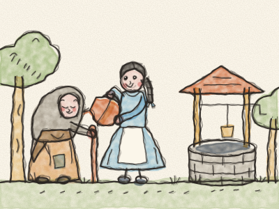
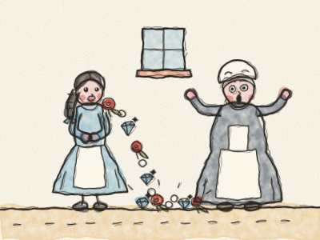
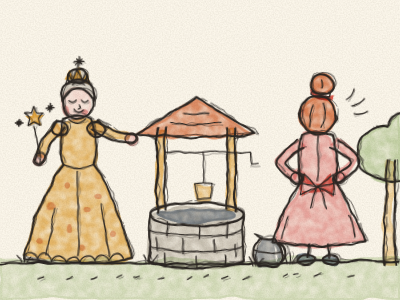
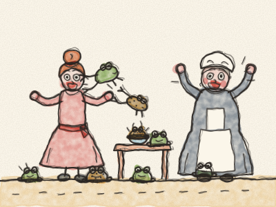
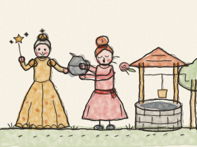

# Les Fées

Il était une fois une mère qui avait deux filles. L’aînée, Fanchon, lui ressemblait trait pour trait : fière, grognon et toujours fâchée. *Hmph !* La cadette, Rose, était douce et gentille, et toujours prête à aider.

Chaque jour, Rose devait marcher très, très loin jusqu’à la fontaine du bois pour aller chercher de l’eau, avec une grosse cruche bien lourde. *Cling, clong, cling, clong.*

Un jour, à la fontaine, une pauvre vieille femme s’approcha d’elle. « Bonjour, ma petite. Voudrais-tu me donner un peu à boire ? J’ai tellement soif. »

« Bien sûr, Grand-mère », dit Rose. Elle rinça sa cruche, la remplit de l’eau la plus claire et la plus fraîche, et la tint bien haut pour que la vieille femme puisse boire sans peine.

La vieille femme but, *glou, glou, glou*, et sourit. Mais ce n’était pas vraiment une vieille femme. C’était une fée ! « Tu es si gentille », dit-elle, « que je vais te faire un don. À chaque parole que tu diras, il te sortira de la bouche une fleur ou une pierre précieuse. »

Quand Rose rentra à la maison, sa mère cria : « Pourquoi rentres-tu si tard ? »

« Pardon, Maman », dit Rose, et de sa bouche tombèrent deux roses, deux perles et deux diamants brillants. *Plinc, plinc, plonc !*

« Quoi ? » s’écria sa mère. « Des perles ! Des diamants ! Comment est-ce arrivé, ma chérie ? » *(Elle n’avait jamais appelé Rose « ma chérie » auparavant.)*

Alors Rose lui raconta toute l’histoire, et à chaque mot, d’autres fleurs et d’autres bijoux roulaient par terre.

« Fanchon ! » dit la mère. « Vite, va à la fontaine ! Et quand une pauvre vieille femme te demandera à boire, sois gentille avec elle. »

« Moi ? Marcher jusqu’à la fontaine ? » grogna Fanchon. « Hmph ! » Mais elle voulait des diamants, elle aussi. Alors elle partit, avec le plus beau pichet d’argent de la maison.

À la fontaine, elle attendit. Mais aucune pauvre vieille femme ne vint. À la place, une grande dame en robe magnifique sortit du bois. C’était la même fée, habillée autrement, pour voir si Fanchon serait gentille.

« Bonjour », dit la dame. « Voudrais-tu me donner un peu à boire ? »

« Servez-vous toute seule ! » répondit Fanchon. « Je ne suis pas venue jusqu’ici pour vous servir. J’attends une vieille femme ! »

« Ce n’est pas très gentil », dit calmement la fée. « Voici donc ton don. À chaque parole que tu diras, un crapaud ou une grenouille te sautera de la bouche. »

Fanchon rentra en courant. « Alors ? » demanda sa mère. « Où sont les diamants ? »

« Oh, Maman… » commença Fanchon, et — *coâ !* — une grosse grenouille verte sauta dehors. *Coâ ! Coâ !* Puis deux gros crapauds bruns. *Croâ !* Puis encore une grenouille, juste sur la chaussure de sa mère.

« Aïe ! » cria la mère. Des grenouilles sur la table ! Des crapauds dans la soupe ! *Coâ, coâ, croâ !*

Fanchon mit la main devant sa bouche et se mit à pleurer. Elle n’osait plus dire un seul mot.

Rose prit la main de sa sœur. « Ne pleure pas », dit-elle doucement, et une petite pâquerette tomba. « Viens avec moi. »

Ensemble, elles retournèrent à la fontaine. La fée était là, qui attendait. Fanchon regarda ses pieds. Puis, d’une toute petite voix, elle dit : « Pardon. Voulez-vous boire un peu ? » Et elle remplit la cruche et la tint bien haut, très doucement.

*Coâ ?* Non ! De sa bouche tomba… une petite rose rose.

La fée sourit. « Les mots gentils font des fleurs », dit-elle, « et les mots méchants font des crapauds. Maintenant, tu le sais. »

Depuis ce jour, Fanchon fit de son mieux pour parler gentiment. De temps en temps, quand elle était grognon, une petite grenouille sortait encore. Mais de plus en plus souvent, c’étaient des fleurs.

> Les douces paroles ont encore plus de force que les diamants.
