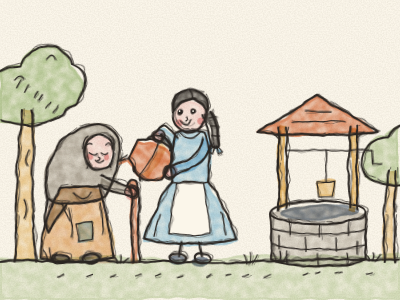
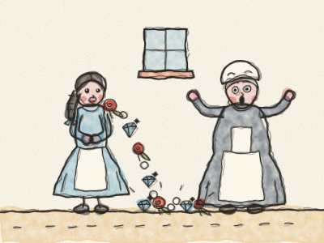
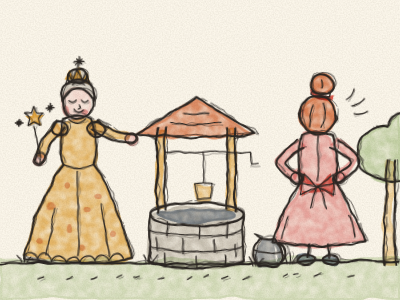
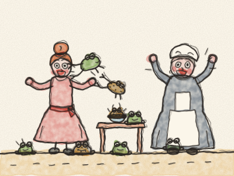
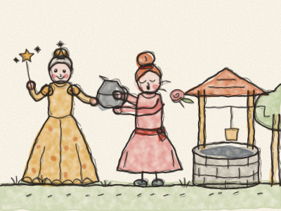

# As Fadas

Era uma vez uma mãe que tinha duas filhas. A mais velha, a Fanchon, era igualzinha à mãe: vaidosa, resmungona e sempre zangada. *Hmpf!* A mais nova, a Rosa, era meiga e bondosa, e estava sempre pronta a ajudar.

Todos os dias, a Rosa tinha de andar muito, muito, até à fonte do bosque para ir buscar água, com um cântaro grande e pesado. *Clinc, clonc, clinc, clonc.*

Um dia, na fonte, aproximou-se dela uma velhinha pobre. — Bom dia, minha querida. Dás-me um bocadinho de água? Tenho tanta sede.

— Claro que sim, avozinha — disse a Rosa. Passou o cântaro por água, encheu-o com a água mais limpa e mais fresquinha, e segurou-o bem alto para a velhinha beber à vontade.

A velhinha bebeu, *glu, glu, glu*, e sorriu. Mas ela não era bem uma velhinha. Era uma fada! — És tão bondosa — disse ela — que te vou dar um dom. Sempre que falares, há de cair-te da boca uma flor ou uma pedra preciosa.

Quando a Rosa chegou a casa, a mãe gritou: — Porque é que chegas tão tarde?

— Desculpe, mãe — disse a Rosa, e da boca caíram-lhe duas rosas, duas pérolas e dois diamantes a brilhar. *Plim, plim, plom!*

— O quê? — exclamou a mãe. — Pérolas! Diamantes! Como é que isto aconteceu, minha querida? *(Ela nunca tinha chamado «minha querida» à Rosa.)*

Então a Rosa contou-lhe a história toda, e a cada palavra caíam mais flores e mais joias no chão.

— Fanchon! — disse a mãe. — Depressa, vai à fonte! E quando uma velhinha pobre te pedir água, sê simpática com ela.

— Eu? Ir a pé até à fonte? — resmungou a Fanchon. — Hmpf! — Mas ela também queria diamantes, por isso lá foi, com o jarro de prata mais bonito da casa.

Na fonte, ficou à espera. Mas não apareceu velhinha nenhuma. Em vez disso, saiu do bosque uma grande senhora com um vestido lindíssimo. Era a mesma fada, vestida de outra maneira, para ver se a Fanchon era bondosa.

— Bom dia — disse a senhora. — Dás-me um bocadinho de água?

— Sirva-se sozinha! — respondeu a Fanchon. — Não vim até aqui para a servir. Estou à espera de uma velhinha!

— Isso não foi nada simpático — disse a fada, com calma. — Por isso, aqui tens o teu dom. Sempre que falares, há de saltar-te da boca um sapo ou uma rã.

A Fanchon voltou para casa a correr. — Então? — perguntou a mãe. — Onde estão os diamantes?

— Ai, mãe… — começou a Fanchon, e — *croac!* — saltou-lhe da boca uma rã verde e grande. *Croac! Croac!* Depois dois sapos castanhos e gordos. *Ribbit!* Depois outra rã, mesmo para cima do sapato da mãe.

— Ai! — gritou a mãe. Rãs em cima da mesa! Sapos na sopa! *Ribbit, ribbit, croac!*

A Fanchon tapou a boca com a mão e desatou a chorar. Já não se atrevia a dizer nem uma palavra.

A Rosa deu a mão à irmã. — Não chores — disse baixinho, e caiu um pequeno malmequer. — Anda comigo.

Juntas, voltaram à fonte. A fada estava lá, à espera. A Fanchon olhou para os pés. Depois, com uma vozinha muito pequenina, disse: — Desculpe. Quer um bocadinho de água? — E encheu o cântaro e segurou-o bem alto, com muito cuidado.

*Ribbit?* Não! Da boca caiu-lhe… uma rosinha cor-de-rosa.

A fada sorriu. — As palavras simpáticas fazem flores — disse ela — e as palavras antipáticas fazem sapos. Agora já sabes.

A partir desse dia, a Fanchon esforçou-se muito por falar com simpatia. De vez em quando, se estava rabugenta, ainda lhe saltava uma rãzinha. Mas cada vez mais eram flores.

> As palavras doces valem mais do que diamantes.
