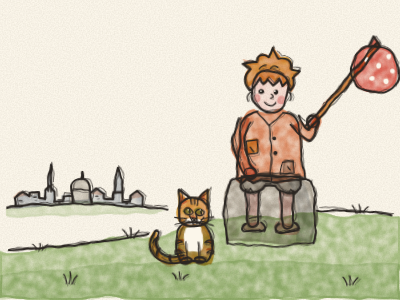
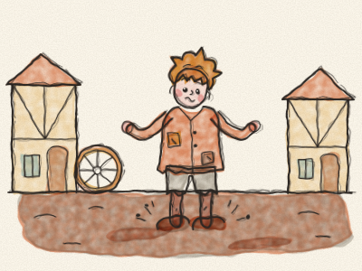
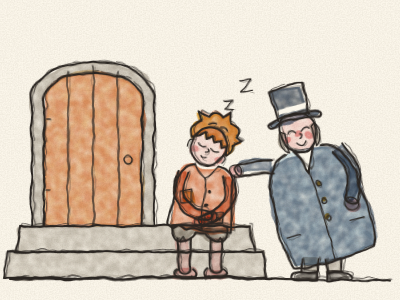
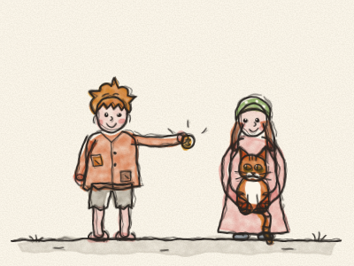
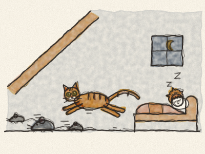
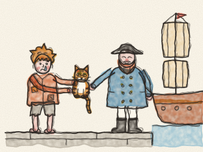
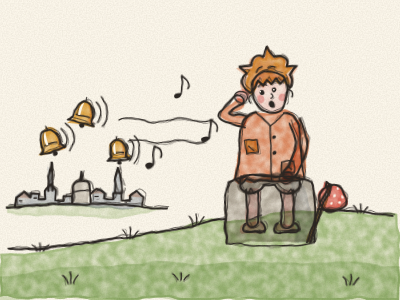
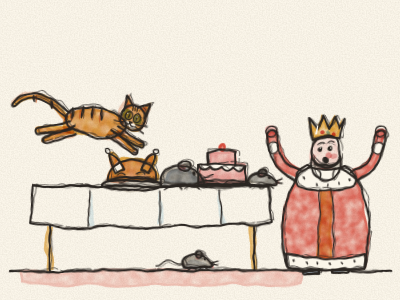
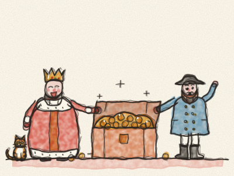
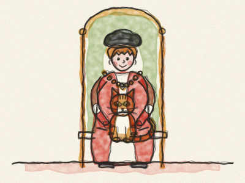

# Dick Whittington and His Cat

Long ago, in a little village far from anywhere, there lived a poor boy called Dick Whittington. He had no mother and no father, no house and no shoes. He had only an old coat, a big smile and a head full of dreams.

In the village, people told stories about London. “In London,” they said, “the streets are paved with gold! You only have to pick it up!”

“Then I will go to London,” said Dick. “I will pick up some gold, and I will never be hungry again.”

So he tied his things in a little bundle — a crust of bread and a spare sock — put it on a stick over his shoulder, and set off down the long, long road. *Step, step, step.*

He walked for days and days. At last he saw the rooftops and church towers of London. He ran down the hill into the city. *Clatter, clatter!* There were carts and horses and people everywhere.

Dick looked down at the street. Then he looked again. There was no gold. There was only mud — brown, sticky, squelchy mud. *Squelch.*

“Oh,” said Dick. “The stories were wrong.”

He looked for work. He asked a baker. “Go away!” He asked a blacksmith. “Go away!” Nobody wanted a ragged little boy. By evening he was so tired and so hungry that he sat down on a doorstep and fell fast asleep.

That doorstep belonged to a rich merchant called Mr Fitzwarren. When he came home, he found Dick curled up like a puppy.

“Who is this?” he said. “Wake up, little one. Are you hungry?”

Dick nodded. He was too tired to speak.

“Then come inside,” said Mr Fitzwarren kindly. “You can help in my kitchen, and you shall have a bed and a bowl of soup.”

So Dick worked in the kitchen. He scrubbed the pots, *scrub, scrub*, he swept the floors, *swish, swish*, and he carried the coal. The Cook was very grumpy. “Faster, boy! Hurry up!” she shouted, and she banged her big spoon. *BANG!* But Mr Fitzwarren’s daughter, Alice, was always kind to him, and that made everything better.

Dick slept in a little room at the very top of the house, up in the attic. But there was a problem. The attic was full of rats and mice! All night long they ran over the floor, *scritch, scratch*, and over his bed, *scamper, scamper*, and nibbled his toes. Dick could not sleep a wink.

One day, a visitor gave Dick a penny for cleaning his boots. A whole penny! Dick could have bought a cake. But on the way home, he met a girl carrying a cat.

“How much for your cat?” asked Dick.

“One penny,” said the girl.

Dick gave her his penny and carried the cat home in his arms. She was a stripy cat with green eyes and a long tail. *Purr, purr.*

That night, the cat sat in the middle of the attic floor. She watched. She waited. Her tail went *swish… swish…*

*Scritch, scratch* went a rat. *POUNCE!* went the cat.

*Scamper, scamper* went a mouse. *POUNCE!* went the cat.

By morning, there was not one rat or mouse left in the attic. They had all run away, far away, and they never came back.

And Dick slept like a baby, with his cat curled up on his feet, warm and purring. From that day on, she was his best friend. He shared his breakfast with her, and he told her all his secrets.

One day, Mr Fitzwarren called everybody together. “My ship is sailing to faraway lands,” he said, “to buy and to sell. Everyone in this house may send something on the ship, and if it sells well, they shall have the money.”

Alice sent a ribbon. The Cook sent a pie. But poor Dick had nothing at all. Only his cat.

“Send the cat!” laughed the Cook. “Ha! Who would ever pay for a cat?”

Dick held his cat very tight. Then, with tears in his eyes, he carried her down to the ship and gave her to the captain. “Please look after her,” he said. The captain nodded, and the big ship sailed away over the sea.

Without his cat, Dick was very lonely. The rats came back to the attic. The Cook was grumpier than ever. *BANG!* went her spoon.

At last, Dick could not bear it any more. Very early one morning, before anyone was awake, he tied up his bundle and crept out of the house. He walked out of London and up a big green hill, and there he sat down on a stone to rest.

Just then, all the bells of London began to ring. *Ding, dong! Ding, dong!* And it seemed to Dick that they were singing to him: *“Turn again, Whittington, Lord Mayor of London!”*

“Lord Mayor? Me?” said Dick. He listened again. *Ding, dong!* The bells sang it again. So Dick picked up his bundle, turned around and walked all the way back. He was home before the Cook even woke up.

Meanwhile, far across the sea, Mr Fitzwarren’s ship had come to a faraway kingdom. The King invited the captain to a great dinner. The table was covered in delicious food: roast chicken, golden bread, pies and cakes.

But just as they sat down — *scamper, scamper, scamper!* — a hundred rats ran out and jumped on the table. They gobbled the chicken. They nibbled the cakes. “Shoo! Shoo!” cried the King. But the rats did not shoo.

“This happens every day,” sighed the Queen.

“Wait a moment,” said the captain. He ran to the ship and came back with Dick’s cat. *POUNCE! POUNCE! POUNCE!* In no time at all, the rats ran away squeaking, and the table was clear.

The King and Queen clapped their hands. “What a wonderful animal!” said the King. “Please let her stay with us! I will give you a whole chest of gold.”

So the cat stayed in the palace, with a velvet cushion and a saucer of cream every day. Soon she had six little kittens. The King kept five, and sent the sixth one home on the ship, with the gold.

When the captain arrived, he went straight to Mr Fitzwarren. “This gold is not yours,” he said, “and it is not mine. It is Dick’s, for his cat!”

Dick was in the kitchen, scrubbing pots. “For me?” he said. “All this gold, for me?” The Cook was so surprised that she dropped her spoon. *Clang!*

Dick was rich now, but he did not forget anyone. He gave presents to the captain and the sailors, to Mr Fitzwarren, and even to the grumpy Cook, who said “Thank you” very nicely for the first time in her life.

He went to school and learned to read and write. He worked hard. And when he grew up, he married kind Alice, and he became… guess what? *(Pause, and let Constance guess.)*

Yes! Lord Mayor of London, just as the bells had sung. And in his big house there was always a stripy cat, the little kitten from far away, purring on his lap.

> The streets are not paved with gold, but kindness and hard work will take you far.
