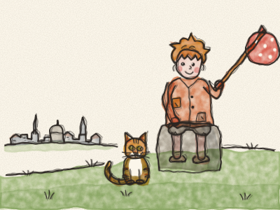
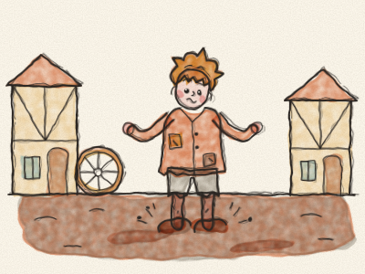
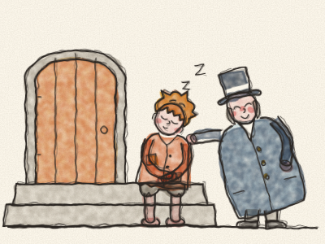
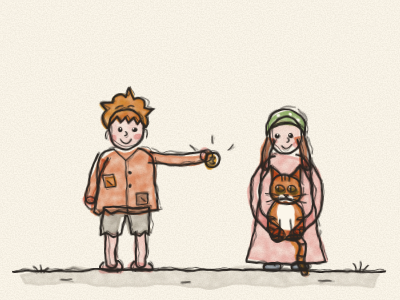
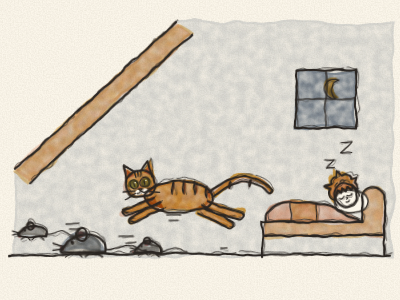
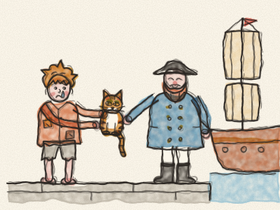
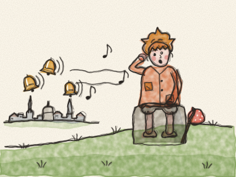
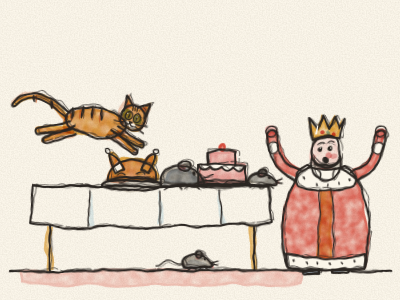
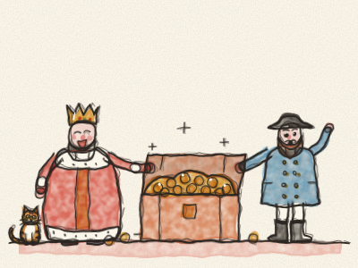
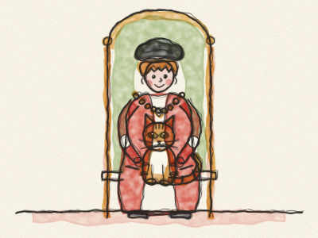

# Dick Whittington et son chat

Il y a très longtemps, dans un petit village perdu au milieu de nulle part, vivait un pauvre garçon qui s’appelait Dick Whittington. Il n’avait ni maman ni papa, ni maison ni chaussures. Il n’avait qu’un vieux manteau, un grand sourire et la tête pleine de rêves.

Au village, les gens racontaient des histoires sur Londres. « À Londres, disaient-ils, les rues sont pavées d’or ! Il suffit de se baisser pour le ramasser ! »

« Alors j’irai à Londres », dit Dick. « Je ramasserai de l’or, et je n’aurai plus jamais faim. »

Il noua ses affaires dans un petit baluchon — un quignon de pain et une chaussette de rechange —, le mit au bout d’un bâton sur son épaule, et partit sur la longue, longue route. *Pas à pas, pas à pas.*

Il marcha des jours et des jours. Enfin, il aperçut les toits et les clochers de Londres. Il descendit la colline en courant jusque dans la ville. *Cataclop, cataclop !* Il y avait des charrettes, des chevaux et des gens partout.

Dick regarda la rue. Puis il regarda encore. Il n’y avait pas d’or. Il n’y avait que de la boue : de la boue marron, collante et gluante. *Splotch.*

« Oh », dit Dick. « Les histoires se trompaient. »

Il chercha du travail. Il demanda au boulanger. « Va-t’en ! » Il demanda au forgeron. « Va-t’en ! » Personne ne voulait d’un petit garçon en haillons. Le soir venu, il était si fatigué et il avait si faim qu’il s’assit sur le pas d’une porte et s’endormit.

Cette porte était celle d’un riche marchand, Monsieur Fitzwarren. En rentrant chez lui, il trouva Dick roulé en boule comme un petit chien.

« Qui est-ce donc ? » dit-il. « Réveille-toi, petit. Tu as faim ? »

Dick fit oui de la tête. Il était trop fatigué pour parler.

« Alors entre », dit gentiment Monsieur Fitzwarren. « Tu aideras à la cuisine, et tu auras un lit et un bol de soupe. »

Alors Dick travailla à la cuisine. Il récurait les casseroles, *frotte, frotte*, il balayait le sol, *swich, swich*, et il portait le charbon. La Cuisinière était très grognon. « Plus vite, garçon ! Dépêche-toi ! » criait-elle, en tapant avec sa grosse cuillère. *BANG !* Mais la fille de Monsieur Fitzwarren, Alice, était toujours gentille avec lui, et cela rendait tout plus doux.

Dick dormait dans une petite chambre tout en haut de la maison, sous le toit. Mais il y avait un problème. Le grenier était plein de rats et de souris ! Toute la nuit, ils couraient sur le plancher, *gratte, gratte*, et sur son lit, *trotte, trotte*, et lui grignotaient les orteils. Dick ne pouvait pas fermer l’œil.

Un jour, un visiteur donna à Dick un sou pour avoir ciré ses bottes. Un sou entier ! Dick aurait pu s’acheter un gâteau. Mais en rentrant, il croisa une petite fille qui portait un chat.

« Combien pour ton chat ? » demanda Dick.

« Un sou », dit la petite fille.

Dick lui donna son sou et rapporta le chat dans ses bras. C’était une chatte rayée, aux yeux verts et à la longue queue. *Ronron, ronron.*

Cette nuit-là, la chatte s’assit au milieu du grenier. Elle guetta. Elle attendit. Sa queue faisait *swich… swich…*

*Gratte, gratte*, fit un rat. *HOP !* fit la chatte.

*Trotte, trotte*, fit une souris. *HOP !* fit la chatte.

Au matin, il ne restait plus un seul rat ni une seule souris dans le grenier. Ils s’étaient tous enfuis, très loin, et ils ne revinrent jamais.

Et Dick dormit comme un bébé, avec sa chatte roulée en boule sur ses pieds, toute chaude et ronronnante. À partir de ce jour, elle fut sa meilleure amie. Il partageait son petit déjeuner avec elle, et il lui racontait tous ses secrets.

Un jour, Monsieur Fitzwarren réunit toute la maison. « Mon bateau part pour des pays lointains, dit-il, pour acheter et pour vendre. Chacun ici peut envoyer quelque chose sur le bateau, et si cela se vend bien, il aura l’argent. »

Alice envoya un ruban. La Cuisinière envoya une tarte. Mais le pauvre Dick n’avait rien du tout. Rien que sa chatte.

« Envoie la chatte ! » ricana la Cuisinière. « Ha ! Qui voudrait payer pour un chat ? »

Dick serra sa chatte très fort. Puis, les larmes aux yeux, il la porta jusqu’au bateau et la confia au capitaine. « S’il vous plaît, prenez soin d’elle », dit-il. Le capitaine fit oui de la tête, et le grand bateau s’en alla sur la mer.

Sans sa chatte, Dick se sentait bien seul. Les rats revinrent au grenier. La Cuisinière était plus grognon que jamais. *BANG !* faisait sa cuillère.

Un jour, Dick n’en put plus. Très tôt un matin, avant que tout le monde soit réveillé, il noua son baluchon et sortit sur la pointe des pieds. Il quitta Londres et grimpa une grande colline verte, et là, il s’assit sur une pierre pour se reposer.

Juste à ce moment, toutes les cloches de Londres se mirent à sonner. *Ding, dong ! Ding, dong !* Et Dick eut l’impression qu’elles lui chantaient : *« Reviens, Whittington, Lord-maire de Londres ! »*

« Lord-maire ? Moi ? » dit Dick. Il écouta encore. *Ding, dong !* Les cloches le chantèrent encore. Alors Dick ramassa son baluchon, fit demi-tour et rentra à pied jusqu’à la maison. Il était revenu avant même que la Cuisinière se réveille.

Pendant ce temps, de l’autre côté de la mer, le bateau de Monsieur Fitzwarren était arrivé dans un royaume lointain. Le Roi invita le capitaine à un grand dîner. La table était couverte de choses délicieuses : du poulet rôti, du pain doré, des tartes et des gâteaux.

Mais au moment de s’asseoir — *trotte, trotte, trotte !* — cent rats surgirent et sautèrent sur la table. Ils dévorèrent le poulet. Ils grignotèrent les gâteaux. « Ouste ! Ouste ! » cria le Roi. Mais les rats ne s’en allèrent pas.

« C’est comme ça tous les jours », soupira la Reine.

« Attendez un instant », dit le capitaine. Il courut jusqu’au bateau et revint avec la chatte de Dick. *HOP ! HOP ! HOP !* En un rien de temps, les rats s’enfuirent en couinant, et la table fut libre.

Le Roi et la Reine applaudirent. « Quel animal merveilleux ! » dit le Roi. « Laissez-la rester avec nous, je vous en prie ! Je vous donnerai tout un coffre d’or. »

Alors la chatte resta au palais, avec un coussin de velours et une soucoupe de crème tous les jours. Bientôt, elle eut six petits chatons. Le Roi en garda cinq, et renvoya le sixième sur le bateau, avec l’or.

En arrivant, le capitaine alla tout droit chez Monsieur Fitzwarren. « Cet or n’est pas à vous, dit-il, et il n’est pas à moi. Il est à Dick, pour sa chatte ! »

Dick était à la cuisine, en train de récurer les casseroles. « Pour moi ? » dit-il. « Tout cet or, pour moi ? » La Cuisinière fut si surprise qu’elle en lâcha sa cuillère. *Cling !*

Dick était riche à présent, mais il n’oublia personne. Il offrit des cadeaux au capitaine et aux marins, à Monsieur Fitzwarren, et même à la Cuisinière grognon, qui dit « Merci » très gentiment pour la première fois de sa vie.

Il alla à l’école et apprit à lire et à écrire. Il travailla dur. Et quand il fut grand, il épousa la gentille Alice, et il devint… devine quoi ? *(Faire une pause, et laisser Constance deviner.)*

Oui ! Lord-maire de Londres, exactement comme l’avaient chanté les cloches. Et dans sa grande maison, il y avait toujours un chat rayé, le petit chaton venu de très loin, qui ronronnait sur ses genoux.

> Les rues ne sont pas pavées d’or, mais la gentillesse et le travail mènent loin.
