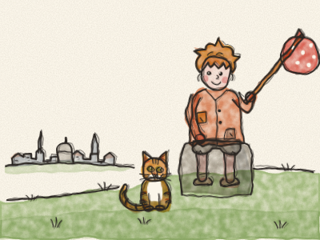
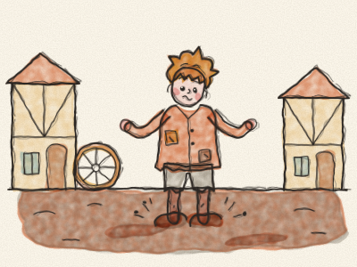
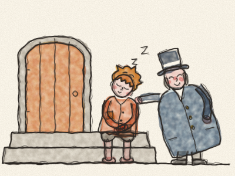
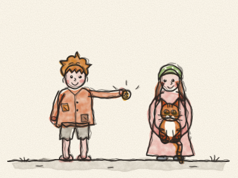
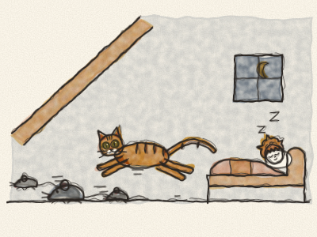
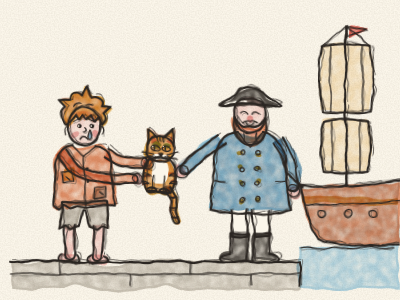
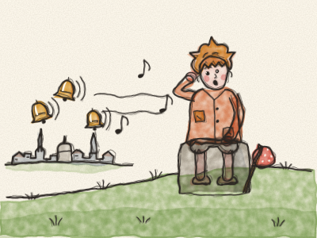
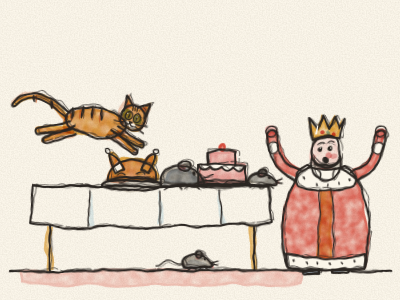
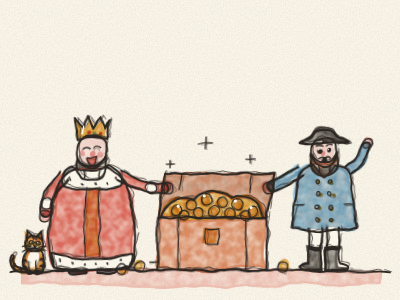
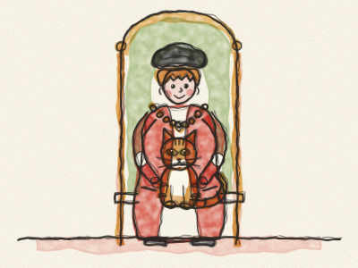

# O Dick Whittington e o seu Gato

Há muito, muito tempo, numa aldeia pequenina perdida no meio de nenhures, vivia um rapaz pobre chamado Dick Whittington. Não tinha mãe nem pai, nem casa nem sapatos. Tinha só um casaco velho, um grande sorriso e a cabeça cheia de sonhos.

Na aldeia, as pessoas contavam histórias sobre Londres. — Em Londres — diziam elas — as ruas são calcetadas de ouro! Basta baixarmo-nos para o apanhar!

— Então vou para Londres — disse o Dick. — Vou apanhar ouro, e nunca mais vou ter fome.

Atou as suas coisas numa pequena trouxa — uma côdea de pão e uma meia sobresselente —, pendurou-a num pau ao ombro e pôs-se a caminho pela longa, longa estrada. *Passo, passo, passo.*

Caminhou dias e dias. Por fim, avistou os telhados e as torres das igrejas de Londres. Desceu o monte a correr até à cidade. *Tracatrás, tracatrás!* Havia carroças, cavalos e gente por todo o lado.

O Dick olhou para a rua. Depois olhou outra vez. Não havia ouro nenhum. Só havia lama — lama castanha, pegajosa e peganhenta. *Chape.*

— Oh — disse o Dick. — As histórias estavam erradas.

Procurou trabalho. Perguntou ao padeiro. — Vai-te embora! Perguntou ao ferreiro. — Vai-te embora! Ninguém queria um rapazinho esfarrapado. Ao fim do dia, estava tão cansado e com tanta fome que se sentou no degrau de uma porta e adormeceu profundamente.

Aquela porta era a de um rico mercador, o Senhor Fitzwarren. Quando ele chegou a casa, encontrou o Dick enroscado como um cachorrinho.

— Quem é este? — disse ele. — Acorda, pequeno. Tens fome?

O Dick acenou que sim. Estava cansado demais para falar.

— Então entra — disse o Senhor Fitzwarren, com bondade. — Podes ajudar na cozinha, e terás uma cama e uma tigela de sopa.

E assim o Dick trabalhou na cozinha. Esfregava as panelas, *esfrega, esfrega*, varria o chão, *suich, suich*, e carregava o carvão. A Cozinheira era muito rabugenta. — Mais depressa, rapaz! Despacha-te! — gritava ela, e batia com a sua colher grande. *PUM!* Mas a filha do Senhor Fitzwarren, a Alice, era sempre simpática com ele, e isso tornava tudo melhor.

O Dick dormia num quartinho mesmo no cimo da casa, lá no sótão. Mas havia um problema. O sótão estava cheio de ratos e ratazanas! Toda a noite corriam pelo chão, *risca, rasca*, e por cima da cama, *trote, trote*, e roíam-lhe os dedos dos pés. O Dick não conseguia pregar olho.

Um dia, uma visita deu ao Dick uma moeda por lhe ter engraxado as botas. Uma moeda inteirinha! O Dick podia ter comprado um bolo. Mas, a caminho de casa, encontrou uma menina com um gato ao colo.

— Quanto queres pelo teu gato? — perguntou o Dick.

— Uma moeda — disse a menina.

O Dick deu-lhe a moeda e levou o gato para casa ao colo. Era uma gata às riscas, de olhos verdes e cauda comprida. *Rom-rom, rom-rom.*

Nessa noite, a gata sentou-se no meio do sótão. Espreitou. Esperou. A cauda fazia *suich… suich…*

*Risca, rasca*, fez uma ratazana. *ZÁS!* fez a gata.

*Trote, trote*, fez um ratinho. *ZÁS!* fez a gata.

De manhã, já não havia nem um rato nem uma ratazana no sótão. Tinham fugido todos, para muito longe, e nunca mais voltaram.

E o Dick dormiu como um bebé, com a gata enroscada nos pés, quentinha e a ronronar. A partir desse dia, ela foi a sua melhor amiga. Ele partilhava o pequeno-almoço com ela e contava-lhe todos os seus segredos.

Um dia, o Senhor Fitzwarren reuniu toda a gente da casa. — O meu navio vai partir para terras distantes — disse ele — para comprar e vender. Todos nesta casa podem mandar alguma coisa no navio, e, se se vender bem, o dinheiro será seu.

A Alice mandou uma fita. A Cozinheira mandou uma tarte. Mas o pobre Dick não tinha nada. Só a sua gata.

— Manda a gata! — riu-se a Cozinheira. — Ah! Quem é que vai pagar por uma gata?

O Dick abraçou a gata com muita força. Depois, com lágrimas nos olhos, levou-a até ao navio e entregou-a ao capitão. — Por favor, tome conta dela — disse ele. O capitão acenou que sim, e o grande navio partiu pelo mar fora.

Sem a sua gata, o Dick sentia-se muito sozinho. Os ratos voltaram ao sótão. A Cozinheira estava mais rabugenta do que nunca. *PUM!* fazia a colher.

Por fim, o Dick já não aguentava mais. Uma manhã, muito cedo, antes de toda a gente acordar, atou a trouxa e saiu de casa pé ante pé. Saiu de Londres e subiu um grande monte verde, e ali se sentou numa pedra para descansar.

Nesse momento, todos os sinos de Londres começaram a tocar. *Dlim, dlão! Dlim, dlão!* E pareceu ao Dick que lhe cantavam: *«Volta atrás, Whittington, Presidente da Câmara de Londres!»*

— Presidente da Câmara? Eu? — disse o Dick. Escutou outra vez. *Dlim, dlão!* Os sinos cantaram outra vez. Então o Dick pegou na trouxa, deu meia-volta e voltou a pé até casa. Chegou antes de a Cozinheira acordar.

Entretanto, do outro lado do mar, o navio do Senhor Fitzwarren tinha chegado a um reino distante. O Rei convidou o capitão para um grande jantar. A mesa estava coberta de coisas deliciosas: frango assado, pão dourado, tartes e bolos.

Mas, mesmo quando se iam sentar — *trote, trote, trote!* — cem ratos saíram a correr e saltaram para a mesa. Devoraram o frango. Roeram os bolos. — Xô! Xô! — gritou o Rei. Mas os ratos não foram a lado nenhum.

— Isto acontece todos os dias — suspirou a Rainha.

— Esperem um momento — disse o capitão. Correu até ao navio e voltou com a gata do Dick. *ZÁS! ZÁS! ZÁS!* Num instante, os ratos fugiram a guinchar, e a mesa ficou livre.

O Rei e a Rainha bateram palmas. — Que animal maravilhoso! — disse o Rei. — Por favor, deixem-na ficar connosco! Dou-vos um baú inteiro de ouro.

E assim a gata ficou no palácio, com uma almofada de veludo e um pires de natas todos os dias. Pouco depois, teve seis gatinhos. O Rei ficou com cinco e mandou o sexto no navio, com o ouro.

Quando o capitão chegou, foi logo ter com o Senhor Fitzwarren. — Este ouro não é seu — disse ele — e também não é meu. É do Dick, pela sua gata!

O Dick estava na cozinha a esfregar panelas. — Para mim? — disse ele. — Este ouro todo, para mim? A Cozinheira ficou tão surpreendida que deixou cair a colher. *Tlim!*

O Dick era agora rico, mas não se esqueceu de ninguém. Deu presentes ao capitão e aos marinheiros, ao Senhor Fitzwarren e até à Cozinheira rabugenta, que disse «Obrigada» com muita simpatia pela primeira vez na vida.

Foi para a escola e aprendeu a ler e a escrever. Trabalhou muito. E, quando cresceu, casou com a simpática Alice, e tornou-se… adivinha o quê? *(Fazer uma pausa, e deixar a Constance adivinhar.)*

Sim! Presidente da Câmara de Londres, tal como os sinos tinham cantado. E na sua casa grande havia sempre um gato às riscas, o gatinho vindo de muito longe, a ronronar no seu colo.

> As ruas não são calcetadas de ouro, mas a bondade e o trabalho levam-nos longe.
