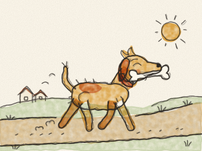
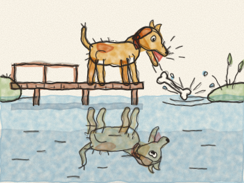

# The Dog and His Reflection

Once upon a time, there was a Dog who was very, very pleased with himself. The butcher had given him a big, juicy bone. The biggest bone in the whole village!

He held it tight in his mouth and trotted off home. *Trot, trot, trot.* “I shall eat it all by myself,” he thought, “in my own cosy basket.”

On the way home, he had to cross a little wooden bridge over a stream. *Clip, clop, clip.* Halfway across, he looked down into the water.

And what did he see? Another dog! A dog with a bone in his mouth. And that bone looked even bigger than his own!

*(Pause, and ask Constance: who is the other dog?)*

“That bone should be mine!” thought the greedy Dog. “I want it! I want both bones!” So he opened his mouth wide to bark at the other dog. “*WOOF!*”

*Splash!* His own bone fell out of his mouth and into the stream. Down, down, down it sank, all the way to the bottom.

And the other dog? He had vanished. There was only the water, with a sad little dog looking back. Because the other dog had only ever been his own reflection.

The Dog walked home slowly, with no bone at all. *Trot… trot… sigh.*

> If you always want more, you may lose what you already have.
