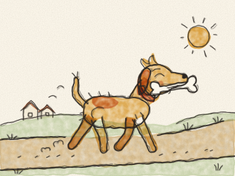
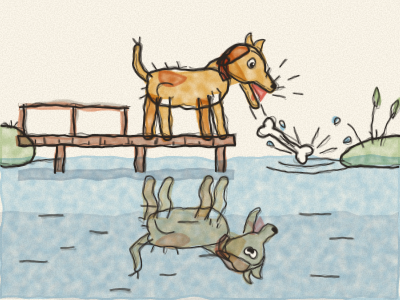

# Le Chien et son reflet

Il était une fois un Chien qui était très, très content de lui. Le boucher lui avait donné un gros os bien juteux. Le plus gros os de tout le village !

Il le serra bien fort dans sa gueule et trotta vers sa maison. *Trot, trot, trot.* « Je vais le manger tout seul, » pensa-t-il, « dans mon petit panier douillet. »

Sur le chemin, il devait traverser un petit pont de bois au-dessus d’un ruisseau. *Clip, clop, clip.* Au milieu du pont, il regarda dans l’eau.

Et que vit-il ? Un autre chien ! Un chien avec un os dans la gueule. Et cet os-là avait l’air encore plus gros que le sien !

*(Faites une pause, et demandez à Constance : qui est l’autre chien ?)*

« Cet os devrait être à moi ! » pensa le Chien gourmand. « Je le veux ! Je veux les deux os ! » Alors il ouvrit grand la gueule pour aboyer contre l’autre chien. « *OUAF !* »

*Plouf !* Son os à lui tomba de sa gueule, dans le ruisseau. Il coula, coula, coula, tout au fond de l’eau.

Et l’autre chien ? Il avait disparu. Il n’y avait plus que l’eau, et un petit chien tout triste qui le regardait. Car l’autre chien n’avait jamais été que son propre reflet.

Le Chien rentra chez lui tout doucement, sans os du tout. *Trot… trot… soupir.*

> Qui veut toujours plus risque de perdre ce qu’il a déjà.
