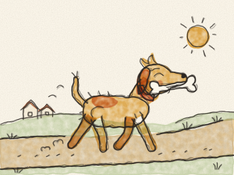
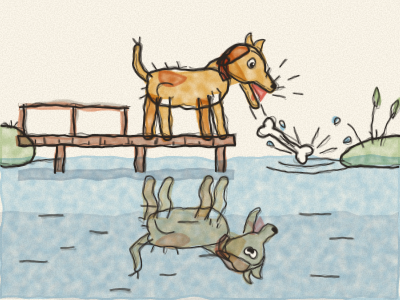

# O Cão e o seu Reflexo

Era uma vez um Cão que estava muito, muito contente consigo mesmo. O talhante tinha-lhe dado um osso grande e suculento. O maior osso da aldeia inteira!

Segurou-o bem na boca e foi a trote para casa. *Trote, trote, trote.* «Vou comê-lo sozinho», pensou ele, «na minha caminha quentinha.»

No caminho, tinha de atravessar uma pequena ponte de madeira por cima de um ribeiro. *Clip, clop, clip.* A meio da ponte, olhou para a água.

E o que é que viu? Outro cão! Um cão com um osso na boca. E aquele osso parecia ainda maior do que o seu!

*(Faça uma pausa e pergunte à Constance: quem é o outro cão?)*

«Aquele osso devia ser meu!», pensou o Cão guloso. «Quero-o! Quero os dois ossos!» Então abriu muito a boca para ladrar ao outro cão. — *ÃO!*

*Chape!* O seu próprio osso caiu-lhe da boca, para dentro do ribeiro. Foi ao fundo, ao fundo, ao fundo, até ao fundo da água.

E o outro cão? Tinha desaparecido. Só havia a água, e um cãozinho muito triste a olhar para ele. Porque o outro cão nunca tinha sido mais do que o seu próprio reflexo.

O Cão voltou para casa devagarinho, sem osso nenhum. *Trote… trote… suspiro.*

> Quem quer sempre mais pode perder o que já tem.
