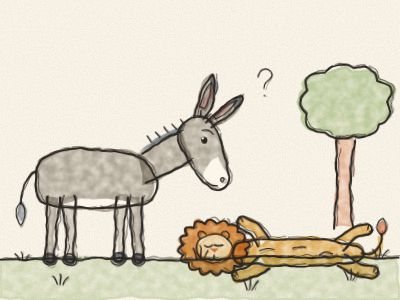
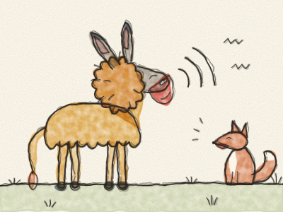

# The Donkey in the Lion's Skin

Once upon a time, a little grey Donkey was trotting through the forest when he found something lying in the grass. It was big. It was golden. It had a great shaggy mane. It was a lion skin, left behind by some hunters.

The Donkey had an idea. He wriggled in, *wriggle, wriggle*, and pulled the skin over his back, his legs and his head. Then he looked at himself in a puddle. “Ooh,” he whispered. “I look just like a lion!”

Off he went to the meadow. The sheep saw him and ran away. *Baa! Baa!* The goats saw him and ran away. *Meh! Meh!* Even the cows hid behind the barn. *Moo!*

The Donkey was very pleased with himself. “Now,” he thought, “I will give them a really big, really scary ROAR.” He opened his mouth as wide as he could, and out came…

*“HEE-HAW! HEE-HAW!”*

*(Do the donkey voice!)*

The animals stopped. They turned round. And just then, a gust of wind lifted the golden mane, and out popped two long, grey, furry ears.

“That’s no lion!” laughed the Fox. “That’s our friend the Donkey!” Soon all the animals were laughing, and the Donkey laughed too, because it really was quite funny. He folded the lion skin up neatly, and from then on he was happy to be just a Donkey.

> You can dress up as someone else, but your voice will always tell who you really are.
