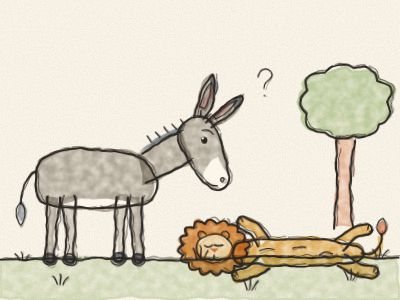
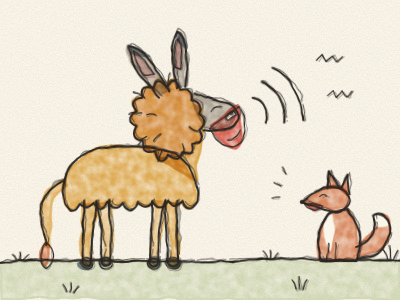

# L’Âne vêtu de la peau du Lion

Il était une fois un petit Âne gris qui trottait dans la forêt quand il trouva quelque chose dans l’herbe. C’était grand. C’était doré. Il y avait une grosse crinière ébouriffée. C’était une peau de lion, oubliée par des chasseurs.

L’Âne eut une idée. Il se glissa dedans, *gigote, gigote*, et tira la peau sur son dos, sur ses pattes et sur sa tête. Puis il se regarda dans une flaque. « Oh », chuchota-t-il. « On dirait un vrai lion ! »

Il partit vers la prairie. Les moutons le virent et s’enfuirent. *Bêê ! Bêê !* Les chèvres le virent et s’enfuirent. *Mêê ! Mêê !* Même les vaches se cachèrent derrière la grange. *Meuh !*

L’Âne était très content de lui. « Maintenant, pensa-t-il, je vais pousser un très grand, très terrible RUGISSEMENT. » Il ouvrit la bouche aussi grand qu’il put, et il en sortit…

*« HI-HAN ! HI-HAN ! »*

*(Faites la voix de l’âne !)*

Les animaux s’arrêtèrent. Ils se retournèrent. Et juste à ce moment, un coup de vent souleva la crinière dorée, et hop ! deux longues oreilles grises et poilues apparurent.

« Ce n’est pas un lion ! » rit le Renard. « C’est notre ami l’Âne ! » Bientôt, tous les animaux riaient, et l’Âne riait aussi, parce que c’était vraiment assez drôle. Il plia soigneusement la peau de lion, et depuis ce jour, il fut heureux d’être simplement un Âne.

> On peut se déguiser en quelqu’un d’autre, mais sa voix dit toujours qui on est vraiment.
