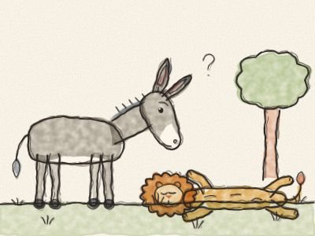
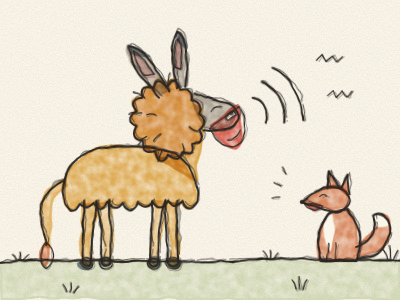

# O Burro na Pele do Leão

Era uma vez um Burrinho cinzento que ia a trotar pela floresta quando encontrou uma coisa deitada na erva. Era grande. Era dourada. Tinha uma juba enorme e desgrenhada. Era uma pele de leão, esquecida por uns caçadores.

O Burro teve uma ideia. Enfiou-se lá dentro, *remexe, remexe*, e puxou a pele por cima das costas, das pernas e da cabeça. Depois olhou-se numa poça. — Uau — sussurrou ele. — Pareço mesmo um leão!

Lá foi ele para o prado. As ovelhas viram-no e fugiram. *Mééé! Mééé!* As cabras viram-no e fugiram. *Méé! Méé!* Até as vacas se esconderam atrás do celeiro. *Muuu!*

O Burro estava muito contente consigo mesmo. «Agora», pensou ele, «vou dar um rugido muito grande e muito assustador.» Abriu a boca o mais que pôde, e saiu…

*— IÓ-Ó! IÓ-Ó!*

*(Façam a voz do burro!)*

Os animais pararam. Viraram-se. E nesse momento, uma rajada de vento levantou a juba dourada, e lá apareceram duas orelhas compridas, cinzentas e peludas.

— Isso não é leão nenhum! — riu-se a Raposa. — É o nosso amigo Burro! — Num instante, todos os animais se riam, e o Burro ria-se também, porque era mesmo muito engraçado. Dobrou a pele de leão com cuidado, e a partir desse dia ficou feliz por ser só um Burro.

> Podemos mascarar-nos de outra pessoa, mas a nossa voz diz sempre quem somos de verdade.
