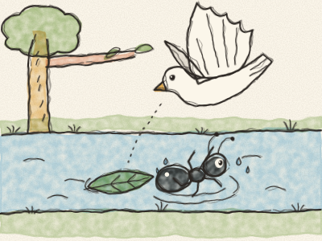
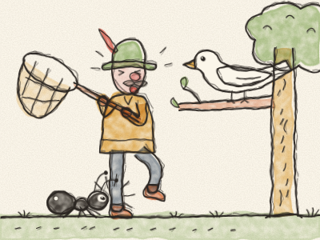

# The Dove and the Ant

On a hot summer day, a little black Ant was very thirsty. She walked down to the river for a drink. *Tip-tap, tip-tap.* She leaned over the water, a little bit, a little bit more… and — *splash!* — she fell in.

“Help! Help!” cried the Ant. The water went round and round, and carried her away. She kicked her tiny legs, but the river was much too big.

High up in a tree sat a white Dove. She saw the little Ant in the water. “Oh dear,” cooed the Dove. “I must help her!” She picked a leaf with her beak, flew down, and dropped it on the water, right next to the Ant. *Plop!*

The Ant climbed onto the leaf. The leaf floated, gently, gently, all the way to the riverbank. The Ant jumped onto the dry grass. “Thank you, Dove!” she called. “You saved me!”

A few days later, a hunter came creeping through the trees with a big net. *Shh…* He had seen the Dove sitting on her branch, and he wanted to catch her. He lifted the net, very slowly…

But the little Ant saw him. “Oh no, you don’t!” she said. She ran up to his foot and — *pinch!* — she bit him on the ankle, as hard as she could.

“OUCH!” shouted the hunter, hopping on one leg. The net fell to the ground. The Dove heard the noise, opened her wings — *flap, flap, flap!* — and flew away, safe and free.

That evening, the Dove came back to the river. She sat on a low branch, the little Ant sat on a leaf just below, and they watched the sun go down together.

> One good turn deserves another. And even the smallest friend can help the biggest one.
